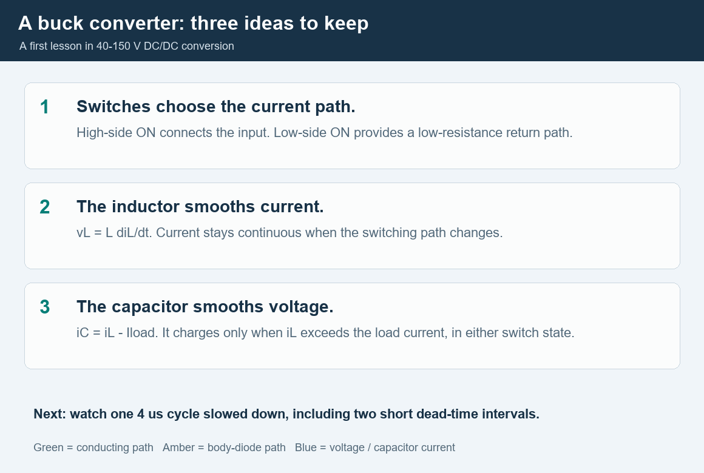

# Mixed-Signal Simulation V3.2.0

# 模拟与混合信号仿真 V3.2.0

2026-11-03 · An undergraduate teaching and engineering exploration library for analog ICs and 40–150 V maximum-input DC/DC converters. English first, Chinese below; animation labels are English only.

2026-11-03 · 面向大学生教学与工程探索的模拟芯片及40～150V最高输入DC/DC仿真库。英文在前、中文在下；动画仅用英文标注。

V3.2 adds nine mechanism benches and 153 cases to the V3.1.0 baseline: 20 model views and 211 cases in total. All 61 implementation checks pass (36 baseline + 25 new). These are authored reduced models with public references, not foundry PDK models, measured device fits, paper-circuit reproductions or validated 150 V designs.

V3.2在V3.1.0基础上增加9项机理测试台、153个工况，合计20项模型视图、211个工况。61项实现检查全部通过（基线36项加新增25项）。这些是有公开依据的人为简化模型，不是晶圆厂PDK、器件实测拟合、论文电路复现或经验证的150V设计。

## Start with the energy-flow lesson

## 从能量流动开始学习



The animation shows high-side conduction, diode conduction during dead time, low-side conduction and the duty change from 40 V to 150 V. It uses a computed piecewise CCM trace at 100 V input, 12 V output, 1 A load and 250 kHz. Phase durations are stretched for teaching; arrow speed is not a physical scale. Output voltage is fixed in this lesson; capacitor ripple is not solved.

动画展示高侧导通、死区二极管续流、低侧导通，以及40V至150V输入时的占空比变化。依据100V输入、12V输出、1A负载、250kHz下计算的分段连续导通电流。为教学拉伸各阶段时长，箭头速度不表示物理比例；本教学轨迹固定输出电压，未求解输出电容纹波。

- [Bilingual Excel workbook](Mixed_Signal_Simulation_V3_2_EN_ZH.xlsx) — 英中对照工作簿
- [Offline viewer](index.html) — 离线曲线、概念3D、数据导出及课堂动画
- [Delivery ZIP](mixed-signal-simulation_V3_2_20261103.zip) — 本版完整交付包
- [Undergraduate lesson and exercises](v32/education/UNDERGRADUATE_TUTORIAL.md) — 大学生课程、练习与答案
- [Model equations and assumptions](v32/MODEL_CARDS.md) — 模型方程与假设
- [New references and remaining gaps](v32/SOURCES_AND_GAPS.md) — 新核对来源与尚未完成项
- [Validation and limitations](v32/VALIDATION_AND_LIMITS.md) — 数值校核与适用边界

Extract the ZIP and open index.html in Edge or Chrome. GitHub previews do not run HTML. The viewer embeds curve data; the Classroom tab also needs the included v32/education assets. Excel contains static poster/model images and native charts; the separate GIF animates.

解压ZIP后用Edge或Chrome打开index.html；GitHub预览不执行HTML。曲线数据已内嵌，课堂页还需要包内v32/education资源。Excel提供静态海报/模型图及原生图表；动态演示使用独立GIF。

## Added DC/DC coverage

## 新增DC/DC覆盖

| ID | Mechanism / 机理 | Cases / 工况 |
|---|---|---:|
| P01 | HV MOS gate charge and switching overlap<br>高压MOS栅电荷与开关交叠 | 18 |
| P02 | Dead-time diode and reverse recovery<br>死区二极管与反向恢复 | 18 |
| P03 | Floating bootstrap supply and UVLO margin<br>浮地自举供电与欠压裕量 | 36 |
| P04 | Level-shifter common-mode disturbance<br>电平移位接收端共模扰动 | 12 |
| P05 | Current-sense amplifier and delayed comparator<br>电流检测放大器与延迟比较器 | 3 |
| P06 | HV startup supply and hysteretic UVLO<br>高压启动供电与迟滞欠压锁定 | 18 |
| P07 | Switch-node parasitic ringing and damping<br>开关节点寄生振铃与阻尼 | 12 |
| P08 | DC/DC separated losses and thermal budget<br>DC/DC分项损耗与热预算 | 18 |
| P09 | Averaged buck soft-start and current-reference limit<br>平均Buck软启动与电流参考限幅 | 18 |

P01–P02 are device-mechanism extensions; P03–P09 are circuit or system benches. They improve earlier simplified coverage and are not nine newly qualified process devices. Cases span 40, 60, 80, 100, 120 and 150 V input; temperature sweeps use −40, 25 and 125°C where applicable. P05 is a low-voltage sensing bench, not a 150 V common-mode input. No completeness percentage is claimed.

P01–P02为器件机理增强，P03–P09为电路或系统测试台；完善早期简化覆盖，不等于新增9种已认证工艺器件。输入工况含40、60、80、100、120、150V；适用模型采用−40、25、125°C温度扫描。P05为低压检测台，不具备150V共模输入资格。不宣称库完整度百分比。

## Evidence and boundaries

## 依据与边界

This release checks four additional papers (three journal papers and one conference paper) and eight manufacturer documents. Two papers received targeted body-page reading and two abstract-level reading; [the source ledger](v32/research/sources.csv) records authors, DOI, access depth, equation locations and limitations. Coefficients are authored assumptions, not values extracted from those papers.

本轮新增核对4篇论文（3篇期刊、1篇会议）与8份厂商文档；其中2篇定向阅读正文、2篇阅读至摘要。[来源台账](v32/research/sources.csv)记录作者、DOI、阅读层级、方程位置与限制。数值系数为人为假设，并非从论文提取。

The [200-person analog research cohort](v3/research/people200.csv) and [182-paper bibliography](v3/research/papers.csv) retain their 2026-11-02 V3.1 audit. They are not a global ranking or a claim of reading every author's papers. The prior 154 circuit/architecture, 14 method/model and 14 component/parasitic classifications remain unchanged. The four new papers supplement this evidence rather than expanding the author cohort.

[200人模拟研究名单](v3/research/people200.csv)与[182篇题录](v3/research/papers.csv)保留2026-11-02的V3.1审计；不是全球排名，也不表示通读每位作者的论文。原154篇电路/架构、14篇方法/模型、14篇元件/寄生分类不变。本轮4篇论文补充依据，不扩充人员名单。

The [foundry context](v3/FOUNDRY_CONTEXT.md) retains its 2026-11-01 public-source date. Exact Hua Hong, UNT/SMEC, DB HiTek, TSMC, UMC, SK hynix and historical Magnachip process options still require foundry confirmation. Maximum converter input is not device breakdown, working voltage or SOA. INA381 (26 V) and LM5116 (up to 100 V) are architecture references only; they do not validate a 150 V implementation.

[晶圆厂背景](v3/FOUNDRY_CONTEXT.md)保留2026-11-01公开来源核对日期。华虹、芯联集成、东部、台积电、联电、海力士及美格纳历史工艺的准确选件仍须厂商确认。转换器最高输入不等于器件击穿、工作电压或安全工作区。INA381（26V）及LM5116（最高100V）仅作架构参考，不证明150V实现可用。

## Reproduce the numerical work

## 复现数值计算

```bash
python -m pip install -r v32/requirements.txt
python v32/models/run_simulations.py
python v32/tests/run_validation.py
python v32/validation/run_baseline_checks.py
python v32/presentation/build_views.py
python v32/education/render_buck_animation.py
```

Recorded environment: Python 3.12.14 and NumPy 2.3.5. GIF rendering also uses Pillow; font availability can change rendered pixels. These commands regenerate numerical data, the viewer and teaching images, not the Excel export snapshot. [Validation records](v32/results/validation.json) and [checksums](v32/validation/release_manifest.json) are included. V3.1 data remain preserved; V1/V2 stay in the full Git repository and are not re-audited in this release.

记录环境：Python 3.12.14、NumPy 2.3.5；GIF生成还使用Pillow，字体环境会影响像素。上述命令生成数值数据、演示页与教学图像，不重新导出Excel快照。包含[校核记录](v32/results/validation.json)及[文件校验值](v32/validation/release_manifest.json)。保留V3.1数据；V1/V2保留在完整Git仓库，本轮未重新审计。

Third-party papers are linked rather than redistributed. The teaching style aims for clear university-level explanation; no academician, author, foundry or peer-review endorsement is implied.

第三方论文仅提供链接，不分发全文。以清晰的大学课堂讲解为目标，不暗示院士、作者、晶圆厂背书或已通过同行评审。
