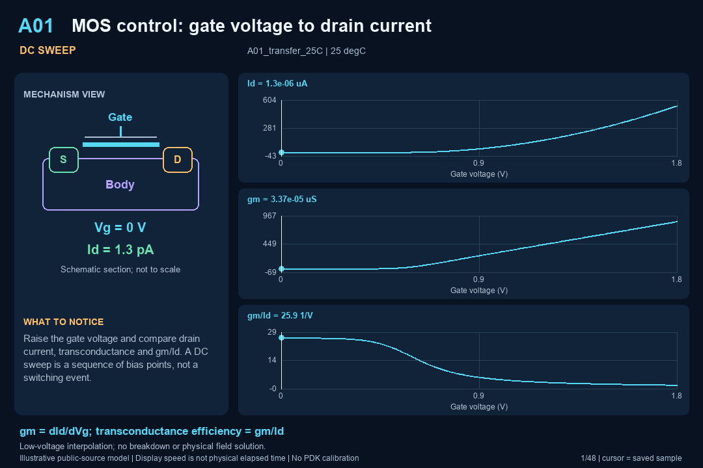

# Mixed-Signal Simulation V3-3

# 模拟与混合信号仿真 V3-3

**Current sharing entry: [V3-3](V3-3/README.md).** The display name is V3-3; the numerical release remains v3.3.0. The [global FAB public-process folder](global-fab-processes/README.md) adds a separately dated official-source catalogue on 2026-11-06. [Download the V3-3 folder package](V3-3_20261106.zip).

**当前分享入口：[V3-3](V3-3/README.md)。** 展示名称统一为V3-3，数值版本仍为v3.3.0。[全球FAB公开工艺文件夹](global-fab-processes/README.md)新增2026-11-06官方来源目录。[下载解压后名为V3-3的分享包](V3-3_20261106.zip)。

2026-11-03. Every one of the 20 model views now has its own English-annotated GIF: a mechanism diagram, a moving data cursor, explicit units and a recorded representative case. DC sweeps, physical-time transients and statistical displays are clearly distinguished. The viewer and workbook retain English-first, Chinese-second explanations.

2026-11-03。20项模型视图现在各配一份英文标注GIF，含机理图、移动数据光标、明确单位及已记录的代表工况。直流扫描、物理时间瞬态与统计展示分别标注；演示页及Excel保持英文在前、中文对照。

**Accuracy result:** 12 stated numerical benchmarks demonstrate at least 10% relative error reduction. 7 benchmarks are at a numerical/analytic floor and carry no percentage claim; 1 statistical model reports sampling uncertainty separately. We cannot verify a 10% improvement in every device's physical accuracy without measured or authorized PDK reference data. The detailed before/after errors and limitations are published, including unchanged and diagnostic-only cases.

**准确性结果：**12项注明的数值基准证明误差相对下降至少10%；7项已到数值/解析精度下限，不赋予提升比例；1项统计模型单独报告采样不确定度。缺少实测或授权PDK参考，无法证明所有器件的物理准确率都提升10%。逐项公开前后误差与限制，包含未变化项和仅诊断测试项。

All 211 cases were regenerated. 96 recorded checks pass, including preserved-model regression and new numerical-improvement tests. Model count is unchanged: six device/parameter extensions and fourteen circuit/system benches. No new foundry-qualified device is claimed.

211个工况已重新计算。96项记录检查通过，包含旧模型回归及新增数值改进检查。模型数量不变：6项器件/参数增强、14项电路/系统测试台；不声称新增晶圆厂认证器件。

## Open the demonstrations

## 查看演示

- [Bilingual Excel](Mixed_Signal_Simulation_V3_3_EN_ZH.xlsx) — 双语工作簿，含逐模型GIF链接及误差算式
- [Offline viewer](index.html) — 离线全模型动画库、曲线、数值与概念3D
- [Current V3-3 shared package](V3-3_20261106.zip) — 当前V3-3分享包，含全球FAB工艺目录
- [Original v3.3.0 simulation snapshot](mixed-signal-simulation_V3_3_20261103.zip) — 原始仿真发布快照
- [Numerical accuracy and limits](v33/ACCURACY_AND_LIMITS.md) — 数值准确性及边界
- [Model cards](v33/MODEL_CARDS.md) — 模型方程、假设与未覆盖项
- [Animation guide](v33/education/README.md) — 动画说明
- [Undergraduate buck lesson](v32/education/UNDERGRADUATE_TUTORIAL.md) — 大学生Buck课程及练习

Extract the package and open index.html locally in Edge/Chrome; GitHub does not execute HTML previews. Select **20 model GIFs**, then **Open full teaching view**. In the simulation view, the GIF is tied to its labeled representative case; the case selector and sampled-value controls operate the separate numerical plot. Conceptual 3D is available in an expandable section.

解压后用Edge/Chrome本地打开index.html；GitHub预览不执行HTML。选择“全模型动画”，再打开完整教学视图。仿真页的GIF绑定其标注的代表工况；工况选择和采样控件操作独立数值曲线。概念3D位于可展开区域。



| ID | Model / 模型 | Animation / 动画 | Display / 展示类型 |
|---|---|---|---|
| A01 | Four-terminal MOS interpolation<br>四端MOS连续插值 | [GIF](v33/education/gifs/A01.gif) | DC SWEEP |
| A02 | Junction charge and varactor<br>结电荷与变容二极管 | [GIF](v33/education/gifs/A02.gif) | DC SWEEP |
| A03 | Reciprocal NPN Ebers–Moll<br>满足互易关系的NPN Ebers–Moll | [GIF](v33/education/gifs/A03.gif) | DC SWEEP |
| A04 | MOS pair mismatch and correlation<br>MOS配对失配与相关性 | [GIF](v33/education/gifs/A04.gif) | STATISTICAL SAMPLES |
| B01 | MOS differential pair<br>MOS差分对 | [GIF](v33/education/gifs/B01.gif) | DC SWEEP |
| B02 | CTAT/PTAT reference sum<br>CTAT/PTAT基准合成 | [GIF](v33/education/gifs/B02.gif) | TEMPERATURE SWEEP |
| B03 | Input noise and sampled kT/C<br>输入噪声与采样kT/C | [GIF](v33/education/gifs/B03.gif) | FREQUENCY SWEEP |
| B04 | Capacitor DAC and SAR ADC<br>电容DAC与SAR ADC | [GIF](v33/education/gifs/B04.gif) | SAMPLED SIGNAL |
| B05 | LDO loop and load step<br>LDO环路与负载阶跃 | [GIF](v33/education/gifs/B05.gif) | TIME TRANSIENT |
| B06 | Phase loop and noise transfer<br>相位环路与噪声传递 | [GIF](v33/education/gifs/B06.gif) | TIME TRANSIENT |
| B07 | 40–150 V synchronous buck<br>40–150V同步降压 | [GIF](v33/education/gifs/B07.gif) | SWITCHED TRANSIENT |
| P01 | HV MOS gate charge and switching overlap<br>高压MOS栅电荷与开关交叠 | [GIF](v33/education/gifs/P01.gif) | STAGED TRANSIENT |
| P02 | Dead-time diode and reverse recovery<br>死区二极管与反向恢复 | [GIF](v33/education/gifs/P02.gif) | PIECEWISE TRANSIENT |
| P03 | Floating bootstrap supply and UVLO margin<br>浮地自举供电与欠压裕量 | [GIF](v33/education/gifs/P03.gif) | TIME TRANSIENT |
| P04 | Level-shifter common-mode disturbance<br>电平移位接收端共模扰动 | [GIF](v33/education/gifs/P04.gif) | TIME TRANSIENT |
| P05 | Current-sense amplifier and delayed comparator<br>电流检测放大器与延迟比较器 | [GIF](v33/education/gifs/P05.gif) | TIME TRANSIENT |
| P06 | HV startup supply and hysteretic UVLO<br>高压启动供电与迟滞欠压锁定 | [GIF](v33/education/gifs/P06.gif) | TIME TRANSIENT |
| P07 | Switch-node parasitic ringing and damping<br>开关节点寄生振铃与阻尼 | [GIF](v33/education/gifs/P07.gif) | TIME TRANSIENT |
| P08 | DC/DC separated losses and thermal budget<br>DC/DC分项损耗与热预算 | [GIF](v33/education/gifs/P08.gif) | THERMAL TRANSIENT |
| P09 | Averaged buck soft-start and current-reference limit<br>平均Buck软启动与电流参考限幅 | [GIF](v33/education/gifs/P09.gif) | AVERAGED TRANSIENT |

## What changed numerically

## 数值实现改进

Analytic derivatives replace finite differences where available; cancellation-safe junction charge improves near-zero evaluation; exact linear state propagation replaces selected time stepping; PSD and switching-energy integrals use analytic or higher-order evaluation; event insertion resolves comparator/UVLO transitions; averaged-buck integration treats the reference ramp at intermediate stages. The original physical coefficients and simplified mechanisms remain the comparison basis.

在可用处以解析导数替代差分；稳定结电荷表达式改进近零计算；部分线性状态采用精确传播；PSD与开关能量采用解析或高阶积分；比较器/欠压锁定插入精确事件点；平均Buck积分在中间阶段计算参考斜坡。原物理系数与简化机理仍为前后比较基础。

Some original errors were already tiny: a large relative reduction may change only far-below-measurement digits. A02's percentage concerns a stated near-zero numerical stress test, not the entire original CV sweep. A04 increases draws from 20,000 to 80,000, halving the asymptotic sampling standard error; this particular realized sigma estimate is farther from the analytic value, so it is not counted as a numerical-accuracy success.

部分旧误差本来已极小，因此较大的下降比例可能只改变远低于测量分辨率的末位数字。A02的比例针对明确列出的近零数值压力测试，并非整个原CV扫描。A04样本从20,000增至80,000，使渐近抽样标准误减半；本次实现的标准差估计反而离解析值更远，因此不计为数值准确度达标项。

## Reproduce

## 复现

```bash
python -m pip install -r v33/requirements.txt
python v33/numerics/analog/run.py
python v33/numerics/analog/validate.py
python v33/numerics/dcdc/run.py
python v33/validation/run_legacy_checks.py
python v33/education/render_all.py
python v33/presentation/build_views.py
```

The numerical runners export data and comparison audits without modifying V3.1/V3.2 inputs. The separate analog `validate.py` command executes and records its tests; the DC/DC runner executes its own validation. GIF hashes record the exact improved data used; rendering fonts may differ across systems. These commands regenerate the numerical viewer with its original v3.3 label, not the sharing navigation or Excel snapshot. [Original release checksums](https://github.com/hemanjie-byte/mixed-signal-simulation/blob/v3.3.0/v33/validation/release_manifest.json), [browser QA](v33/validation/viewer_validation.json) and [workbook QA](v33/validation/workbook_validation.json) describe the original simulation release. [Current sharing checksums](V3-3/package_manifest.json) describe the 2026-11-06 package.

数值脚本导出数据与误差审计，不修改V3.1/V3.2输入。模拟系列通过独立的`validate.py`命令执行并记录测试；DC/DC脚本自行执行验证。GIF记录所用改进数据的精确哈希，跨系统字体可能不同。上述命令重建带原v3.3标签的数值演示页，不重建分享导航或Excel快照。[原发布校验值](https://github.com/hemanjie-byte/mixed-signal-simulation/blob/v3.3.0/v33/validation/release_manifest.json)、[浏览器检查](v33/validation/viewer_validation.json)及[工作簿检查](v33/validation/workbook_validation.json)对应原仿真发布；[当前分享包校验值](V3-3/package_manifest.json)对应2026-11-06分享包。

The TOP200/182-paper cohort retains its V3.1 audit; the four additional papers and eight manufacturer documents retain their V3.2 reading-depth records. No new full-text literature or foundry-availability audit is claimed. The 40–150 V values mean maximum DC/DC input, not device ratings. Physical accuracy, PDK sign-off, breakdown/SOA, extracted layout and calibrated electrothermal behavior remain unverified.

TOP200/182篇名单保留V3.1审计；新增4篇论文与8份厂商文档保留V3.2阅读深度记录。不宣称本轮重新全文审查文献或核对工艺供货。40～150V指DC/DC最高输入，不是器件额定；物理准确性、PDK签核、击穿/SOA、提取版图及校准电热行为仍未验证。
