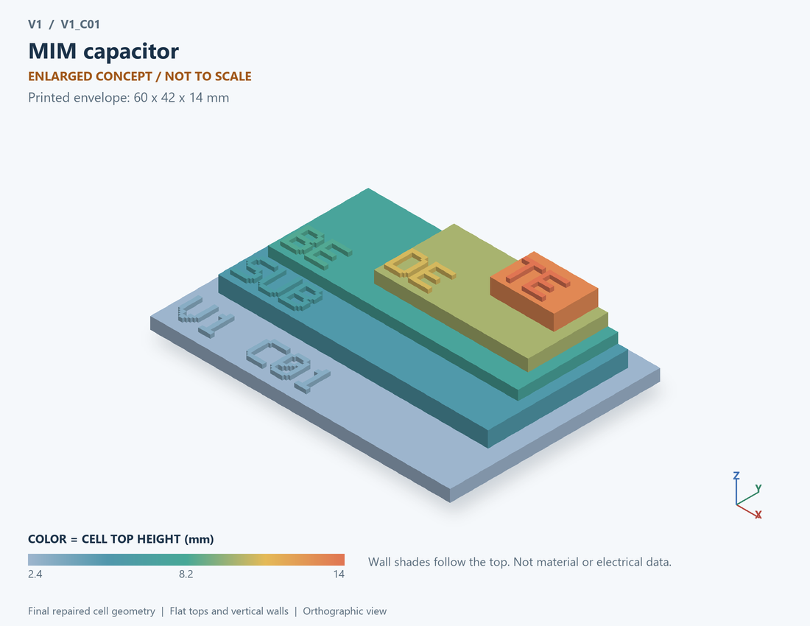

# V1_C01 · MIM capacitor
# MIM电容

Classification / 分类: `passive` · `legacy`

[STL](../stl/V1_C01.stl) · [Preview](../previews/V1_C01.png) · [Top view](../previews/V1_C01_top.png)

60 × 42 mm footprint; flat face on the bed, Z up. Dimensions are teaching choices; they have no process-scale mapping.
60×42毫米底面；平底朝打印平台，Z朝上。尺寸属于教学选择，不对应工艺比例。

This monolithic tactile relief is intentionally supported down to its base. Plastic continuity does not imply an electrical short or a particular material. Only printed surfaces and exposed ledges are visible; hidden interfaces are interpreted using the key.
本单体触觉浮雕刻意向底座填实支撑，塑料相连不代表电气短路或同一种材料。实物仅呈现表面及外露台阶，隐藏界面须配合图例理解。

## Visible feature key / 可见结构说明

| Mark | English | 中文 |
|---|---|---|
| SUB | Exposed substrate ledge | 外露衬底台阶 |
| BE | Bottom electrode | 下电极 |
| DE | Dielectric | 介质 |
| TE | Top electrode | 上电极 |

Some small/hidden ledges have no raised lettering; the illustrated atlas and feature list identify them. Numbers on functional displays refer to the numbered source-parts list below.
部分小型或遮挡台阶不刻字，由图册和结构表辨认。功能展示件上的数字对应下方源部件列表。

## Source concepts / 来源概念

1. Top metal: First electrode 第一电极
2. Dielectric: Enlarged insulating layer 放大绝缘层
3. Bottom metal: Second electrode 第二电极
4. Contacts: Separate electrode labels 分离电极标签

## Terminals and boundaries / 端口与边界

- A (modeled_electrical): First electrical terminal 第一电端
- B (modeled_electrical): Second electrical terminal 第二电端

## Interpretation limits / 解释边界

Two metal plates separated by dielectric; the saved model is a low-voltage 5 V example, not a high-voltage capacitor rating. Teaching geometry is enlarged and not to scale. No foundry cross-section, mask dimensions, dopant profile, local field solution or electrically functional printed device is claimed.

介质分隔的两层金属板；保存模型是低压5V示例，不是高压电容额定。教学几何经放大且不按真实比例；不代表晶圆厂截面、掩模尺寸、掺杂分布、局部场解或可工作的打印电子器件。

Source-model limitations are retained below; STL generation does not add physics or establish process qualification.
下方保留源模型限制；生成STL不增加物理机制或工艺认证。

单器件独立测试；所有数值为通用假设；温度系数假设为零

[Source catalogue / 源目录](../../可复现计算/data.json) · ID `C01`
