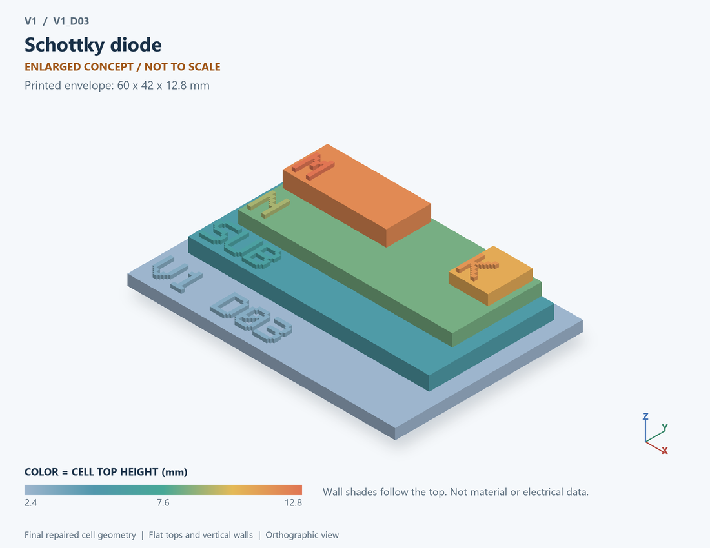

# V1_D03 · Schottky diode
# 肖特基二极管

Classification / 分类: `physical_device` · `legacy`

[STL](../stl/V1_D03.stl) · [Preview](../previews/V1_D03.png) · [Top view](../previews/V1_D03_top.png)

60 × 42 mm footprint; flat face on the bed, Z up. Dimensions are teaching choices; they have no process-scale mapping.
60×42毫米底面；平底朝打印平台，Z朝上。尺寸属于教学选择，不对应工艺比例。

This monolithic tactile relief is intentionally supported down to its base. Plastic continuity does not imply an electrical short or a particular material. Only printed surfaces and exposed ledges are visible; hidden interfaces are interpreted using the key.
本单体触觉浮雕刻意向底座填实支撑，塑料相连不代表电气短路或同一种材料。实物仅呈现表面及外露台阶，隐藏界面须配合图例理解。

## Visible feature key / 可见结构说明

| Mark | English | 中文 |
|---|---|---|
| SUB | Exposed substrate ledge | 外露衬底台阶 |
| N | Semiconductor drift region | 半导体漂移区 |
| M | Metal / semiconductor contact | 金属/半导体接触 |
| K | Cathode contact | 阴极接触 |

Some small/hidden ledges have no raised lettering; the illustrated atlas and feature list identify them. Numbers on functional displays refer to the numbered source-parts list below.
部分小型或遮挡台阶不刻字，由图册和结构表辨认。功能展示件上的数字对应下方源部件列表。

## Source concepts / 来源概念

1. Metal anode: Rectifying metal contact 整流金属接触
2. Barrier: Conceptual metal-semiconductor interface 金属半导体界面概念
3. Semiconductor: Conduction region 导电半导体区
4. Cathode: Ohmic return contact 欧姆回流接触

## Terminals and boundaries / 端口与边界

- A (modeled_electrical): First terminal / anode where applicable 第一端／适用时为阳极
- K (modeled_electrical): Cathode 阴极

## Interpretation limits / 解释边界

A metal-semiconductor barrier concept; no particular metal, barrier height, high-voltage grade or foundry option is established. Teaching geometry is enlarged and not to scale. No foundry cross-section, mask dimensions, dopant profile, local field solution or electrically functional printed device is claimed.

金属半导体势垒概念；不指定金属、势垒高度、高压等级或工艺选件。教学几何经放大且不按真实比例；不代表晶圆厂截面、掩模尺寸、掺杂分布、局部场解或可工作的打印电子器件。

Source-model limitations are retained below; STL generation does not add physics or establish process qualification.
下方保留源模型限制；生成STL不增加物理机制或工艺认证。

单器件独立测试；所有数值为通用假设；无反向击穿/反向恢复，Qrr与trr无法由本模型预测

[Source catalogue / 源目录](../../可复现计算/data.json) · ID `D03`
