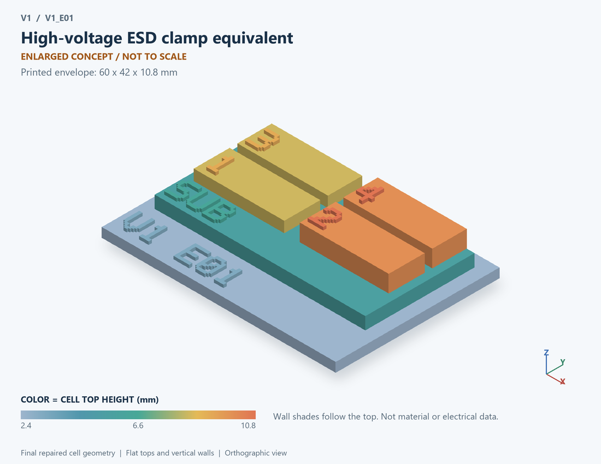

# V1_E01 · High-voltage ESD clamp equivalent
# 高压ESD钳位等效器件

Classification / 分类: `mechanism_demo` · `legacy`

[STL](../stl/V1_E01.stl) · [Preview](../previews/V1_E01.png) · [Top view](../previews/V1_E01_top.png)

60 × 42 mm footprint; flat face on the bed, Z up. Dimensions are teaching choices; they have no process-scale mapping.
60×42毫米底面；平底朝打印平台，Z朝上。尺寸属于教学选择，不对应工艺比例。

This monolithic tactile relief is intentionally supported down to its base. Plastic continuity does not imply an electrical short or a particular material. Only printed surfaces and exposed ledges are visible; hidden interfaces are interpreted using the key.
本单体触觉浮雕刻意向底座填实支撑，塑料相连不代表电气短路或同一种材料。实物仅呈现表面及外露台阶，隐藏界面须配合图例理解。

## Visible feature key / 可见结构说明

| Mark | English | 中文 |
|---|---|---|
| SUB | Exposed substrate ledge | 外露衬底台阶 |
| 1 | Protected electrical node | 受保护节点 |
| 2 | Assumed threshold concept | 假设阈值概念 |
| 3 | Behavioral conduction path | 行为导电路径 |
| 4 | Return node | 回流节点 |
| KEY | Numbered functional blocks, not silicon layout or solved 3D fields. See numbered key in the atlas. | 编号功能块，不是硅版图或求解的三维场，编号说明见图册 |

Some small/hidden ledges have no raised lettering; the illustrated atlas and feature list identify them. Numbers on functional displays refer to the numbered source-parts list below.
部分小型或遮挡台阶不刻字，由图册和结构表辨认。功能展示件上的数字对应下方源部件列表。

## Source concepts / 来源概念

1. Pad: Protected electrical node 受保护节点
2. Trigger: Assumed threshold concept 假设阈值概念
3. Clamp: Behavioral conduction path 行为导电路径
4. Return: Return node 回流节点

## Terminals and boundaries / 端口与边界

- PAD (modeled_electrical): Protected pad 受保护引脚
- RETURN (modeled_electrical): Return node 回流节点

## Interpretation limits / 解释边界

Print a pad-to-return clamp block, not an invented SCR/ggNMOS cross-section; original curve has no snapback, It2 or ESD qualification. Teaching geometry is enlarged and not to scale. No foundry cross-section, mask dimensions, dopant profile, local field solution or electrically functional printed device is claimed.

打印引脚至回流端的钳位功能块，不虚构SCR/ggNMOS截面；原曲线不含回滞、It2或ESD认证。教学几何经放大且不按真实比例；不代表晶圆厂截面、掩模尺寸、掺杂分布、局部场解或可工作的打印电子器件。

Source-model limitations are retained below; STL generation does not add physics or establish process qualification.
下方保留源模型限制；生成STL不增加物理机制或工艺认证。

单器件独立测试；所有数值为通用假设；人为钳位曲线，没有snapback、It2或ESD认证能力

[Source catalogue / 源目录](../../可复现计算/data.json) · ID `E01`
