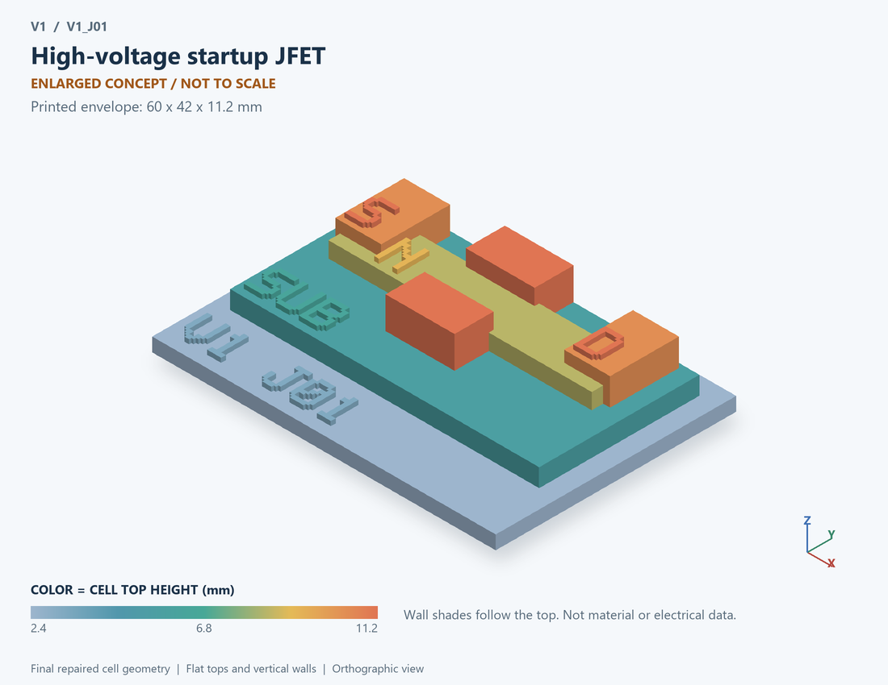

# V1_J01 · High-voltage startup JFET
# 高压启动JFET

Classification / 分类: `physical_device` · `legacy`

[STL](../stl/V1_J01.stl) · [Preview](../previews/V1_J01.png) · [Top view](../previews/V1_J01_top.png)

60 × 42 mm footprint; flat face on the bed, Z up. Dimensions are teaching choices; they have no process-scale mapping.
60×42毫米底面；平底朝打印平台，Z朝上。尺寸属于教学选择，不对应工艺比例。

This monolithic tactile relief is intentionally supported down to its base. Plastic continuity does not imply an electrical short or a particular material. Only printed surfaces and exposed ledges are visible; hidden interfaces are interpreted using the key.
本单体触觉浮雕刻意向底座填实支撑，塑料相连不代表电气短路或同一种材料。实物仅呈现表面及外露台阶，隐藏界面须配合图例理解。

## Visible feature key / 可见结构说明

| Mark | English | 中文 |
|---|---|---|
| SUB | Exposed substrate ledge | 外露衬底台阶 |
| N | N-type conducting channel | N型导电沟道 |
| G | P-type gate regions | P型栅区 |
| G | P-type gate regions | P型栅区 |
| S | Source | 源极 |
| D | Drain | 漏极 |

Some small/hidden ledges have no raised lettering; the illustrated atlas and feature list identify them. Numbers on functional displays refer to the numbered source-parts list below.
部分小型或遮挡台阶不刻字，由图册和结构表辨认。功能展示件上的数字对应下方源部件列表。

## Source concepts / 来源概念

1. Channel: Source-to-drain conductive channel 源至漏导电沟道
2. Junction gates: Conceptual side junctions 两侧结栅概念
3. Depletion: Illustrative depletion boundaries 示意耗尽边界
4. Contacts: Drain, gate and source 漏栅源

## Terminals and boundaries / 端口与边界

- D (modeled_electrical): Drain 漏极
- G (modeled_electrical): Gate 栅极
- S (modeled_electrical): Source 源极

## Interpretation limits / 解释边界

Show a junction-gated channel; the legacy equation only demonstrates VGS=0 startup and has no turn-off network or calibrated pinch-off geometry. Teaching geometry is enlarged and not to scale. No foundry cross-section, mask dimensions, dopant profile, local field solution or electrically functional printed device is claimed.

展示结栅控制沟道；旧方程仅示意VGS=0启动，无关断网络或标定夹断几何。教学几何经放大且不按真实比例；不代表晶圆厂截面、掩模尺寸、掺杂分布、局部场解或可工作的打印电子器件。

Source-model limitations are retained below; STL generation does not add physics or establish process qualification.
下方保留源模型限制；生成STL不增加物理机制或工艺认证。

单器件独立测试；所有数值为通用假设；VGS=0启动状态，不含关断网络

[Source catalogue / 源目录](../../可复现计算/data.json) · ID `J01`
