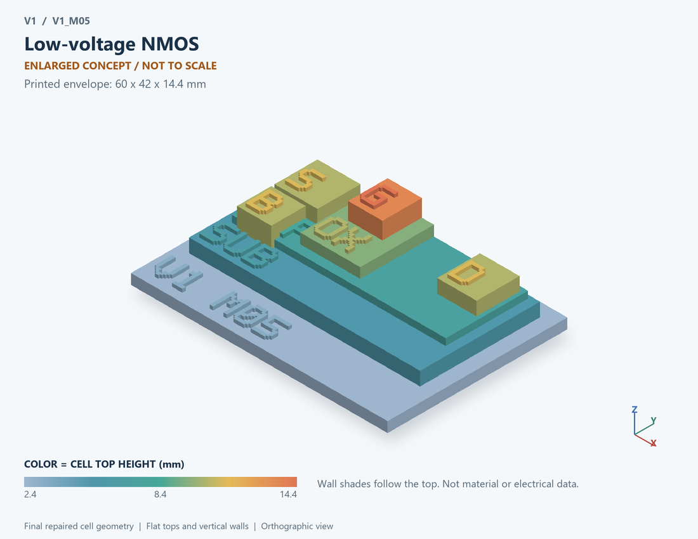

# V1_M05 · Low-voltage NMOS
# 低压NMOS

Classification / 分类: `physical_device` · `legacy`

[STL](../stl/V1_M05.stl) · [Preview](../previews/V1_M05.png) · [Top view](../previews/V1_M05_top.png)

60 × 42 mm footprint; flat face on the bed, Z up. Dimensions are teaching choices; they have no process-scale mapping.
60×42毫米底面；平底朝打印平台，Z朝上。尺寸属于教学选择，不对应工艺比例。

This monolithic tactile relief is intentionally supported down to its base. Plastic continuity does not imply an electrical short or a particular material. Only printed surfaces and exposed ledges are visible; hidden interfaces are interpreted using the key.
本单体触觉浮雕刻意向底座填实支撑，塑料相连不代表电气短路或同一种材料。实物仅呈现表面及外露台阶，隐藏界面须配合图例理解。

## Visible feature key / 可见结构说明

| Mark | English | 中文 |
|---|---|---|
| SUB | Exposed substrate ledge | 外露衬底台阶 |
| P | Body well | 体区/阱 |
| S | Source contact / implanted region | 源极接触/注入区 |
| D | Drain contact / implanted region | 漏极接触/注入区 |
| OX | Exposed gate dielectric ledge | 外露栅介质台阶 |
| G | Gate electrode | 栅电极 |
| B | Separate body contact, distinct from doping label | 独立体接触，与掺杂标签区分 |
| POL | N-channel schematic | N沟道示意 |

Some small/hidden ledges have no raised lettering; the illustrated atlas and feature list identify them. Numbers on functional displays refer to the numbered source-parts list below.
部分小型或遮挡台阶不刻字，由图册和结构表辨认。功能展示件上的数字对应下方源部件列表。

## Source concepts / 来源概念

1. P body: Illustrative N-channel body N沟道体区示意
2. N source: Source diffusion 源扩散区
3. N drain: Drain diffusion 漏扩散区
4. Oxide: Gate dielectric 栅介质
5. Gate: Insulated control electrode 绝缘控制栅
6. Body tap: Body connection 体端连接

## Terminals and boundaries / 端口与边界

- S (modeled_electrical): Source 源极
- G (modeled_electrical): Gate 栅极
- D (modeled_electrical): Drain 漏极
- B (modeled_electrical): Body or second terminal, as specified by the part 体端或第二端，按该条目定义

## Interpretation limits / 解释边界

Low-voltage control MOS only; the legacy circuit model ties body to reference and does not derive a real channel geometry. Teaching geometry is enlarged and not to scale. No foundry cross-section, mask dimensions, dopant profile, local field solution or electrically functional printed device is claimed.

仅低压控制MOS；旧电路模型体端接参考，不反推真实沟道几何。教学几何经放大且不按真实比例；不代表晶圆厂截面、掩模尺寸、掺杂分布、局部场解或可工作的打印电子器件。

Source-model limitations are retained below; STL generation does not add physics or establish process qualification.
下方保留源模型限制；生成STL不增加物理机制或工艺认证。

单器件独立测试；所有数值为通用假设；忽略亚阈值/漏电、体效应、Miller非线性、自热反馈、雪崩；P型用绝对值曲线

[Source catalogue / 源目录](../../可复现计算/data.json) · ID `M05`
