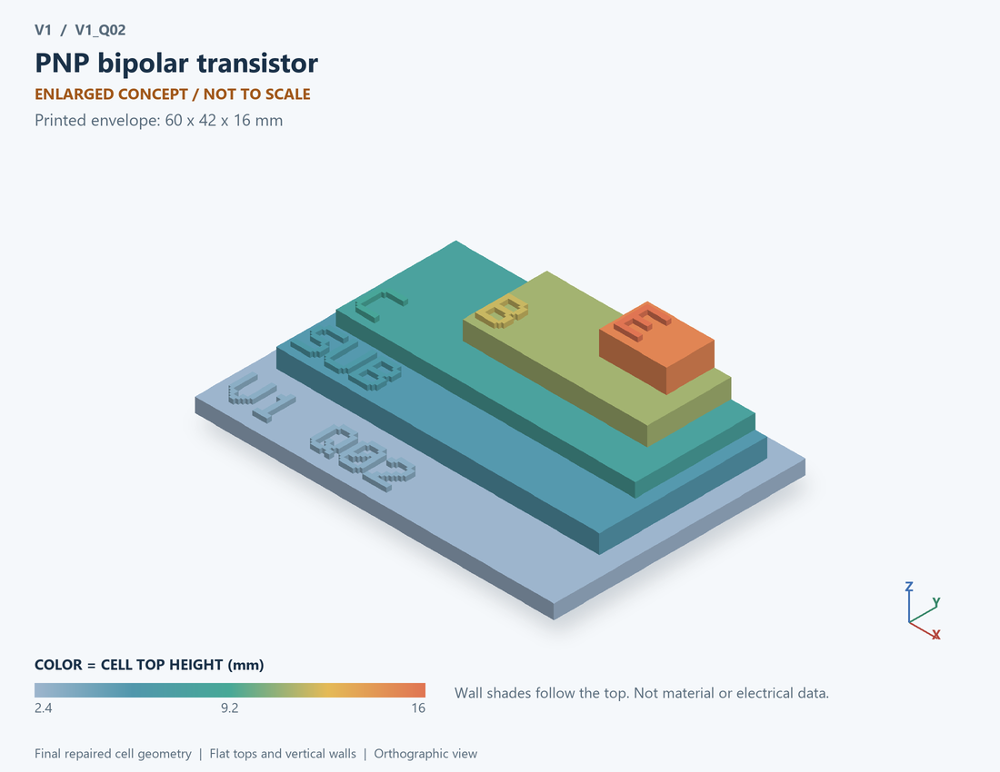

# V1_Q02 · PNP bipolar transistor
# PNP双极晶体管

Classification / 分类: `physical_device` · `legacy`

[STL](../stl/V1_Q02.stl) · [Preview](../previews/V1_Q02.png) · [Top view](../previews/V1_Q02_top.png)

60 × 42 mm footprint; flat face on the bed, Z up. Dimensions are teaching choices; they have no process-scale mapping.
60×42毫米底面；平底朝打印平台，Z朝上。尺寸属于教学选择，不对应工艺比例。

This monolithic tactile relief is intentionally supported down to its base. Plastic continuity does not imply an electrical short or a particular material. Only printed surfaces and exposed ledges are visible; hidden interfaces are interpreted using the key.
本单体触觉浮雕刻意向底座填实支撑，塑料相连不代表电气短路或同一种材料。实物仅呈现表面及外露台阶，隐藏界面须配合图例理解。

## Visible feature key / 可见结构说明

| Mark | English | 中文 |
|---|---|---|
| SUB | Exposed substrate ledge | 外露衬底台阶 |
| C | Collector region | 集电区 |
| B | Base region | 基区 |
| E | Emitter region | 发射区 |
| DOP | P-N-P doping order | P-N-P掺杂顺序 |

Some small/hidden ledges have no raised lettering; the illustrated atlas and feature list identify them. Numbers on functional displays refer to the numbered source-parts list below.
部分小型或遮挡台阶不刻字，由图册和结构表辨认。功能展示件上的数字对应下方源部件列表。

## Source concepts / 来源概念

1. P collector: Collector region 集电区
2. N base: Base region 基区
3. P emitter: Emitter region 发射区
4. Contacts: Collector, base and emitter labels 集电极基极发射极标签

## Terminals and boundaries / 端口与边界

- C (modeled_electrical): Collector 集电极
- B (modeled_electrical): Base 基极
- E (modeled_electrical): Emitter 发射极

## Interpretation limits / 解释边界

P-N-P region ordering is illustrative; the simulation does not establish lateral versus vertical fabrication. Teaching geometry is enlarged and not to scale. No foundry cross-section, mask dimensions, dopant profile, local field solution or electrically functional printed device is claimed.

P-N-P区顺序为示意；仿真不能确定采用横向或纵向制造结构。教学几何经放大且不按真实比例；不代表晶圆厂截面、掩模尺寸、掺杂分布、局部场解或可工作的打印电子器件。

Source-model limitations are retained below; STL generation does not add physics or establish process qualification.
下方保留源模型限制；生成STL不增加物理机制或工艺认证。

单器件独立测试；所有数值为通用假设；正向有源区近似，不含饱和/高注入

[Source catalogue / 源目录](../../可复现计算/data.json) · ID `Q02`
