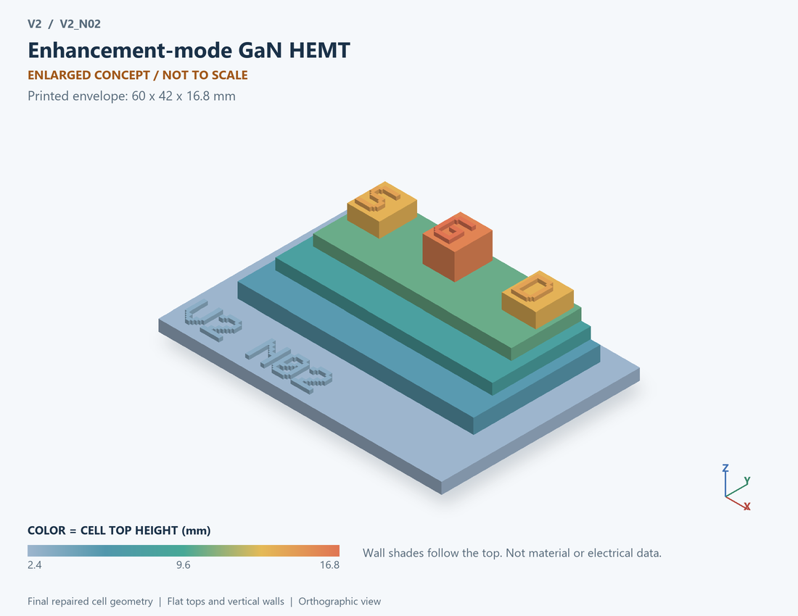

# V2_N02 · Enhancement-mode GaN HEMT
# 增强型GaN HEMT

Classification / 分类: `physical_device` · `legacy`

[STL](../stl/V2_N02.stl) · [Preview](../previews/V2_N02.png) · [Top view](../previews/V2_N02_top.png)

60 × 42 mm footprint; flat face on the bed, Z up. Dimensions are teaching choices; they have no process-scale mapping.
60×42毫米底面；平底朝打印平台，Z朝上。尺寸属于教学选择，不对应工艺比例。

This monolithic tactile relief is intentionally supported down to its base. Plastic continuity does not imply an electrical short or a particular material. Only printed surfaces and exposed ledges are visible; hidden interfaces are interpreted using the key.
本单体触觉浮雕刻意向底座填实支撑，塑料相连不代表电气短路或同一种材料。实物仅呈现表面及外露台阶，隐藏界面须配合图例理解。

## Visible feature key / 可见结构说明

| Mark | English | 中文 |
|---|---|---|
| BUF | Buffer / substrate ledge | 缓冲层/衬底台阶 |
| GAN | GaN channel region | GaN沟道区 |
| BAR | Barrier / interface marker | 势垒/界面标记 |
| S | Electrode S | 电极 S |
| G | Electrode G | 电极 G |
| D | Electrode D | 电极 D |
| 2DEG | The conductive interface is conceptual; no specific enhancement-mode gate technology is certified | 导电界面为概念示意；不认定特定增强型栅工艺 |

Some small/hidden ledges have no raised lettering; the illustrated atlas and feature list identify them. Numbers on functional displays refer to the numbered source-parts list below.
部分小型或遮挡台阶不刻字，由图册和结构表辨认。功能展示件上的数字对应下方源部件列表。

## Source concepts / 来源概念

1. Buffer: Support and buffer concept 支撑与缓冲层概念
2. GaN: GaN channel material GaN沟道材料
3. Barrier: Heterojunction barrier 异质结势垒
4. Channel: Enlarged channel sheet beneath the barrier 势垒下放大的沟道薄层
5. Gate: Gate-control region, implementation unspecified 栅控区，实现形式未指定
6. Source: Source contact 源接触
7. Drain: Drain contact 漏接触

## Terminals and boundaries / 端口与边界

- D (modeled_electrical): Drain 漏极
- G (modeled_electrical): Gate / control electrode 栅极／控制电极
- S (modeled_electrical): Source 源极

## Interpretation limits / 解释边界

Show source, drain, barrier, channel and gate-control region; enhancement-mode realization is unspecified, so do not identify p-GaN, recessed-gate or cascode fabrication as verified. Teaching geometry is enlarged and not to scale. It is not foundry geometry, a solved local field, or an electrically functional printed component.

展示源漏、势垒、沟道和栅控区；增强型实现方式未确定，不把p-GaN、凹槽栅或级联结构称为已验证工艺。教学几何经放大且不按真实比例；不是晶圆厂几何、局部场解或可工作的打印电子元件。

Source-model limitations are retained below; STL generation does not add physics or establish process qualification.
下方保留源模型限制；生成STL不增加物理机制或工艺认证。

外接功率器件研究对照；不能据此认定BCD平台支持。IGBT/650V器件并非40–150V的默认选型。

[Source catalogue / 源目录](../../v2/models/model_catalog.json) · ID `N02`
