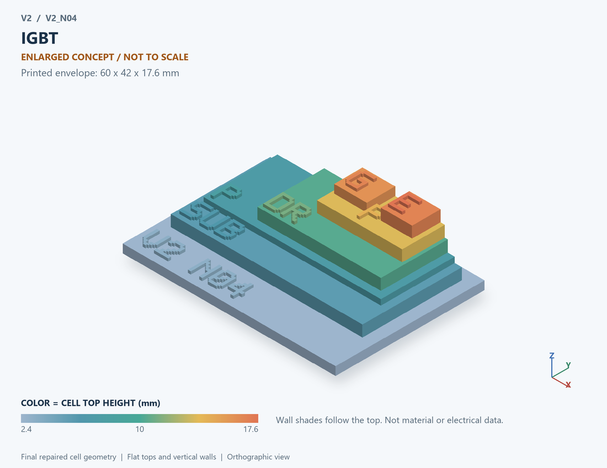

# V2_N04 · IGBT
# IGBT

Classification / 分类: `physical_device` · `legacy`

[STL](../stl/V2_N04.stl) · [Preview](../previews/V2_N04.png) · [Top view](../previews/V2_N04_top.png)

60 × 42 mm footprint; flat face on the bed, Z up. Dimensions are teaching choices; they have no process-scale mapping.
60×42毫米底面；平底朝打印平台，Z朝上。尺寸属于教学选择，不对应工艺比例。

This monolithic tactile relief is intentionally supported down to its base. Plastic continuity does not imply an electrical short or a particular material. Only printed surfaces and exposed ledges are visible; hidden interfaces are interpreted using the key.
本单体触觉浮雕刻意向底座填实支撑，塑料相连不代表电气短路或同一种材料。实物仅呈现表面及外露台阶，隐藏界面须配合图例理解。

## Visible feature key / 可见结构说明

| Mark | English | 中文 |
|---|---|---|
| SUB | Exposed substrate ledge | 外露衬底台阶 |
| P | P-type bottom collector / hole-injection layer | P型底部集电极/空穴注入层 |
| DR | Vertical drift layer | 垂直漂移层 |
| P | Body region | 体区 |
| E | Top emitter | 顶部发射极 |
| G | Insulated gate | 绝缘栅 |

Some small/hidden ledges have no raised lettering; the illustrated atlas and feature list identify them. Numbers on functional displays refer to the numbered source-parts list below.
部分小型或遮挡台阶不刻字，由图册和结构表辨认。功能展示件上的数字对应下方源部件列表。

## Source concepts / 来源概念

1. Emitter: Top emitter contact 顶面发射极接触
2. P body: Channel/body region 沟道体区
3. Gate: Insulated gate 绝缘栅
4. N drift: Voltage-supporting drift 承压漂移区
5. P collector: Collector injection layer 集电极注入层
6. Back C: Backside collector contact 背面集电极接触

## Terminals and boundaries / 端口与边界

- C (modeled_electrical): Collector 集电极
- G (modeled_electrical): Gate / control electrode 栅极／控制电极
- E (modeled_electrical): Emitter 发射极

## Interpretation limits / 解释边界

Include a P-type collector/injector beneath the N drift region; this must not be a relabeled MOSFET drain. Carrier injection and tail current are only simplified behavioral examples. Teaching geometry is enlarged and not to scale. It is not foundry geometry, a solved local field, or an electrically functional printed component.

N漂移区下应有P型集电极注入层，不能将MOS漏极简单改名；载流子注入及尾流仅为简化行为示例。教学几何经放大且不按真实比例；不是晶圆厂几何、局部场解或可工作的打印电子元件。

Source-model limitations are retained below; STL generation does not add physics or establish process qualification.
下方保留源模型限制；生成STL不增加物理机制或工艺认证。

外接功率器件研究对照；不能据此认定BCD平台支持。IGBT/650V器件并非40–150V的默认选型。

[Source catalogue / 源目录](../../v2/models/model_catalog.json) · ID `N04`
