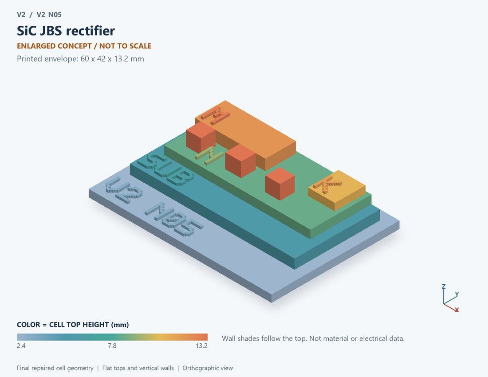

# V2_N05 · SiC JBS rectifier
# SiC JBS整流二极管

Classification / 分类: `physical_device` · `legacy`

[STL](../stl/V2_N05.stl) · [Preview](../previews/V2_N05.png) · [Top view](../previews/V2_N05_top.png)

60 × 42 mm footprint; flat face on the bed, Z up. Dimensions are teaching choices; they have no process-scale mapping.
60×42毫米底面；平底朝打印平台，Z朝上。尺寸属于教学选择，不对应工艺比例。

This monolithic tactile relief is intentionally supported down to its base. Plastic continuity does not imply an electrical short or a particular material. Only printed surfaces and exposed ledges are visible; hidden interfaces are interpreted using the key.
本单体触觉浮雕刻意向底座填实支撑，塑料相连不代表电气短路或同一种材料。实物仅呈现表面及外露台阶，隐藏界面须配合图例理解。

## Visible feature key / 可见结构说明

| Mark | English | 中文 |
|---|---|---|
| SUB | Exposed substrate ledge | 外露衬底台阶 |
| N | Semiconductor drift region | 半导体漂移区 |
| M | Metal / semiconductor contact | 金属/半导体接触 |
| K | Cathode contact | 阴极接触 |
| P | Junction-barrier island | 结势垒P型岛 |
| P | Junction-barrier island | 结势垒P型岛 |
| P | Junction-barrier island | 结势垒P型岛 |

Some small/hidden ledges have no raised lettering; the illustrated atlas and feature list identify them. Numbers on functional displays refer to the numbered source-parts list below.
部分小型或遮挡台阶不刻字，由图册和结构表辨认。功能展示件上的数字对应下方源部件列表。

## Source concepts / 来源概念

1. Anode: Top Schottky electrode 顶面肖特基电极
2. P shield: PN shielding islands PN屏蔽岛
3. Windows: Schottky contact windows 肖特基接触窗口
4. N drift: Drift region 漂移区
5. Cathode: Backside ohmic contact 背面欧姆接触

## Terminals and boundaries / 端口与边界

- K (modeled_electrical): Cathode 阴极
- A (modeled_electrical): Anode 阳极

## Interpretation limits / 解释边界

Place P shielding islands beside Schottky-contact windows in an N drift region; enlarged geometry does not establish electric-field shielding or breakdown voltage. Teaching geometry is enlarged and not to scale. It is not foundry geometry, a solved local field, or an electrically functional printed component.

N漂移区中的肖特基接触窗口旁配置P屏蔽岛；放大几何不证明电场屏蔽或击穿电压。教学几何经放大且不按真实比例；不是晶圆厂几何、局部场解或可工作的打印电子元件。

Source-model limitations are retained below; STL generation does not add physics or establish process qualification.
下方保留源模型限制；生成STL不增加物理机制或工艺认证。

外接功率器件研究对照；不能据此认定BCD平台支持。IGBT/650V器件并非40–150V的默认选型。

[Source catalogue / 源目录](../../v2/models/model_catalog.json) · ID `N05`
