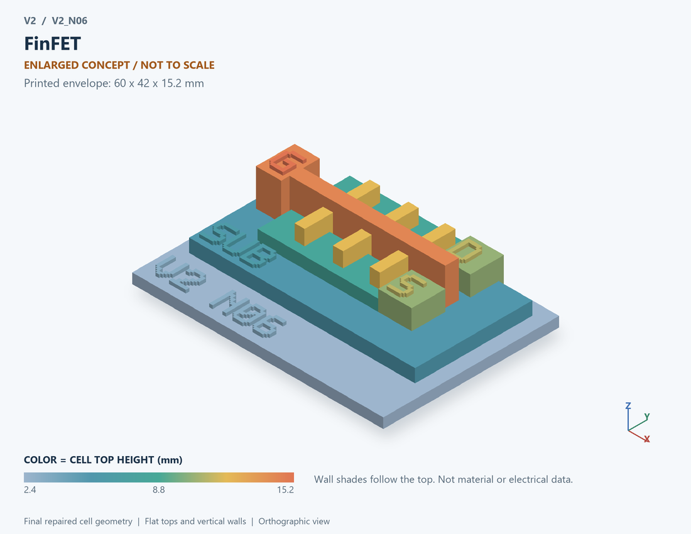

# V2_N06 · FinFET
# FinFET

Classification / 分类: `physical_device` · `legacy`

[STL](../stl/V2_N06.stl) · [Preview](../previews/V2_N06.png) · [Top view](../previews/V2_N06_top.png)

60 × 42 mm footprint; flat face on the bed, Z up. Dimensions are teaching choices; they have no process-scale mapping.
60×42毫米底面；平底朝打印平台，Z朝上。尺寸属于教学选择，不对应工艺比例。

This monolithic tactile relief is intentionally supported down to its base. Plastic continuity does not imply an electrical short or a particular material. Only printed surfaces and exposed ledges are visible; hidden interfaces are interpreted using the key.
本单体触觉浮雕刻意向底座填实支撑，塑料相连不代表电气短路或同一种材料。实物仅呈现表面及外露台阶，隐藏界面须配合图例理解。

## Visible feature key / 可见结构说明

| Mark | English | 中文 |
|---|---|---|
| SUB | Exposed substrate ledge | 外露衬底台阶 |
| FIN | Semiconductor fin | 半导体鳍 |
| FIN | Semiconductor fin | 半导体鳍 |
| FIN | Semiconductor fin | 半导体鳍 |
| G | Gate crossing fin channels | 跨越鳍沟道的栅 |
| G | Exposed gate pad, joined to crossing gate | 与横跨栅连接的外露栅垫 |
| S | Source joining the first ends of all fins; lowered cutaway exposes fins | 连接所有鳍第一端的源区；降低剖切面以露出鳍 |
| D | Drain joining the opposite ends of all fins; lowered cutaway exposes fins | 连接所有鳍另一端的漏区；降低剖切面以露出鳍 |
| S | Exposed source contact pad | 外露源接触垫 |
| D | Exposed drain contact pad | 外露漏接触垫 |

Some small/hidden ledges have no raised lettering; the illustrated atlas and feature list identify them. Numbers on functional displays refer to the numbered source-parts list below.
部分小型或遮挡台阶不刻字，由图册和结构表辨认。功能展示件上的数字对应下方源部件列表。

## Source concepts / 来源概念

1. Support: Substrate/support 衬底支撑
2. Fin: Raised silicon channel fin 凸起硅沟道鳍
3. Oxide: Gate dielectric around fin 鳍周围栅介质
4. Gate: Multi-face gate concept 多面栅概念
5. Source: Source end of fin 鳍源端
6. Drain: Drain end of fin 鳍漏端

## Terminals and boundaries / 端口与边界

- D (modeled_electrical): Drain 漏极
- G (modeled_electrical): Gate / control electrode 栅极／控制电极
- S (modeled_electrical): Source 源极

## Interpretation limits / 解释边界

Gate wraps a raised fin in a generic multi-gate teaching structure; no BSIM-CMG, fin dimensions, substrate isolation or specific node is inferred. Teaching geometry is enlarged and not to scale. It is not foundry geometry, a solved local field, or an electrically functional printed component.

栅绕凸起鳍部的通用多栅教学结构；不推断BSIM-CMG、鳍尺寸、衬底隔离或具体节点。教学几何经放大且不按真实比例；不是晶圆厂几何、局部场解或可工作的打印电子元件。

Source-model limitations are retained below; STL generation does not add physics or establish process qualification.
下方保留源模型限制；生成STL不增加物理机制或工艺认证。

低压控制/传感研究；不接入40–150V开关节点；非BSIM/TCAD，FinFET只示意多栅器件端口。

[Source catalogue / 源目录](../../v2/models/model_catalog.json) · ID `N06`
