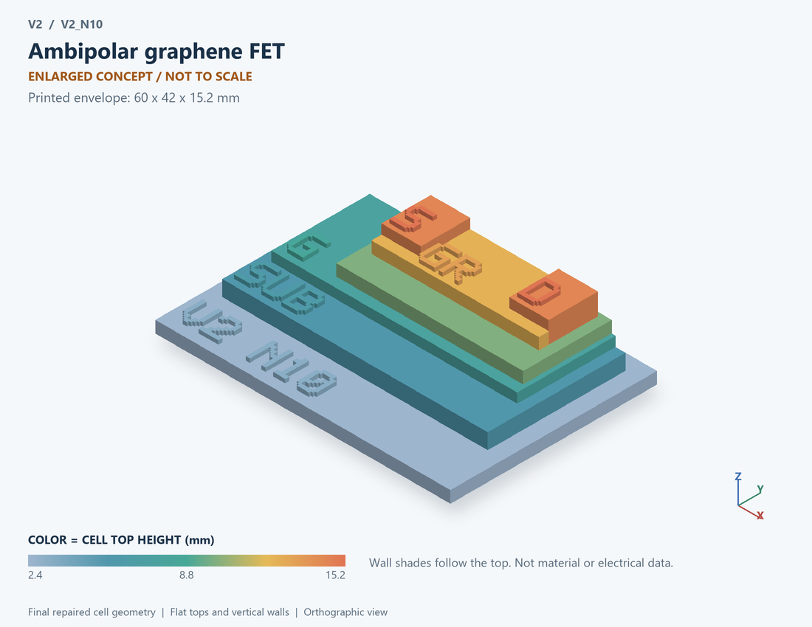

# V2_N10 · Ambipolar graphene FET
# 石墨烯双极性FET

Classification / 分类: `physical_device` · `legacy`

[STL](../stl/V2_N10.stl) · [Preview](../previews/V2_N10.png) · [Top view](../previews/V2_N10_top.png)

60 × 42 mm footprint; flat face on the bed, Z up. Dimensions are teaching choices; they have no process-scale mapping.
60×42毫米底面；平底朝打印平台，Z朝上。尺寸属于教学选择，不对应工艺比例。

This monolithic tactile relief is intentionally supported down to its base. Plastic continuity does not imply an electrical short or a particular material. Only printed surfaces and exposed ledges are visible; hidden interfaces are interpreted using the key.
本单体触觉浮雕刻意向底座填实支撑，塑料相连不代表电气短路或同一种材料。实物仅呈现表面及外露台阶，隐藏界面须配合图例理解。

## Visible feature key / 可见结构说明

| Mark | English | 中文 |
|---|---|---|
| SUB | Exposed substrate ledge | 外露衬底台阶 |
| G | Exposed lower gate ledge | 外露底栅台阶 |
| OX | Gate dielectric | 栅介质 |
| GR | Active film / channel joining both contacts | 连接两接触的有源薄膜/沟道 |
| S | Source contacting one end of the active layer | 接触有源层一端的源接触 |
| D | Drain contacting the other end of the active layer | 接触有源层另一端的漏接触 |

Some small/hidden ledges have no raised lettering; the illustrated atlas and feature list identify them. Numbers on functional displays refer to the numbered source-parts list below.
部分小型或遮挡台阶不刻字，由图册和结构表辨认。功能展示件上的数字对应下方源部件列表。

## Source concepts / 来源概念

1. Support: Supporting substrate 支撑衬底
2. Graphene: Enlarged channel sheet 放大的沟道片
3. Dielectric: Gate insulator 栅介质
4. Gate: Electrostatic gate 静电控制栅
5. Source: Source contact 源接触
6. Drain: Drain contact 漏接触

## Terminals and boundaries / 端口与边界

- D (modeled_electrical): Drain 漏极
- G (modeled_electrical): Gate / control electrode 栅极／控制电极
- S (modeled_electrical): Source 源极

## Interpretation limits / 解释边界

Use a sheet, not N/P diffusion blocks implying a silicon junction; the simulation is an ambipolar conductance law, not a band-structure solution. Teaching geometry is enlarged and not to scale. It is not foundry geometry, a solved local field, or an electrically functional printed component.

采用薄片结构，避免用N/P扩散块暗示硅PN结；仿真为双极性电导律，不是能带求解。教学几何经放大且不按真实比例；不是晶圆厂几何、局部场解或可工作的打印电子元件。

Source-model limitations are retained below; STL generation does not add physics or establish process qualification.
下方保留源模型限制；生成STL不增加物理机制或工艺认证。

仅双极性电导示意；无带隙、量子霍尔和高场输运模型

[Source catalogue / 源目录](../../v2/models/model_catalog.json) · ID `N10`
