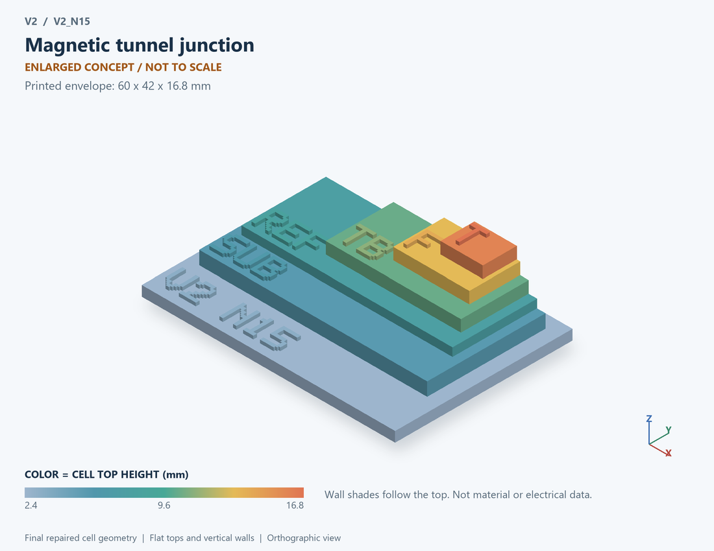

# V2_N15 · Magnetic tunnel junction
# MTJ磁隧道结

Classification / 分类: `physical_device` · `legacy`

[STL](../stl/V2_N15.stl) · [Preview](../previews/V2_N15.png) · [Top view](../previews/V2_N15_top.png)

60 × 42 mm footprint; flat face on the bed, Z up. Dimensions are teaching choices; they have no process-scale mapping.
60×42毫米底面；平底朝打印平台，Z朝上。尺寸属于教学选择，不对应工艺比例。

This monolithic tactile relief is intentionally supported down to its base. Plastic continuity does not imply an electrical short or a particular material. Only printed surfaces and exposed ledges are visible; hidden interfaces are interpreted using the key.
本单体触觉浮雕刻意向底座填实支撑，塑料相连不代表电气短路或同一种材料。实物仅呈现表面及外露台阶，隐藏界面须配合图例理解。

## Visible feature key / 可见结构说明

| Mark | English | 中文 |
|---|---|---|
| SUB | Exposed substrate ledge | 外露衬底台阶 |
| REF | Reference magnetic layer / lower contact ledge | 参考磁层/下接触台阶 |
| TB | Tunnel-barrier dielectric | 隧穿势垒介质 |
| F | Free magnetic layer | 自由磁层 |
| T | Top contact above the free layer | 自由层上方的顶接触 |

Some small/hidden ledges have no raised lettering; the illustrated atlas and feature list identify them. Numbers on functional displays refer to the numbered source-parts list below.
部分小型或遮挡台阶不刻字，由图册和结构表辨认。功能展示件上的数字对应下方源部件列表。

## Source concepts / 来源概念

1. Top: Top electrode 顶电极
2. Free: Free magnetic layer 自由磁层
3. Barrier: Insulating tunnel barrier 绝缘隧穿层
4. Fixed: Reference magnetic layer 参考磁层
5. Bottom: Bottom electrode 底电极
6. M arrows: Symbolic parallel/antiparallel state 平行/反平行状态符号

## Terminals and boundaries / 端口与边界

- TE (modeled_electrical): Top electrode 顶电极
- BE (modeled_electrical): Bottom electrode 底电极

## Interpretation limits / 解释边界

Separate fixed magnetic layer, tunnel barrier and free layer; magnetization arrows are state labels, not an LLG field or magnetic-domain calculation. Teaching geometry is enlarged and not to scale. It is not foundry geometry, a solved local field, or an electrically functional printed component.

区分固定磁层、隧穿层和自由层；磁化箭头是状态标记，不是LLG场或磁畴计算。教学几何经放大且不按真实比例；不是晶圆厂几何、局部场解或可工作的打印电子元件。

Source-model limitations are retained below; STL generation does not add physics or establish process qualification.
下方保留源模型限制；生成STL不增加物理机制或工艺认证。

确定性双态读写；不实现LLG、热噪声、写入误码率和磁化空间纹理

[Source catalogue / 源目录](../../v2/models/model_catalog.json) · ID `N15`
