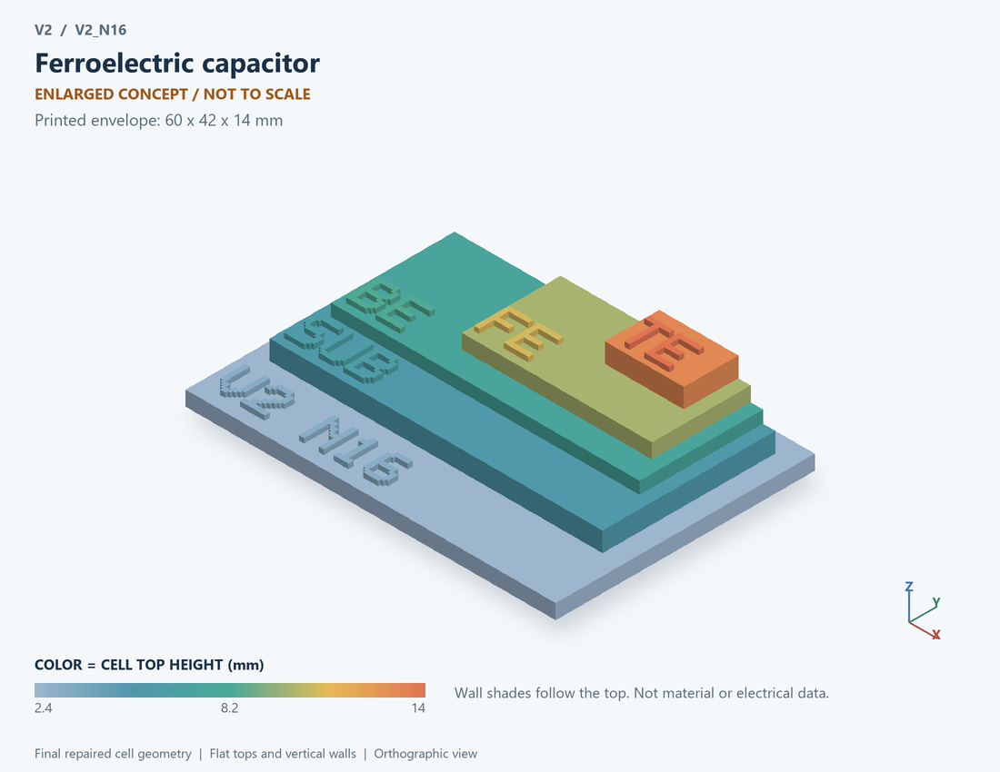

# V2_N16 · Ferroelectric capacitor
# 铁电电容

Classification / 分类: `passive` · `legacy`

[STL](../stl/V2_N16.stl) · [Preview](../previews/V2_N16.png) · [Top view](../previews/V2_N16_top.png)

60 × 42 mm footprint; flat face on the bed, Z up. Dimensions are teaching choices; they have no process-scale mapping.
60×42毫米底面；平底朝打印平台，Z朝上。尺寸属于教学选择，不对应工艺比例。

This monolithic tactile relief is intentionally supported down to its base. Plastic continuity does not imply an electrical short or a particular material. Only printed surfaces and exposed ledges are visible; hidden interfaces are interpreted using the key.
本单体触觉浮雕刻意向底座填实支撑，塑料相连不代表电气短路或同一种材料。实物仅呈现表面及外露台阶，隐藏界面须配合图例理解。

## Visible feature key / 可见结构说明

| Mark | English | 中文 |
|---|---|---|
| SUB | Exposed substrate ledge | 外露衬底台阶 |
| BE | Bottom electrode | 下电极 |
| FE | Ferroelectric dielectric | 铁电介质 |
| TE | Top electrode | 上电极 |

Some small/hidden ledges have no raised lettering; the illustrated atlas and feature list identify them. Numbers on functional displays refer to the numbered source-parts list below.
部分小型或遮挡台阶不刻字，由图册和结构表辨认。功能展示件上的数字对应下方源部件列表。

## Source concepts / 来源概念

1. Top: Top electrode 顶电极
2. FE layer: Ferroelectric dielectric 铁电介质
3. P arrow: Symbolic polarization 极化符号
4. Bottom: Bottom electrode 底电极

## Terminals and boundaries / 端口与边界

- TE (modeled_electrical): Top electrode 顶电极
- BE (modeled_electrical): Bottom electrode 底电极

## Interpretation limits / 解释边界

Show a ferroelectric dielectric between electrodes; polarization markers do not identify a material or reproduce spatial switching kinetics. Teaching geometry is enlarged and not to scale. It is not foundry geometry, a solved local field, or an electrically functional printed component.

展示两电极之间的铁电介质；极化标记不指定材料，也不复现空间开关动力学。教学几何经放大且不按真实比例；不是晶圆厂几何、局部场解或可工作的打印电子元件。

Source-model limitations are retained below; STL generation does not add physics or establish process qualification.
下方保留源模型限制；生成STL不增加物理机制或工艺认证。

双稳态极化示意；不是Landau–Khalatnikov或真实SrTiO3参数拟合

[Source catalogue / 源目录](../../v2/models/model_catalog.json) · ID `N16`
