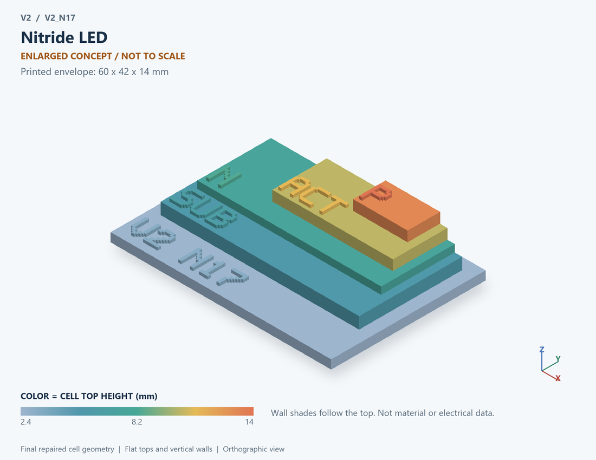

# V2_N17 · Nitride LED
# 氮化物LED

Classification / 分类: `physical_device` · `legacy`

[STL](../stl/V2_N17.stl) · [Preview](../previews/V2_N17.png) · [Top view](../previews/V2_N17_top.png)

60 × 42 mm footprint; flat face on the bed, Z up. Dimensions are teaching choices; they have no process-scale mapping.
60×42毫米底面；平底朝打印平台，Z朝上。尺寸属于教学选择，不对应工艺比例。

This monolithic tactile relief is intentionally supported down to its base. Plastic continuity does not imply an electrical short or a particular material. Only printed surfaces and exposed ledges are visible; hidden interfaces are interpreted using the key.
本单体触觉浮雕刻意向底座填实支撑，塑料相连不代表电气短路或同一种材料。实物仅呈现表面及外露台阶，隐藏界面须配合图例理解。

## Visible feature key / 可见结构说明

| Mark | English | 中文 |
|---|---|---|
| SUB | Exposed substrate ledge | 外露衬底台阶 |
| N | Lower injection / cladding region | 下部注入/包层区 |
| ACT | Active emission layer | 有源发光层 |
| P | Upper injection / cladding region | 上部注入/包层区 |

Some small/hidden ledges have no raised lettering; the illustrated atlas and feature list identify them. Numbers on functional displays refer to the numbered source-parts list below.
部分小型或遮挡台阶不刻字，由图册和结构表辨认。功能展示件上的数字对应下方源部件列表。

## Source concepts / 来源概念

1. P layer: Hole-side semiconductor 空穴侧半导体
2. Active: Radiative active layer 辐射复合活性层
3. N layer: Electron-side semiconductor 电子侧半导体
4. Anode: Anode contact 阳极接触
5. Cathode: Cathode contact 阴极接触
6. Light: Optical-output direction 出光方向

## Terminals and boundaries / 端口与边界

- A (modeled_electrical): Anode 阳极
- K (modeled_electrical): Cathode 阴极
- LIGHT (optical_boundary): Optical output boundary, not an electrical port 光输出边界，非电端

## Interpretation limits / 解释边界

Generic P/active/N layers and light-output direction; quantum-well count, band offsets and extraction optics are not reconstructed. Teaching geometry is enlarged and not to scale. It is not foundry geometry, a solved local field, or an electrically functional printed component.

通用P/活性/N层与出光方向；不重建量子阱数、能带偏移或出光光学结构。教学几何经放大且不按真实比例；不是晶圆厂几何、局部场解或可工作的打印电子元件。

Source-model limitations are retained below; STL generation does not add physics or establish process qualification.
下方保留源模型限制；生成STL不增加物理机制或工艺认证。

仅电光端口模型；不模拟能带/光谱/激子或论文器件效率。

[Source catalogue / 源目录](../../v2/models/model_catalog.json) · ID `N17`
