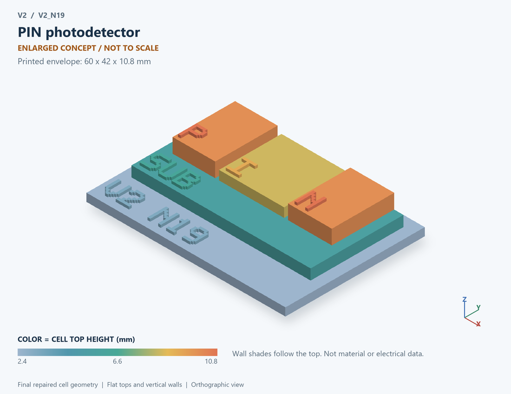

# V2_N19 · PIN photodetector
# PIN光电探测器

Classification / 分类: `physical_device` · `legacy`

[STL](../stl/V2_N19.stl) · [Preview](../previews/V2_N19.png) · [Top view](../previews/V2_N19_top.png)

60 × 42 mm footprint; flat face on the bed, Z up. Dimensions are teaching choices; they have no process-scale mapping.
60×42毫米底面；平底朝打印平台，Z朝上。尺寸属于教学选择，不对应工艺比例。

This monolithic tactile relief is intentionally supported down to its base. Plastic continuity does not imply an electrical short or a particular material. Only printed surfaces and exposed ledges are visible; hidden interfaces are interpreted using the key.
本单体触觉浮雕刻意向底座填实支撑，塑料相连不代表电气短路或同一种材料。实物仅呈现表面及外露台阶，隐藏界面须配合图例理解。

## Visible feature key / 可见结构说明

| Mark | English | 中文 |
|---|---|---|
| SUB | Exposed substrate ledge | 外露衬底台阶 |
| P | P region | P区 |
| I | Intrinsic region | 本征区 |
| N | N region | N区 |

Some small/hidden ledges have no raised lettering; the illustrated atlas and feature list identify them. Numbers on functional displays refer to the numbered source-parts list below.
部分小型或遮挡台阶不刻字，由图册和结构表辨认。功能展示件上的数字对应下方源部件列表。

## Source concepts / 来源概念

1. P layer: P-side region P侧区域
2. Intrinsic: Enlarged absorption region 放大的吸收区
3. N layer: N-side region N侧区域
4. Contacts: Anode and cathode 阳极与阴极
5. Light in: Optical input direction 入光方向

## Terminals and boundaries / 端口与边界

- A (modeled_electrical): Anode 阳极
- K (modeled_electrical): Cathode 阴极
- LIGHT (optical_boundary): Incident optical-power boundary, not an electrical port 入射光功率边界，非电端

## Interpretation limits / 解释边界

Show an intrinsic absorption region between P and N; incoming light is an optical boundary, not a third electrical terminal. Teaching geometry is enlarged and not to scale. It is not foundry geometry, a solved local field, or an electrically functional printed component.

展示P与N之间的本征吸收区；入射光为光学边界，不是第三个电端。教学几何经放大且不按真实比例；不是晶圆厂几何、局部场解或可工作的打印电子元件。

Source-model limitations are retained below; STL generation does not add physics or establish process qualification.
下方保留源模型限制；生成STL不增加物理机制或工艺认证。

光输入到电流输出；不含倍增、量子噪声和波长依赖

[Source catalogue / 源目录](../../v2/models/model_catalog.json) · ID `N19`
