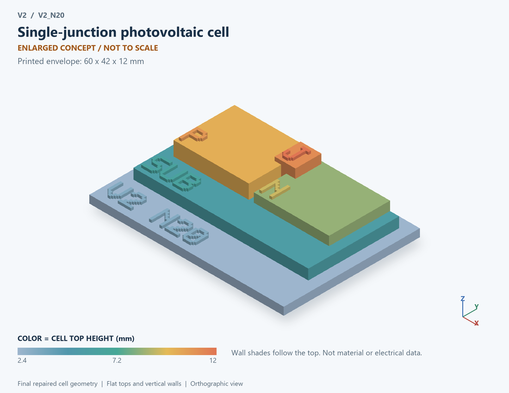

# V2_N20 · Single-junction photovoltaic cell
# 单结光伏电池

Classification / 分类: `physical_device` · `legacy`

[STL](../stl/V2_N20.stl) · [Preview](../previews/V2_N20.png) · [Top view](../previews/V2_N20_top.png)

60 × 42 mm footprint; flat face on the bed, Z up. Dimensions are teaching choices; they have no process-scale mapping.
60×42毫米底面；平底朝打印平台，Z朝上。尺寸属于教学选择，不对应工艺比例。

This monolithic tactile relief is intentionally supported down to its base. Plastic continuity does not imply an electrical short or a particular material. Only printed surfaces and exposed ledges are visible; hidden interfaces are interpreted using the key.
本单体触觉浮雕刻意向底座填实支撑，塑料相连不代表电气短路或同一种材料。实物仅呈现表面及外露台阶，隐藏界面须配合图例理解。

## Visible feature key / 可见结构说明

| Mark | English | 中文 |
|---|---|---|
| SUB | Exposed substrate ledge | 外露衬底台阶 |
| P | P-type region / anode | P型区/阳极 |
| N | N-type region / cathode | N型区/阴极 |
| J | Exposed junction marker | 外露结界面标记 |

Some small/hidden ledges have no raised lettering; the illustrated atlas and feature list identify them. Numbers on functional displays refer to the numbered source-parts list below.
部分小型或遮挡台阶不刻字，由图册和结构表辨认。功能展示件上的数字对应下方源部件列表。

## Source concepts / 来源概念

1. Front: Light-facing electrode 受光侧电极
2. P region: One junction side 结的一侧
3. Junction: Photocarrier separation region 光生载流子分离区
4. N region: Opposite junction side 结的另一侧
5. Back: Rear electrode 背面电极
6. Light in: Incident optical power 入射光功率

## Terminals and boundaries / 端口与边界

- P (modeled_electrical): Positive electrical output/reference 正电输出／参考端
- N (modeled_electrical): Negative electrical output/reference 负电输出／参考端
- LIGHT (optical_boundary): Incident optical-power boundary, not an electrical port 入射光功率边界，非电端

## Interpretation limits / 解释边界

Generic illuminated single junction; the single-diode law does not determine cell material, texturing or multilayer composition. Teaching geometry is enlarged and not to scale. It is not foundry geometry, a solved local field, or an electrically functional printed component.

通用受光单结；单二极管方程不确定电池材料、织构或多层成分。教学几何经放大且不按真实比例；不是晶圆厂几何、局部场解或可工作的打印电子元件。

Source-model limitations are retained below; STL generation does not add physics or establish process qualification.
下方保留源模型限制；生成STL不增加物理机制或工艺认证。

电流进入器件为负表示发电；单二极管参数为假设，非特定钙钛矿/有机电池拟合

[Source catalogue / 源目录](../../v2/models/model_catalog.json) · ID `N20`
