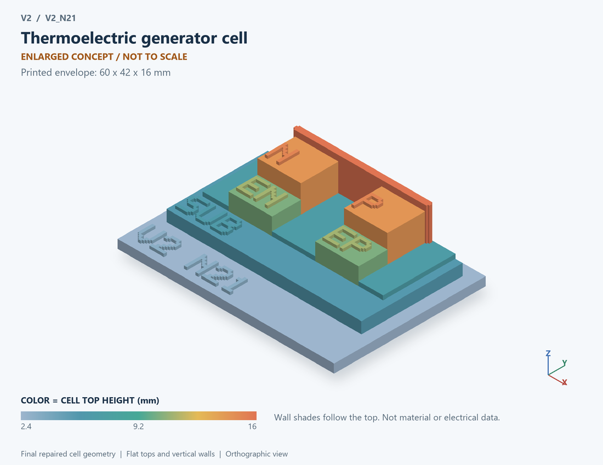

# V2_N21 · Thermoelectric generator cell
# 热电发电单元

Classification / 分类: `physical_device` · `legacy`

[STL](../stl/V2_N21.stl) · [Preview](../previews/V2_N21.png) · [Top view](../previews/V2_N21_top.png)

60 × 42 mm footprint; flat face on the bed, Z up. Dimensions are teaching choices; they have no process-scale mapping.
60×42毫米底面；平底朝打印平台，Z朝上。尺寸属于教学选择，不对应工艺比例。

This monolithic tactile relief is intentionally supported down to its base. Plastic continuity does not imply an electrical short or a particular material. Only printed surfaces and exposed ledges are visible; hidden interfaces are interpreted using the key.
本单体触觉浮雕刻意向底座填实支撑，塑料相连不代表电气短路或同一种材料。实物仅呈现表面及外露台阶，隐藏界面须配合图例理解。

## Visible feature key / 可见结构说明

| Mark | English | 中文 |
|---|---|---|
| SUB | Exposed substrate ledge | 外露衬底台阶 |
| COLD | Cold-side thermal plate | 冷端热边界板 |
| N | N-type thermoelectric leg | N型热电腿 |
| P | P-type thermoelectric leg | P型热电腿 |
| EN | Electrical terminal N (not the doping label) | 电端N（不是掺杂标签） |
| EP | Electrical terminal P (not the doping label) | 电端P（不是掺杂标签） |
| HOT | Raised hot-side boundary marker | 凸起热端边界标记 |
| PORT | HOT/COLD are thermal boundaries; electrical P/N ports are distinct from doping labels and are documented in the source mapping | HOT/COLD为热边界；电气P/N端口与掺杂标记分开，详见源目录映射 |

Some small/hidden ledges have no raised lettering; the illustrated atlas and feature list identify them. Numbers on functional displays refer to the numbered source-parts list below.
部分小型或遮挡台阶不刻字，由图册和结构表辨认。功能展示件上的数字对应下方源部件列表。

## Source concepts / 来源概念

1. Hot: Hot thermal boundary 热端边界
2. Cold: Cold thermal boundary 冷端边界
3. P leg: P-type thermoelectric leg P型热电腿
4. N leg: N-type thermoelectric leg N型热电腿
5. Links: Electrical series interconnects 电气串联互连
6. Insulator: Thermal contact with electrical insulation 导热电绝缘接触

## Terminals and boundaries / 端口与边界

- P (modeled_electrical): Positive electrical output/reference 正电输出／参考端
- N (modeled_electrical): Negative electrical output/reference 负电输出／参考端
- HOT (thermal_boundary): Hot-side temperature/heat boundary 热侧温度/热流边界
- COLD (thermal_boundary): Cold-side temperature/heat boundary 冷侧温度/热流边界

## Interpretation limits / 解释边界

Keep electrical P/N terminals on interconnects separate from HOT/COLD thermal boundaries; the two thermal plates must not be mislabeled as the two electrical terminals. Teaching geometry is enlarged and not to scale. It is not foundry geometry, a solved local field, or an electrically functional printed component.

电气P/N端放在互连处，并与HOT/COLD热边界分离；不得把两块冷热板当成两个电端。教学几何经放大且不按真实比例；不是晶圆厂几何、局部场解或可工作的打印电子元件。

Source-model limitations are retained below; STL generation does not add physics or establish process qualification.
下方保留源模型限制；生成STL不增加物理机制或工艺认证。

定常集总热电转换；不含温度依赖材料系数或汤姆孙效应

[Source catalogue / 源目录](../../v2/models/model_catalog.json) · ID `N21`
