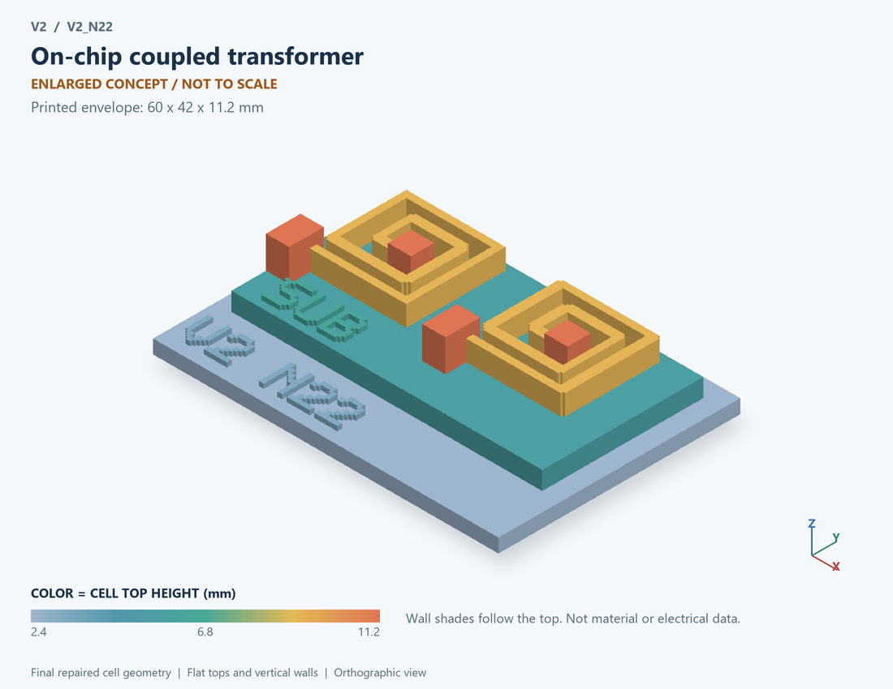

# V2_N22 · On-chip coupled transformer
# 片上耦合变压器

Classification / 分类: `passive` · `legacy`

[STL](../stl/V2_N22.stl) · [Preview](../previews/V2_N22.png) · [Top view](../previews/V2_N22_top.png)

60 × 42 mm footprint; flat face on the bed, Z up. Dimensions are teaching choices; they have no process-scale mapping.
60×42毫米底面；平底朝打印平台，Z朝上。尺寸属于教学选择，不对应工艺比例。

This monolithic tactile relief is intentionally supported down to its base. Plastic continuity does not imply an electrical short or a particular material. Only printed surfaces and exposed ledges are visible; hidden interfaces are interpreted using the key.
本单体触觉浮雕刻意向底座填实支撑，塑料相连不代表电气短路或同一种材料。实物仅呈现表面及外露台阶，隐藏界面须配合图例理解。

## Visible feature key / 可见结构说明

| Mark | English | 中文 |
|---|---|---|
| SUB | Exposed substrate ledge | 外露衬底台阶 |
| PRI | Primary open spiral | 初级开口螺旋 |
| 1 | Winding outer terminal | 绕组外端 |
| 2 | Winding inner terminal | 绕组内端 |
| SEC | Secondary open spiral | 次级开口螺旋 |
| 3 | Winding outer terminal | 绕组外端 |
| 4 | Winding inner terminal | 绕组内端 |
| COUP | Two electrically separate open windings shown side by side for clarity; no coupling magnitude or actual winding layout asserted | 两组电气独立的开口绕组并列展示；不据此认定耦合量或实际绕组版图 |

Some small/hidden ledges have no raised lettering; the illustrated atlas and feature list identify them. Numbers on functional displays refer to the numbered source-parts list below.
部分小型或遮挡台阶不刻字，由图册和结构表辨认。功能展示件上的数字对应下方源部件列表。

## Source concepts / 来源概念

1. Primary: First winding with two ends 带两端的初级绕组
2. Secondary: Second winding with two ends 带两端的次级绕组
3. Spacing: Electrical separation 电气间隔
4. Substrate: Conceptual substrate coupling context 衬底耦合概念
5. Pads: Four separately labeled ports 四个独立端标签

## Terminals and boundaries / 端口与边界

- P+ (modeled_electrical): Primary winding first terminal 初级第一端
- P- (modeled_electrical): Primary winding second terminal 初级第二端
- S+ (modeled_electrical): Secondary winding first terminal 次级第一端
- S- (modeled_electrical): Secondary winding second terminal 次级第二端

## Interpretation limits / 解释边界

Show two isolated windings with four distinct ends, not electrically closed decorative rings; no winding geometry or coupling factor is extracted from layout. Teaching geometry is enlarged and not to scale. It is not foundry geometry, a solved local field, or an electrically functional printed component.

展示两组隔离绕组与四个独立端点，不用闭合装饰环冒充绕组；未从版图提取绕组几何或耦合系数。教学几何经放大且不按真实比例；不是晶圆厂几何、局部场解或可工作的打印电子元件。

Source-model limitations are retained below; STL generation does not add physics or establish process qualification.
下方保留源模型限制；生成STL不增加物理机制或工艺认证。

频域RMS相量；含基底并联RC；不是实际金属版图电磁提取

[Source catalogue / 源目录](../../v2/models/model_catalog.json) · ID `N22`
