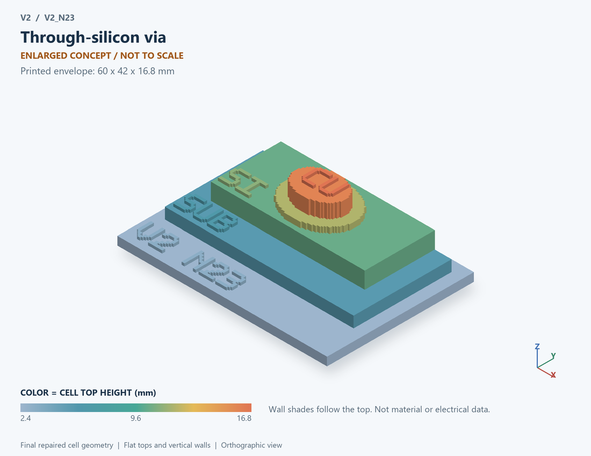

# V2_N23 · Through-silicon via
# TSV硅通孔

Classification / 分类: `interconnect` · `legacy`

[STL](../stl/V2_N23.stl) · [Preview](../previews/V2_N23.png) · [Top view](../previews/V2_N23_top.png)

60 × 42 mm footprint; flat face on the bed, Z up. Dimensions are teaching choices; they have no process-scale mapping.
60×42毫米底面；平底朝打印平台，Z朝上。尺寸属于教学选择，不对应工艺比例。

This monolithic tactile relief is intentionally supported down to its base. Plastic continuity does not imply an electrical short or a particular material. Only printed surfaces and exposed ledges are visible; hidden interfaces are interpreted using the key.
本单体触觉浮雕刻意向底座填实支撑，塑料相连不代表电气短路或同一种材料。实物仅呈现表面及外露台阶，隐藏界面须配合图例理解。

## Visible feature key / 可见结构说明

| Mark | English | 中文 |
|---|---|---|
| SUB | Exposed substrate ledge | 外露衬底台阶 |
| SI | Silicon cross-section | 硅剖面 |
| LIN | Via liner ring ledge | 通孔衬层环形台阶 |
| CU | Via conductor; enlarged exposed end | 通孔导体；放大外露端面 |

Some small/hidden ledges have no raised lettering; the illustrated atlas and feature list identify them. Numbers on functional displays refer to the numbered source-parts list below.
部分小型或遮挡台阶不刻字，由图册和结构表辨认。功能展示件上的数字对应下方源部件列表。

## Source concepts / 来源概念

1. Top pad: Top electrical connection 顶部电连接
2. Via: Conductive via core 导电通孔芯
3. Liner: Insulating sleeve 绝缘衬层
4. Silicon: Surrounding substrate 周围衬底
5. Bottom: Bottom electrical connection 底部电连接
6. SUB tap: Substrate return 衬底回流端

## Terminals and boundaries / 端口与边界

- IN (modeled_electrical): Electrical input 电气输入
- OUT (modeled_electrical): Electrical output 电气输出
- SUB (modeled_electrical): Substrate electrical terminal 衬底电端

## Interpretation limits / 解释边界

Cross-section separates conductive via, insulating liner and silicon body; no real aspect ratio, stress or electromagnetic coupling is derived. Teaching geometry is enlarged and not to scale. It is not foundry geometry, a solved local field, or an electrically functional printed component.

剖面区分导电通孔、绝缘衬层与硅体；不推导真实深宽比、应力或电磁耦合。教学几何经放大且不按真实比例；不是晶圆厂几何、局部场解或可工作的打印电子元件。

Source-model limitations are retained below; STL generation does not add physics or establish process qualification.
下方保留源模型限制；生成STL不增加物理机制或工艺认证。

集总RLCG幅频模型；不做多TSV耦合、电磁传播和真实几何提取

[Source catalogue / 源目录](../../v2/models/model_catalog.json) · ID `N23`
