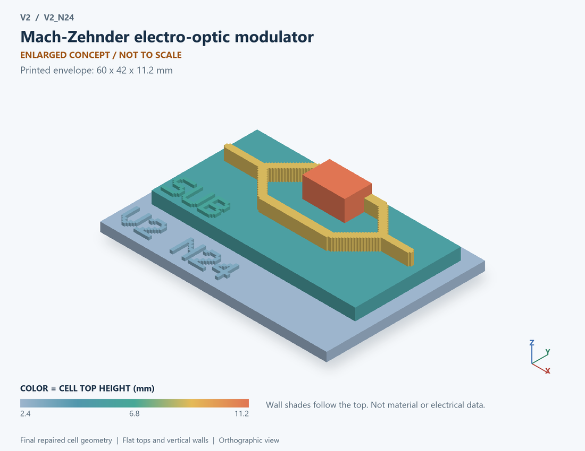

# V2_N24 · Mach-Zehnder electro-optic modulator
# MZI电光调制器

Classification / 分类: `physical_device` · `legacy`

[STL](../stl/V2_N24.stl) · [Preview](../previews/V2_N24.png) · [Top view](../previews/V2_N24_top.png)

60 × 42 mm footprint; flat face on the bed, Z up. Dimensions are teaching choices; they have no process-scale mapping.
60×42毫米底面；平底朝打印平台，Z朝上。尺寸属于教学选择，不对应工艺比例。

This monolithic tactile relief is intentionally supported down to its base. Plastic continuity does not imply an electrical short or a particular material. Only printed surfaces and exposed ledges are visible; hidden interfaces are interpreted using the key.
本单体触觉浮雕刻意向底座填实支撑，塑料相连不代表电气短路或同一种材料。实物仅呈现表面及外露台阶，隐藏界面须配合图例理解。

## Visible feature key / 可见结构说明

| Mark | English | 中文 |
|---|---|---|
| SUB | Exposed substrate ledge | 外露衬底台阶 |
| WG | Interferometer waveguide arm | 干涉仪波导臂 |
| WG | Interferometer waveguide arm | 干涉仪波导臂 |
| RF | Electrode region beside one arm | 一条臂旁的电极区 |

Some small/hidden ledges have no raised lettering; the illustrated atlas and feature list identify them. Numbers on functional displays refer to the numbered source-parts list below.
部分小型或遮挡台阶不刻字，由图册和结构表辨认。功能展示件上的数字对应下方源部件列表。

## Source concepts / 来源概念

1. Splitter: Optical input splitter 输入分束器
2. Arm 1: First optical path 第一光路
3. Arm 2: Second optical path 第二光路
4. Electrode: Phase-control electrode 相位控制电极
5. Return: Electrical return 电气回流端
6. Combiner: Optical output combiner 输出合束器

## Terminals and boundaries / 端口与边界

- G (modeled_electrical): Gate / control electrode 栅极／控制电极
- RET (modeled_electrical): Electrical return 电气回流端
- OPT IN (optical_boundary): Optical input, separate from electrical control 光输入，区别于电气控制
- OPT OUT (optical_boundary): Optical output, separate from electrical return 光输出，区别于电气回流

## Interpretation limits / 解释边界

Two optical arms split and recombine; electrical G/RET and optical IN/OUT must be distinct. No waveguide mode, carrier or travelling-wave electrode solution is claimed. Teaching geometry is enlarged and not to scale. It is not foundry geometry, a solved local field, or an electrically functional printed component.

两条光臂分束后合束；电气G/RET与光学IN/OUT必须区分。不声称波导模式、载流子或行波电极求解。教学几何经放大且不按真实比例；不是晶圆厂几何、局部场解或可工作的打印电子元件。

Source-model limitations are retained below; STL generation does not add physics or establish process qualification.
下方保留源模型限制；生成STL不增加物理机制或工艺认证。

集总相移/干涉模型；不求解波导光场、pn载流子或行波电极

[Source catalogue / 源目录](../../v2/models/model_catalog.json) · ID `N24`
