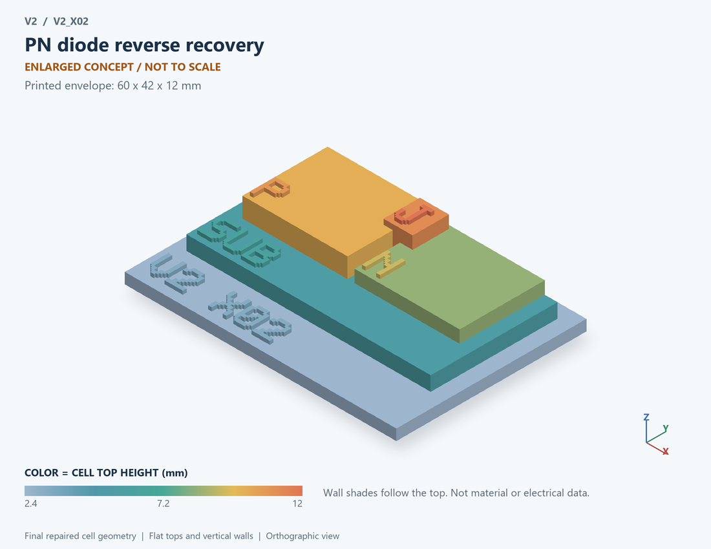

# V2_X02 · PN diode reverse recovery
# PN二极管反向恢复

Classification / 分类: `mechanism_demo` · `legacy`

[STL](../stl/V2_X02.stl) · [Preview](../previews/V2_X02.png) · [Top view](../previews/V2_X02_top.png)

60 × 42 mm footprint; flat face on the bed, Z up. Dimensions are teaching choices; they have no process-scale mapping.
60×42毫米底面；平底朝打印平台，Z朝上。尺寸属于教学选择，不对应工艺比例。

This monolithic tactile relief is intentionally supported down to its base. Plastic continuity does not imply an electrical short or a particular material. Only printed surfaces and exposed ledges are visible; hidden interfaces are interpreted using the key.
本单体触觉浮雕刻意向底座填实支撑，塑料相连不代表电气短路或同一种材料。实物仅呈现表面及外露台阶，隐藏界面须配合图例理解。

## Visible feature key / 可见结构说明

| Mark | English | 中文 |
|---|---|---|
| SUB | Exposed substrate ledge | 外露衬底台阶 |
| P | P-type region / anode | P型区/阳极 |
| N | N-type region / cathode | N型区/阴极 |
| J | Exposed junction marker | 外露结界面标记 |

Some small/hidden ledges have no raised lettering; the illustrated atlas and feature list identify them. Numbers on functional displays refer to the numbered source-parts list below.
部分小型或遮挡台阶不刻字，由图册和结构表辨认。功能展示件上的数字对应下方源部件列表。

## Source concepts / 来源概念

1. P region: Anode-side junction region 阳极侧结区
2. N region: Cathode-side junction region 阴极侧结区
3. Charge: Symbolic stored charge 存储电荷符号
4. Recovery: Reverse-current direction marker 反向电流方向标记

## Terminals and boundaries / 端口与边界

- A (modeled_electrical): Anode 阳极
- K (modeled_electrical): Cathode 阴极

## Interpretation limits / 解释边界

Show a PN junction and symbolic stored-charge markers; the triangular current pulse does not solve carrier density or a physical recovery front. Teaching geometry is enlarged and not to scale. It is not foundry geometry, a solved local field, or an electrically functional printed component.

展示PN结与存储电荷符号；三角电流脉冲不求解载流子密度或物理恢复前沿。教学几何经放大且不按真实比例；不是晶圆厂几何、局部场解或可工作的打印电子元件。

Source-model limitations are retained below; STL generation does not add physics or establish process qualification.
下方保留源模型限制；生成STL不增加物理机制或工艺认证。

电荷约束行为模型；Qrr为输入假设，无少子连续性方程或实测恢复数据

[Source catalogue / 源目录](../../v2/models/model_catalog.json) · ID `X02`
