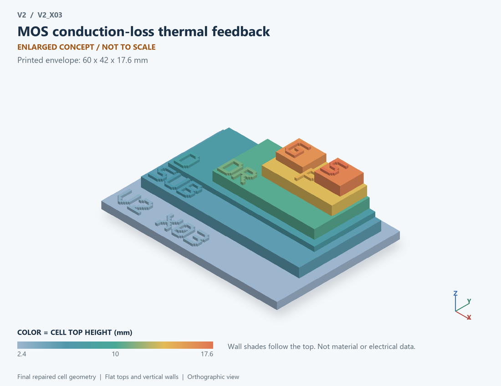

# V2_X03 · MOS conduction-loss thermal feedback
# MOS导通损耗自热反馈

Classification / 分类: `mechanism_demo` · `legacy`

[STL](../stl/V2_X03.stl) · [Preview](../previews/V2_X03.png) · [Top view](../previews/V2_X03_top.png)

60 × 42 mm footprint; flat face on the bed, Z up. Dimensions are teaching choices; they have no process-scale mapping.
60×42毫米底面；平底朝打印平台，Z朝上。尺寸属于教学选择，不对应工艺比例。

This monolithic tactile relief is intentionally supported down to its base. Plastic continuity does not imply an electrical short or a particular material. Only printed surfaces and exposed ledges are visible; hidden interfaces are interpreted using the key.
本单体触觉浮雕刻意向底座填实支撑，塑料相连不代表电气短路或同一种材料。实物仅呈现表面及外露台阶，隐藏界面须配合图例理解。

## Visible feature key / 可见结构说明

| Mark | English | 中文 |
|---|---|---|
| SUB | Exposed substrate ledge | 外露衬底台阶 |
| D | Bottom drain | 底部漏极 |
| DR | Vertical drift layer | 垂直漂移层 |
| P | Body region | 体区 |
| S | Top source | 顶部源极 |
| G | Insulated gate | 绝缘栅 |

Some small/hidden ledges have no raised lettering; the illustrated atlas and feature list identify them. Numbers on functional displays refer to the numbered source-parts list below.
部分小型或遮挡台阶不刻字，由图册和结构表辨认。功能展示件上的数字对应下方源部件列表。

## Source concepts / 来源概念

1. MOS: Conduction-loss element 导通损耗元件
2. Rth: Equivalent thermal resistance 等效热阻
3. Cth: Equivalent heat capacity 等效热容
4. Ambient: Thermal reference boundary 环境热参考边界

## Terminals and boundaries / 端口与边界

- D (modeled_electrical): Drain 漏极
- G (modeled_electrical): Gate / control electrode 栅极／控制电极
- S (modeled_electrical): Source 源极
- TAMB (thermal_boundary): Ambient thermal boundary, not an electrical terminal 环境热边界，非电端

## Interpretation limits / 解释边界

MOS plus a lumped thermal path; heat arrows represent an assumed single-node relation, not a three-dimensional temperature field. Teaching geometry is enlarged and not to scale. It is not foundry geometry, a solved local field, or an electrically functional printed component.

MOS与集总热路径；热箭头表示假设单节点关系，不是三维温度场。教学几何经放大且不按真实比例；不是晶圆厂几何、局部场解或可工作的打印电子元件。

Source-model limitations are retained below; STL generation does not add physics or establish process qualification.
下方保留源模型限制；生成STL不增加物理机制或工艺认证。

单节点热RC与电阻反馈；不是器件内部三维温度场或热失效寿命

[Source catalogue / 源目录](../../v2/models/model_catalog.json) · ID `X03`
