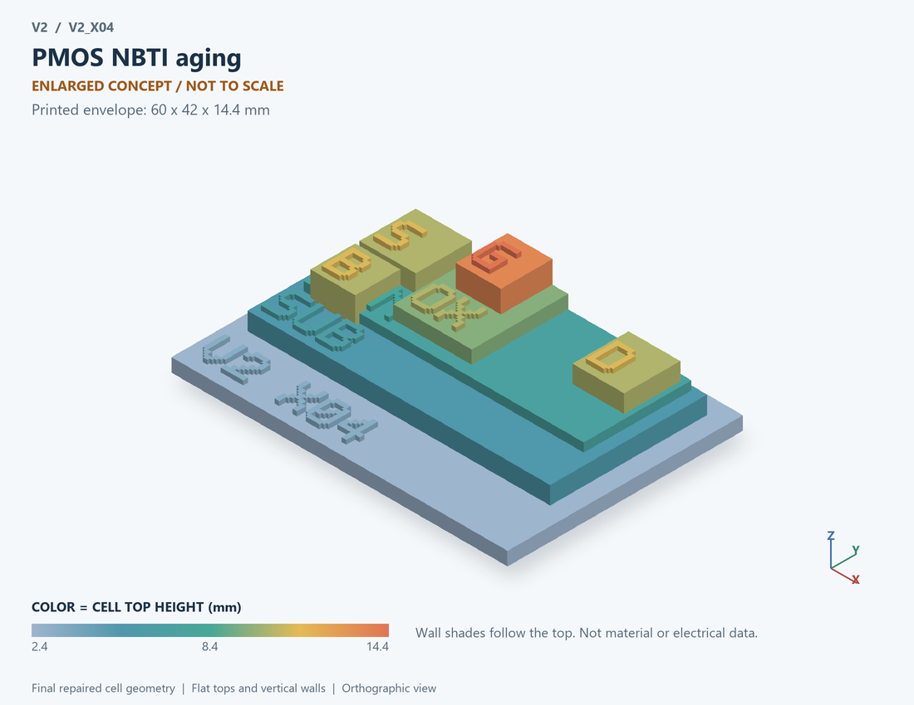

# V2_X04 · PMOS NBTI aging
# PMOS NBTI老化

Classification / 分类: `mechanism_demo` · `legacy`

[STL](../stl/V2_X04.stl) · [Preview](../previews/V2_X04.png) · [Top view](../previews/V2_X04_top.png)

60 × 42 mm footprint; flat face on the bed, Z up. Dimensions are teaching choices; they have no process-scale mapping.
60×42毫米底面；平底朝打印平台，Z朝上。尺寸属于教学选择，不对应工艺比例。

This monolithic tactile relief is intentionally supported down to its base. Plastic continuity does not imply an electrical short or a particular material. Only printed surfaces and exposed ledges are visible; hidden interfaces are interpreted using the key.
本单体触觉浮雕刻意向底座填实支撑，塑料相连不代表电气短路或同一种材料。实物仅呈现表面及外露台阶，隐藏界面须配合图例理解。

## Visible feature key / 可见结构说明

| Mark | English | 中文 |
|---|---|---|
| SUB | Exposed substrate ledge | 外露衬底台阶 |
| N | Body well | 体区/阱 |
| S | Source contact / implanted region | 源极接触/注入区 |
| D | Drain contact / implanted region | 漏极接触/注入区 |
| OX | Exposed gate dielectric ledge | 外露栅介质台阶 |
| G | Gate electrode | 栅电极 |
| B | Separate body contact, distinct from doping label | 独立体接触，与掺杂标签区分 |
| POL | P-channel schematic | P沟道示意 |

Some small/hidden ledges have no raised lettering; the illustrated atlas and feature list identify them. Numbers on functional displays refer to the numbered source-parts list below.
部分小型或遮挡台阶不刻字，由图册和结构表辨认。功能展示件上的数字对应下方源部件列表。

## Source concepts / 来源概念

1. PMOS: P-channel teaching core P沟道教学核心
2. Gate: Stressed gate interface concept 受应力栅界面概念
3. Stress: Bias/temperature/time relationship 偏置温度时间关系
4. Vth: Symbolic threshold-shift marker 阈值偏移符号

## Terminals and boundaries / 端口与边界

- D (modeled_electrical): Drain 漏极
- G (modeled_electrical): Gate / control electrode 栅极／控制电极
- S (modeled_electrical): Source 源极

## Interpretation limits / 解释边界

PMOS gate-stack teaching section plus a stress/time marker; do not print invented traps as a calibrated defect distribution. Teaching geometry is enlarged and not to scale. It is not foundry geometry, a solved local field, or an electrically functional printed component.

PMOS栅堆教学剖面及应力时间标记；不把虚构陷阱当标定缺陷分布。教学几何经放大且不按真实比例；不是晶圆厂几何、局部场解或可工作的打印电子元件。

Source-model limitations are retained below; STL generation does not add physics or establish process qualification.
下方保留源模型限制；生成STL不增加物理机制或工艺认证。

经验幂律定压应力；不解反应扩散，不含恢复/工艺标定，不作寿命预测

[Source catalogue / 源目录](../../v2/models/model_catalog.json) · ID `X04`
