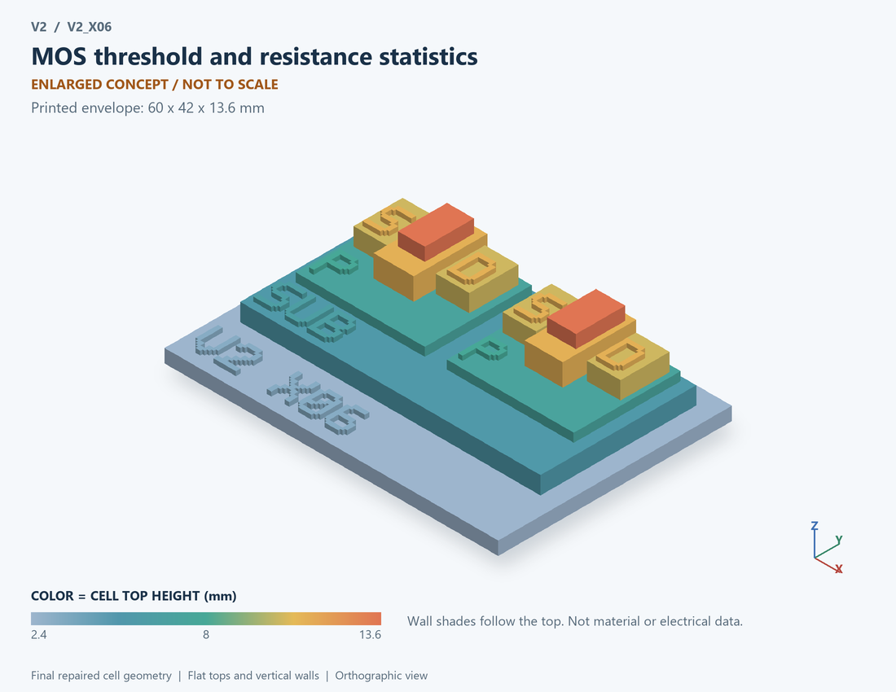

# V2_X06 · MOS threshold and resistance statistics
# MOS阈值及电阻统计分散

Classification / 分类: `parameter_demo` · `legacy`

[STL](../stl/V2_X06.stl) · [Preview](../previews/V2_X06.png) · [Top view](../previews/V2_X06_top.png)

60 × 42 mm footprint; flat face on the bed, Z up. Dimensions are teaching choices; they have no process-scale mapping.
60×42毫米底面；平底朝打印平台，Z朝上。尺寸属于教学选择，不对应工艺比例。

This monolithic tactile relief is intentionally supported down to its base. Plastic continuity does not imply an electrical short or a particular material. Only printed surfaces and exposed ledges are visible; hidden interfaces are interpreted using the key.
本单体触觉浮雕刻意向底座填实支撑，塑料相连不代表电气短路或同一种材料。实物仅呈现表面及外露台阶，隐藏界面须配合图例理解。

## Visible feature key / 可见结构说明

| Mark | English | 中文 |
|---|---|---|
| SUB | Exposed substrate ledge | 外露衬底台阶 |
| P | Body well 1 | 体区/阱 1 |
| S | Source 1 | 源极 1 |
| D | Drain 1 | 漏极 1 |
| OX | Gate dielectric 1 | 栅介质 1 |
| G | Gate 1 | 栅极 1 |
| P | Body well 2 | 体区/阱 2 |
| S | Source 2 | 源极 2 |
| D | Drain 2 | 漏极 2 |
| OX | Gate dielectric 2 | 栅介质 2 |
| G | Gate 2 | 栅极 2 |

Some small/hidden ledges have no raised lettering; the illustrated atlas and feature list identify them. Numbers on functional displays refer to the numbered source-parts list below.
部分小型或遮挡台阶不刻字，由图册和结构表辨认。功能展示件上的数字对应下方源部件列表。

## Source concepts / 来源概念

1. MOS 1: First parameter sample 第一参数样本
2. MOS 2: Second parameter sample 第二参数样本
3. Vth: Threshold variation marker 阈值变化标记
4. R: Resistance variation marker 电阻变化标记

## Terminals and boundaries / 端口与边界

- D (modeled_electrical): Drain 漏极
- G (modeled_electrical): Gate / control electrode 栅极／控制电极
- S (modeled_electrical): Source 源极

## Interpretation limits / 解释边界

Identical teaching transistors illustrate parameter samples; differing surface roughness or dopant maps are not generated by this Monte Carlo model. Teaching geometry is enlarged and not to scale. It is not foundry geometry, a solved local field, or an electrically functional printed component.

相同教学晶体管表示参数样本；本Monte Carlo模型不生成不同表面粗糙度或掺杂图。教学几何经放大且不按真实比例；不是晶圆厂几何、局部场解或可工作的打印电子元件。

Source-model limitations are retained below; STL generation does not add physics or establish process qualification.
下方保留源模型限制；生成STL不增加物理机制或工艺认证。

参数Monte Carlo；不复现论文LER/离散掺杂的3D随机几何，不给制造良率

[Source catalogue / 源目录](../../v2/models/model_catalog.json) · ID `X06`
