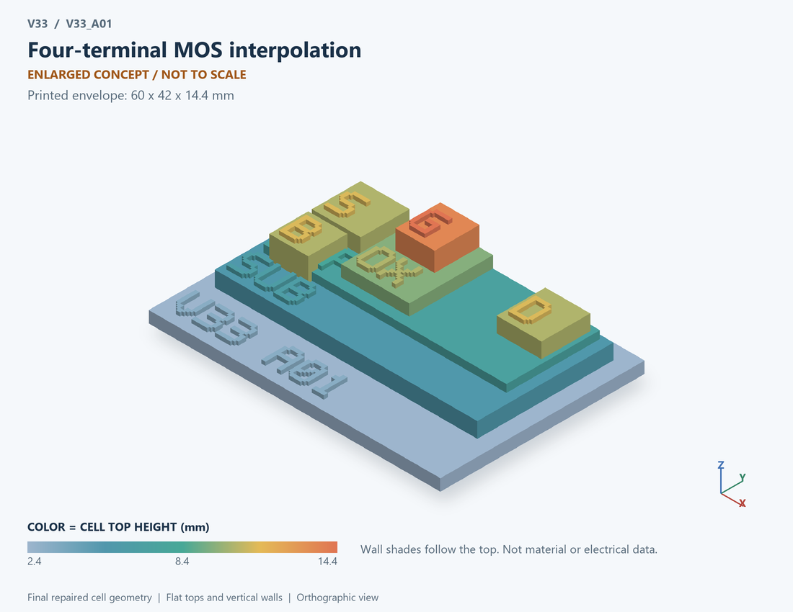

# V33_A01 · Four-terminal MOS interpolation
# 四端MOS连续插值

Classification / 分类: `physical_device` · `current`

[STL](../stl/V33_A01.stl) · [Preview](../previews/V33_A01.png) · [Top view](../previews/V33_A01_top.png)

60 × 42 mm footprint; flat face on the bed, Z up. Dimensions are teaching choices; they have no process-scale mapping.
60×42毫米底面；平底朝打印平台，Z朝上。尺寸属于教学选择，不对应工艺比例。

This monolithic tactile relief is intentionally supported down to its base. Plastic continuity does not imply an electrical short or a particular material. Only printed surfaces and exposed ledges are visible; hidden interfaces are interpreted using the key.
本单体触觉浮雕刻意向底座填实支撑，塑料相连不代表电气短路或同一种材料。实物仅呈现表面及外露台阶，隐藏界面须配合图例理解。

## Visible feature key / 可见结构说明

| Mark | English | 中文 |
|---|---|---|
| SUB | Exposed substrate ledge | 外露衬底台阶 |
| P | Body well | 体区/阱 |
| S | Source contact / implanted region | 源极接触/注入区 |
| D | Drain contact / implanted region | 漏极接触/注入区 |
| OX | Exposed gate dielectric ledge | 外露栅介质台阶 |
| G | Gate electrode | 栅电极 |
| B | Separate body contact, distinct from doping label | 独立体接触，与掺杂标签区分 |
| POL | N-channel schematic | N沟道示意 |

Some small/hidden ledges have no raised lettering; the illustrated atlas and feature list identify them. Numbers on functional displays refer to the numbered source-parts list below.
部分小型或遮挡台阶不刻字，由图册和结构表辨认。功能展示件上的数字对应下方源部件列表。

## Source concepts / 来源概念

1. Body: Semiconductor body 半导体体区
2. Source: Source diffusion concept 源扩散区概念
3. Drain: Drain diffusion concept 漏扩散区概念
4. Oxide: Enlarged gate insulator 放大的栅绝缘层
5. Gate: Control electrode 控制栅
6. B tap: Independent body contact 独立体接触

## Terminals and boundaries / 端口与边界

- G (modeled_electrical): Gate 栅极
- D (modeled_electrical): Drain 漏极
- S (modeled_electrical): Source 源极
- B (modeled_electrical): Body 体端

## Interpretation limits / 解释边界

Four electrical terminals require a visible body connection. The drawing represents a generic MOS concept; the interpolation does not determine process geometry or intrinsic charge partition. Teaching geometry is enlarged and not to scale. Circuit blocks show functional relationships and are not transistor layouts. The physical equations and numerical results remain unchanged.

四电端须显示独立体连接。图为通用MOS概念；插值模型不确定工艺几何或内禀电荷分配。教学几何经放大且不按真实比例；电路图块表示功能关系，不是晶体管版图。物理方程和数值结果保持不变。

Source-model limitations are retained below; STL generation does not add physics or establish process qualification.
下方保留源模型限制；生成STL不增加物理机制或工艺认证。

0–1.8 V low-voltage demonstration. No avalanche, oxide leakage, DIBL, velocity saturation, intrinsic charge partition or measured fit. Not full EKV/BSIM.

仅0–1.8V低压示意；无雪崩、栅漏、DIBL、速度饱和、内禀电荷分配或实测拟合；不是完整EKV/BSIM。

[Source catalogue / 源目录](../../v33/numerics/analog/models/model_catalog.json) · ID `A01`
