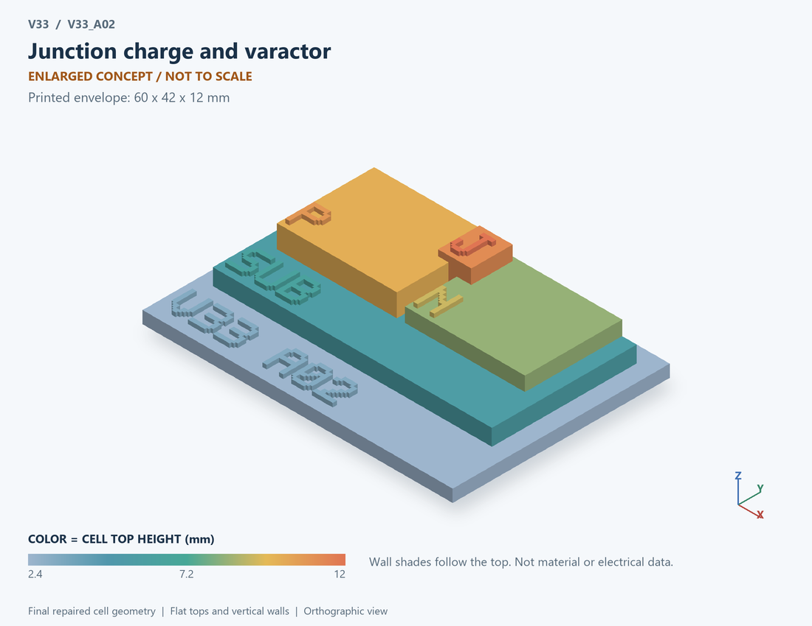

# V33_A02 · Junction charge and varactor
# 结电荷与变容二极管

Classification / 分类: `physical_device` · `current`

[STL](../stl/V33_A02.stl) · [Preview](../previews/V33_A02.png) · [Top view](../previews/V33_A02_top.png)

60 × 42 mm footprint; flat face on the bed, Z up. Dimensions are teaching choices; they have no process-scale mapping.
60×42毫米底面；平底朝打印平台，Z朝上。尺寸属于教学选择，不对应工艺比例。

This monolithic tactile relief is intentionally supported down to its base. Plastic continuity does not imply an electrical short or a particular material. Only printed surfaces and exposed ledges are visible; hidden interfaces are interpreted using the key.
本单体触觉浮雕刻意向底座填实支撑，塑料相连不代表电气短路或同一种材料。实物仅呈现表面及外露台阶，隐藏界面须配合图例理解。

## Visible feature key / 可见结构说明

| Mark | English | 中文 |
|---|---|---|
| SUB | Exposed substrate ledge | 外露衬底台阶 |
| P | P-type region / anode | P型区/阳极 |
| N | N-type region / cathode | N型区/阴极 |
| J | Exposed junction marker | 外露结界面标记 |

Some small/hidden ledges have no raised lettering; the illustrated atlas and feature list identify them. Numbers on functional displays refer to the numbered source-parts list below.
部分小型或遮挡台阶不刻字，由图册和结构表辨认。功能展示件上的数字对应下方源部件列表。

## Source concepts / 来源概念

1. P region: Anode-side region 阳极侧区域
2. N region: Cathode-side region 阴极侧区域
3. Depletion: Symbolic variable-width depletion region 可变耗尽宽度符号
4. Contacts: Anode and cathode labels 阳极阴极标签

## Terminals and boundaries / 端口与边界

- A (modeled_electrical): Anode 阳极
- K (modeled_electrical): Cathode 阴极

## Interpretation limits / 解释边界

A PN junction with a marked depletion region illustrates voltage-dependent capacitance; the depletion-width shape is symbolic, not solved from doping. Teaching geometry is enlarged and not to scale. Circuit blocks show functional relationships and are not transistor layouts. The physical equations and numerical results remain unchanged.

PN结与耗尽区标记表示压变电容；耗尽宽度形状为符号，不是由掺杂求解。教学几何经放大且不按真实比例；电路图块表示功能关系，不是晶体管版图。物理方程和数值结果保持不变。

Source-model limitations are retained below; STL generation does not add physics or establish process qualification.
下方保留源模型限制；生成STL不增加物理机制或工艺认证。

Depletion capacitance only, -20 <= V < 0.35 V. No forward diffusion charge, breakdown or series resistance. Reverse leakage is an assumed 1 pA.

仅耗尽电容，-20≤V<0.35V；不含正向扩散电荷、击穿和串联电阻；反向漏电假设为1pA。

[Source catalogue / 源目录](../../v33/numerics/analog/models/model_catalog.json) · ID `A02`
