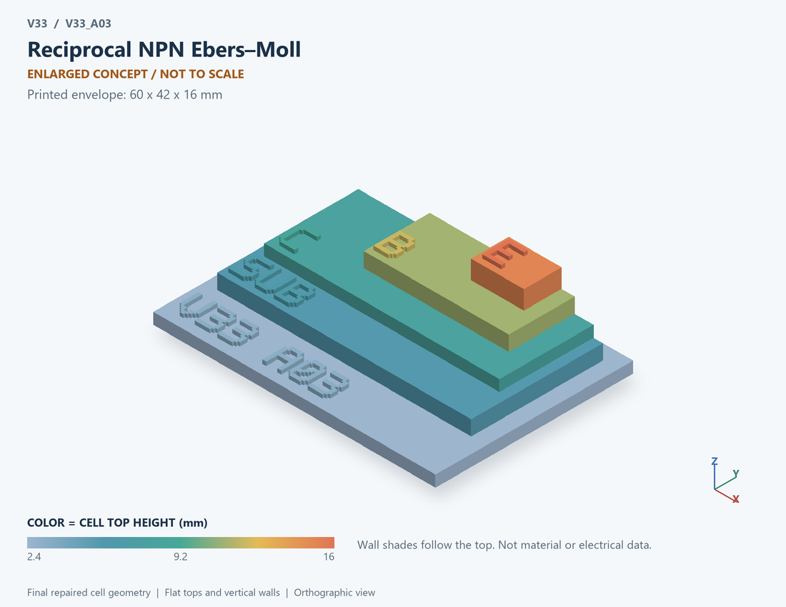

# V33_A03 · Reciprocal NPN Ebers–Moll
# 满足互易关系的NPN Ebers–Moll

Classification / 分类: `physical_device` · `current`

[STL](../stl/V33_A03.stl) · [Preview](../previews/V33_A03.png) · [Top view](../previews/V33_A03_top.png)

60 × 42 mm footprint; flat face on the bed, Z up. Dimensions are teaching choices; they have no process-scale mapping.
60×42毫米底面；平底朝打印平台，Z朝上。尺寸属于教学选择，不对应工艺比例。

This monolithic tactile relief is intentionally supported down to its base. Plastic continuity does not imply an electrical short or a particular material. Only printed surfaces and exposed ledges are visible; hidden interfaces are interpreted using the key.
本单体触觉浮雕刻意向底座填实支撑，塑料相连不代表电气短路或同一种材料。实物仅呈现表面及外露台阶，隐藏界面须配合图例理解。

## Visible feature key / 可见结构说明

| Mark | English | 中文 |
|---|---|---|
| SUB | Exposed substrate ledge | 外露衬底台阶 |
| C | Collector region | 集电区 |
| B | Base region | 基区 |
| E | Emitter region | 发射区 |
| DOP | N-P-N doping order | N-P-N掺杂顺序 |

Some small/hidden ledges have no raised lettering; the illustrated atlas and feature list identify them. Numbers on functional displays refer to the numbered source-parts list below.
部分小型或遮挡台阶不刻字，由图册和结构表辨认。功能展示件上的数字对应下方源部件列表。

## Source concepts / 来源概念

1. N collector: Collector region 集电区
2. P base: Enlarged base region 放大的基区
3. N emitter: Emitter region 发射区
4. Contacts: Three electrical contacts 三个电气接触

## Terminals and boundaries / 端口与边界

- C (modeled_electrical): Collector 集电极
- B (modeled_electrical): Base 基极
- E (modeled_electrical): Emitter 发射极

## Interpretation limits / 解释边界

A generic silicon NPN section, not SiGe HBT; its emitter/base/collector regions do not imply a specific vertical process or transit-time simulation. Teaching geometry is enlarged and not to scale. Circuit blocks show functional relationships and are not transistor layouts. The physical equations and numerical results remain unchanged.

通用硅NPN剖面，非SiGe HBT；发射基集电区不隐含特定纵向工艺或渡越时间仿真。教学几何经放大且不按真实比例；电路图块表示功能关系，不是晶体管版图。物理方程和数值结果保持不变。

Source-model limitations are retained below; STL generation does not add physics or establish process qualification.
下方保留源模型限制；生成STL不增加物理机制或工艺认证。

Generic silicon NPN, not a SiGe HBT. Low-injection DC only; no Early effect, high injection, transit time, RF fT or breakdown.

通用硅NPN，不是SiGe HBT；仅低注入直流，不含Early效应、大注入、渡越时间、fT及击穿。

[Source catalogue / 源目录](../../v33/numerics/analog/models/model_catalog.json) · ID `A03`
