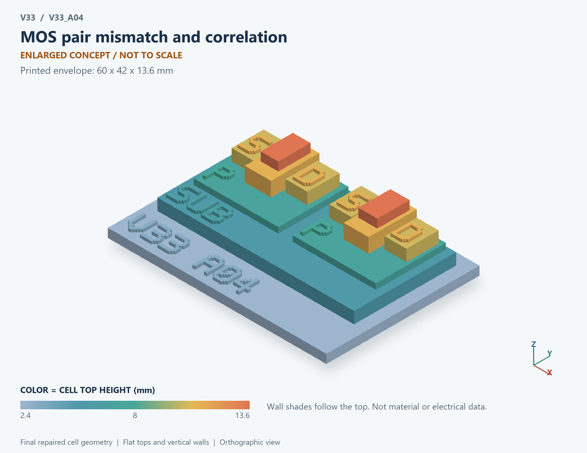

# V33_A04 · MOS pair mismatch and correlation
# MOS配对失配与相关性

Classification / 分类: `parameter_demo` · `current`

[STL](../stl/V33_A04.stl) · [Preview](../previews/V33_A04.png) · [Top view](../previews/V33_A04_top.png)

60 × 42 mm footprint; flat face on the bed, Z up. Dimensions are teaching choices; they have no process-scale mapping.
60×42毫米底面；平底朝打印平台，Z朝上。尺寸属于教学选择，不对应工艺比例。

This monolithic tactile relief is intentionally supported down to its base. Plastic continuity does not imply an electrical short or a particular material. Only printed surfaces and exposed ledges are visible; hidden interfaces are interpreted using the key.
本单体触觉浮雕刻意向底座填实支撑，塑料相连不代表电气短路或同一种材料。实物仅呈现表面及外露台阶，隐藏界面须配合图例理解。

## Visible feature key / 可见结构说明

| Mark | English | 中文 |
|---|---|---|
| SUB | Exposed substrate ledge | 外露衬底台阶 |
| P | Body well 1 | 体区/阱 1 |
| S | Source 1 | 源极 1 |
| D | Drain 1 | 漏极 1 |
| OX | Gate dielectric 1 | 栅介质 1 |
| G | Gate 1 | 栅极 1 |
| P | Body well 2 | 体区/阱 2 |
| S | Source 2 | 源极 2 |
| D | Drain 2 | 漏极 2 |
| OX | Gate dielectric 2 | 栅介质 2 |
| G | Gate 2 | 栅极 2 |

Some small/hidden ledges have no raised lettering; the illustrated atlas and feature list identify them. Numbers on functional displays refer to the numbered source-parts list below.
部分小型或遮挡台阶不刻字，由图册和结构表辨认。功能展示件上的数字对应下方源部件列表。

## Source concepts / 来源概念

1. MOS 1: First nominal device 第一名义器件
2. MOS 2: Second nominal device 第二名义器件
3. W L: Symbolic width/length labels 宽长符号标记
4. Delta: Threshold-difference relation 阈值差关系
5. Rho: Statistical correlation label 统计相关性标记

## Terminals and boundaries / 端口与边界

- G1 (conceptual_node): Conceptual gate of device 1; not an electrical port solved by this statistical model 器件1的概念栅；非此统计模型求解电端
- D1 (conceptual_node): Conceptual drain of device 1; not an electrical port solved by this statistical model 器件1的概念漏；非此统计模型求解电端
- S1 (conceptual_node): Conceptual source of device 1; not an electrical port solved by this statistical model 器件1的概念源；非此统计模型求解电端
- B1 (conceptual_node): Conceptual body of device 1; not an electrical port solved by this statistical model 器件1的概念体；非此统计模型求解电端
- G2 (conceptual_node): Conceptual gate of device 2; not an electrical port solved by this statistical model 器件2的概念栅；非此统计模型求解电端
- D2 (conceptual_node): Conceptual drain of device 2; not an electrical port solved by this statistical model 器件2的概念漏；非此统计模型求解电端
- S2 (conceptual_node): Conceptual source of device 2; not an electrical port solved by this statistical model 器件2的概念源；非此统计模型求解电端
- B2 (conceptual_node): Conceptual body of device 2; not an electrical port solved by this statistical model 器件2的概念体；非此统计模型求解电端

## Interpretation limits / 解释边界

Two identical MOS teaching sections indicate matched nominal devices. Differences are statistical parameters; do not print different dopant maps or call the diagram a verified common-centroid layout. Teaching geometry is enlarged and not to scale. Circuit blocks show functional relationships and are not transistor layouts. The physical equations and numerical results remain unchanged.

两个相同MOS剖面表示名义配对器件。差异属于统计参数；不绘制不同掺杂图，也不称其为验证的共质心版图。教学几何经放大且不按真实比例；电路图块表示功能关系，不是晶体管版图。物理方程和数值结果保持不变。

Source-model limitations are retained below; STL generation does not add physics or establish process qualification.
下方保留源模型限制；生成STL不增加物理机制或工艺认证。

Assumed Gaussian local mismatch and correlation. No foundry statistics, spatial-gradient fit, yield certification or temperature-dependent mismatch law.

高斯局部失配和相关系数为假设；无工艺统计、空间梯度拟合、良率认证或温度失配律。

[Source catalogue / 源目录](../../v33/numerics/analog/models/model_catalog.json) · ID `A04`
