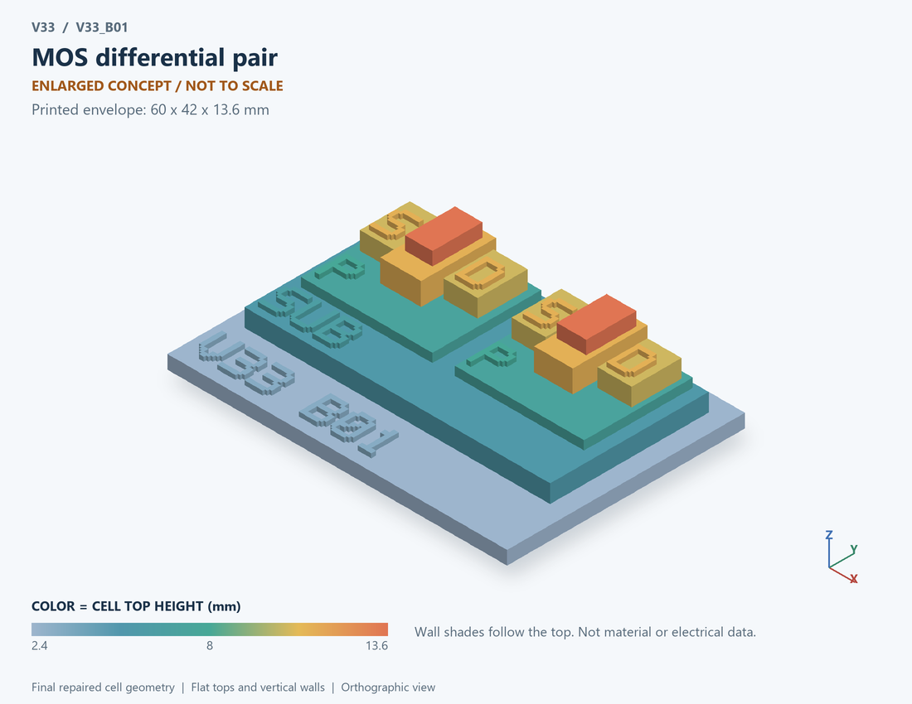

# V33_B01 · MOS differential pair
# MOS差分对

Classification / 分类: `circuit_bench` · `current`

[STL](../stl/V33_B01.stl) · [Preview](../previews/V33_B01.png) · [Top view](../previews/V33_B01_top.png)

60 × 42 mm footprint; flat face on the bed, Z up. Dimensions are teaching choices; they have no process-scale mapping.
60×42毫米底面；平底朝打印平台，Z朝上。尺寸属于教学选择，不对应工艺比例。

This monolithic tactile relief is intentionally supported down to its base. Plastic continuity does not imply an electrical short or a particular material. Only printed surfaces and exposed ledges are visible; hidden interfaces are interpreted using the key.
本单体触觉浮雕刻意向底座填实支撑，塑料相连不代表电气短路或同一种材料。实物仅呈现表面及外露台阶，隐藏界面须配合图例理解。

## Visible feature key / 可见结构说明

| Mark | English | 中文 |
|---|---|---|
| SUB | Exposed substrate ledge | 外露衬底台阶 |
| P | Body well 1 | 体区/阱 1 |
| S | Source 1 | 源极 1 |
| D | Drain 1 | 漏极 1 |
| OX | Gate dielectric 1 | 栅介质 1 |
| G | Gate 1 | 栅极 1 |
| P | Body well 2 | 体区/阱 2 |
| S | Source 2 | 源极 2 |
| D | Drain 2 | 漏极 2 |
| OX | Gate dielectric 2 | 栅介质 2 |
| G | Gate 2 | 栅极 2 |

Some small/hidden ledges have no raised lettering; the illustrated atlas and feature list identify them. Numbers on functional displays refer to the numbered source-parts list below.
部分小型或遮挡台阶不刻字，由图册和结构表辨认。功能展示件上的数字对应下方源部件列表。

## Source concepts / 来源概念

1. MOS 1: First input transistor 第一输入管
2. MOS 2: Second input transistor 第二输入管
3. Tail: Ideal common tail-current source 理想共同尾电流源
4. D1 D2: Separate branch-current outputs 两支路电流输出
5. G1 G2: Differential input labels 差分输入标签

## Terminals and boundaries / 端口与边界

- D1 (modeled_electrical): First branch drain 第一支路漏极
- D2 (modeled_electrical): Second branch drain 第二支路漏极
- G1 (modeled_electrical): First gate input 第一栅输入
- G2 (modeled_electrical): Second gate input 第二栅输入
- Tail (modeled_electrical): Common source/tail-current node 共源尾电流节点

## Interpretation limits / 解释边界

Two MOS sections sharing an ideal tail-source node show the circuit relation; load and amplifier compensation must not be invented as simulated components. Teaching geometry is enlarged and not to scale. Circuit blocks show functional relationships and are not transistor layouts. The physical equations and numerical results remain unchanged.

两个MOS剖面共用理想尾源节点表示电路关系；不得虚构已仿真的负载或放大器补偿。教学几何经放大且不按真实比例；电路图块表示功能关系，不是晶体管版图。物理方程和数值结果保持不变。

Source-model limitations are retained below; STL generation does not add physics or establish process qualification.
下方保留源模型限制；生成STL不增加物理机制或工艺认证。

Fixed drain biases and ideal tail source. No amplifier load, common-mode feedback, frequency compensation or finite tail impedance.

固定漏端偏置、理想尾电流源；不含放大器负载、共模反馈、频率补偿及尾源有限阻抗。

[Source catalogue / 源目录](../../v33/numerics/analog/models/model_catalog.json) · ID `B01`
