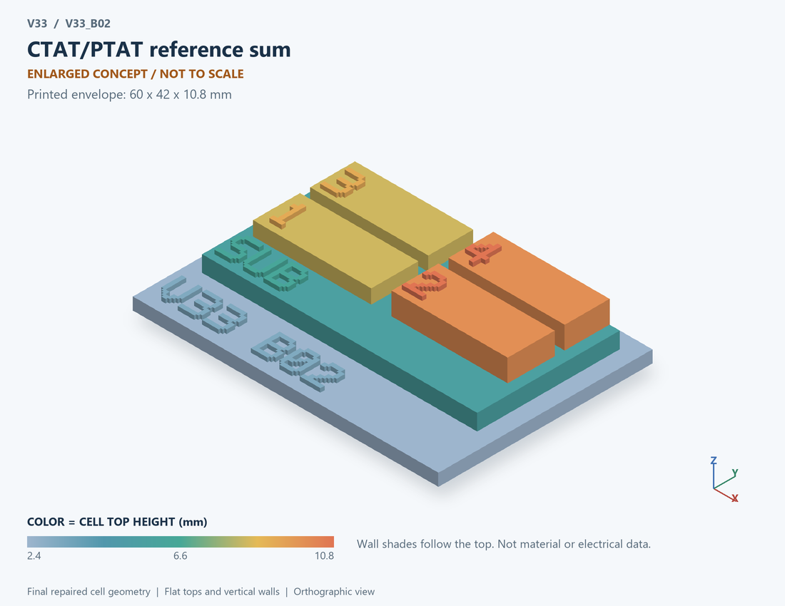

# V33_B02 · CTAT/PTAT reference sum
# CTAT/PTAT基准合成

Classification / 分类: `circuit_bench` · `current`

[STL](../stl/V33_B02.stl) · [Preview](../previews/V33_B02.png) · [Top view](../previews/V33_B02_top.png)

60 × 42 mm footprint; flat face on the bed, Z up. Dimensions are teaching choices; they have no process-scale mapping.
60×42毫米底面；平底朝打印平台，Z朝上。尺寸属于教学选择，不对应工艺比例。

This monolithic tactile relief is intentionally supported down to its base. Plastic continuity does not imply an electrical short or a particular material. Only printed surfaces and exposed ledges are visible; hidden interfaces are interpreted using the key.
本单体触觉浮雕刻意向底座填实支撑，塑料相连不代表电气短路或同一种材料。实物仅呈现表面及外露台阶，隐藏界面须配合图例理解。

## Visible feature key / 可见结构说明

| Mark | English | 中文 |
|---|---|---|
| SUB | Exposed substrate ledge | 外露衬底台阶 |
| 1 | First junction voltage concept | 第一结电压概念 |
| 2 | Different-area junction concept | 不同面积结概念 |
| 3 | PTAT current scaling | PTAT电流缩放 |
| 4 | Temperature-proportional term | 正温度系数项 |
| KEY | Numbered functional blocks, not silicon layout or solved 3D fields. See numbered key in the atlas. | 编号功能块，不是硅版图或求解的三维场，编号说明见图册 |

Some small/hidden ledges have no raised lettering; the illustrated atlas and feature list identify them. Numbers on functional displays refer to the numbered source-parts list below.
部分小型或遮挡台阶不刻字，由图册和结构表辨认。功能展示件上的数字对应下方源部件列表。

## Source concepts / 来源概念

1. Q1: First junction voltage concept 第一结电压概念
2. Q2: Different-area junction concept 不同面积结概念
3. R1: PTAT current scaling PTAT电流缩放
4. PTAT: Temperature-proportional term 正温度系数项
5. SUM: CTAT plus weighted PTAT CTAT与加权PTAT合成

## Terminals and boundaries / 端口与边界

- VBE (conceptual_node): CTAT junction-voltage term CTAT结电压项
- DVBE (conceptual_node): Junction-voltage difference 结电压差
- VREF (conceptual_node): Reference-voltage signal 参考电压信号

## Interpretation limits / 解释边界

Use conceptual junctions and an arithmetic sum, not a purported Brokaw transistor-level circuit or bandgap layout. Labels are conceptual signals because the simulation has no electrical-port list. Teaching geometry is enlarged and not to scale. Circuit blocks show functional relationships and are not transistor layouts. The physical equations and numerical results remain unchanged.

使用概念结及算术合成，不虚称Brokaw晶体管电路或带隙版图。标签为概念信号，仿真无电端口列表。教学几何经放大且不按真实比例；电路图块表示功能关系，不是晶体管版图。物理方程和数值结果保持不变。

Source-model limitations are retained below; STL generation does not add physics or establish process qualification.
下方保留源模型限制；生成STL不增加物理机制或工艺认证。

Ideal voltage sum inspired by bandgap principles, not the 2.5 V Brokaw circuit reproduction. No start-up, PSRR, trimming, resistor TC, mismatch or output load.

按带隙原理的理想电压合成，并非复现Brokaw的2.5V电路；不含启动、PSRR、修调、电阻温漂、失配及输出负载。

[Source catalogue / 源目录](../../v33/numerics/analog/models/model_catalog.json) · ID `B02`
