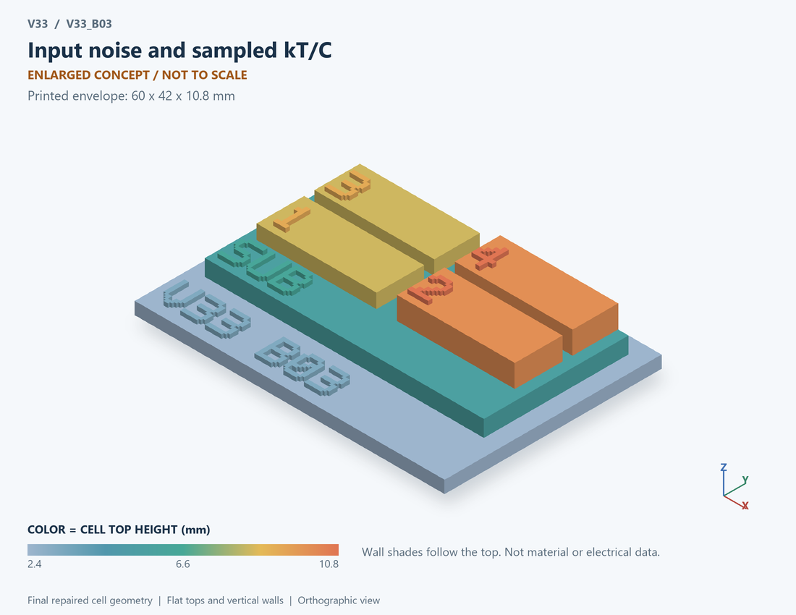

# V33_B03 · Input noise and sampled kT/C
# 输入噪声与采样kT/C

Classification / 分类: `circuit_bench` · `current`

[STL](../stl/V33_B03.stl) · [Preview](../previews/V33_B03.png) · [Top view](../previews/V33_B03_top.png)

60 × 42 mm footprint; flat face on the bed, Z up. Dimensions are teaching choices; they have no process-scale mapping.
60×42毫米底面；平底朝打印平台，Z朝上。尺寸属于教学选择，不对应工艺比例。

This monolithic tactile relief is intentionally supported down to its base. Plastic continuity does not imply an electrical short or a particular material. Only printed surfaces and exposed ledges are visible; hidden interfaces are interpreted using the key.
本单体触觉浮雕刻意向底座填实支撑，塑料相连不代表电气短路或同一种材料。实物仅呈现表面及外露台阶，隐藏界面须配合图例理解。

## Visible feature key / 可见结构说明

| Mark | English | 中文 |
|---|---|---|
| SUB | Exposed substrate ledge | 外露衬底台阶 |
| 1 | Input-referred noise concept | 输入参考噪声概念 |
| 2 | Illustrative spectral shaping | 示意频谱整形 |
| 3 | White-noise contribution | 白噪声贡献 |
| 4 | Low-frequency contribution | 低频噪声贡献 |
| KEY | Numbered functional blocks, not silicon layout or solved 3D fields. See numbered key in the atlas. | 编号功能块，不是硅版图或求解的三维场，编号说明见图册 |

Some small/hidden ledges have no raised lettering; the illustrated atlas and feature list identify them. Numbers on functional displays refer to the numbered source-parts list below.
部分小型或遮挡台阶不刻字，由图册和结构表辨认。功能展示件上的数字对应下方源部件列表。

## Source concepts / 来源概念

1. Input: Input-referred noise concept 输入参考噪声概念
2. Shape: Illustrative spectral shaping 示意频谱整形
3. White: White-noise contribution 白噪声贡献
4. Flicker: Low-frequency contribution 低频噪声贡献
5. Sample C: Sampling-capacitance concept 采样电容概念

## Terminals and boundaries / 端口与边界

- INPUT (conceptual_node): Input-referred noise boundary 输入参考噪声边界
- PSD (conceptual_node): Spectral-density representation 谱密度表示
- SAMPLE (conceptual_node): Sampled-noise relation 采样噪声关系

## Interpretation limits / 解释边界

Print spectral/noise-path symbols and a sampling capacitor. The saved model is not a complete chopper amplifier, transistor noise generator or sampled switching netlist. Teaching geometry is enlarged and not to scale. Circuit blocks show functional relationships and are not transistor layouts. The physical equations and numerical results remain unchanged.

打印频谱/噪声路径符号及采样电容。保存模型不是完整斩波放大器、晶体管噪声发生器或采样开关网表。教学几何经放大且不按真实比例；电路图块表示功能关系，不是晶体管版图。物理方程和数值结果保持不变。

Source-model limitations are retained below; STL generation does not add physics or establish process qualification.
下方保留源模型限制；生成STL不增加物理机制或工艺认证。

Illustrative spectral shaping, not a switched chopper circuit or measured op amp. No current noise, source resistance, aliasing, ripple or charge injection.

仅示意频谱整形，不是开关斩波电路或实测运放；不含电流噪声、源阻、混叠、纹波和电荷注入。

[Source catalogue / 源目录](../../v33/numerics/analog/models/model_catalog.json) · ID `B03`
