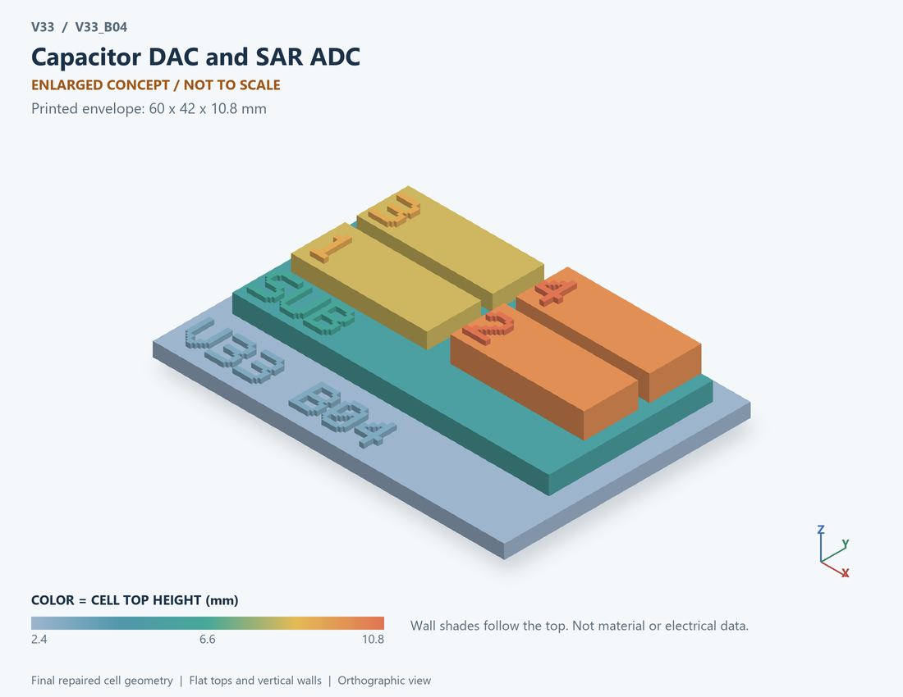

# V33_B04 · Capacitor DAC and SAR ADC
# 电容DAC与SAR ADC

Classification / 分类: `circuit_bench` · `current`

[STL](../stl/V33_B04.stl) · [Preview](../previews/V33_B04.png) · [Top view](../previews/V33_B04_top.png)

60 × 42 mm footprint; flat face on the bed, Z up. Dimensions are teaching choices; they have no process-scale mapping.
60×42毫米底面；平底朝打印平台，Z朝上。尺寸属于教学选择，不对应工艺比例。

This monolithic tactile relief is intentionally supported down to its base. Plastic continuity does not imply an electrical short or a particular material. Only printed surfaces and exposed ledges are visible; hidden interfaces are interpreted using the key.
本单体触觉浮雕刻意向底座填实支撑，塑料相连不代表电气短路或同一种材料。实物仅呈现表面及外露台阶，隐藏界面须配合图例理解。

## Visible feature key / 可见结构说明

| Mark | English | 中文 |
|---|---|---|
| SUB | Exposed substrate ledge | 外露衬底台阶 |
| 1 | Binary-weighted capacitance bank concept | 二进制权重电容组概念 |
| 2 | Dummy-capacitance role | 哑元电容作用 |
| 3 | Ideal comparison block | 理想比较功能块 |
| 4 | Sequential-decision logic | 逐次判决逻辑 |
| KEY | Numbered functional blocks, not silicon layout or solved 3D fields. See numbered key in the atlas. | 编号功能块，不是硅版图或求解的三维场，编号说明见图册 |

Some small/hidden ledges have no raised lettering; the illustrated atlas and feature list identify them. Numbers on functional displays refer to the numbered source-parts list below.
部分小型或遮挡台阶不刻字，由图册和结构表辨认。功能展示件上的数字对应下方源部件列表。

## Source concepts / 来源概念

1. CDAC: Binary-weighted capacitance bank concept 二进制权重电容组概念
2. Dummy: Dummy-capacitance role 哑元电容作用
3. Compare: Ideal comparison block 理想比较功能块
4. SAR: Sequential-decision logic 逐次判决逻辑
5. Code: Digital output marker 数字输出标记

## Terminals and boundaries / 端口与边界

- VIN (conceptual_node): Input supply or input signal as described 输入供电或输入信号，按条目说明
- VREF (conceptual_node): Reference-voltage signal 参考电压信号
- CODE (conceptual_node): Digital output code 数字输出码

## Interpretation limits / 解释边界

Show a capacitor array, comparator and decision logic as functional blocks. Labels are algorithmic nodes; electrode layout and charge-switch trajectories are not extracted from a physical ADC. Teaching geometry is enlarged and not to scale. Circuit blocks show functional relationships and are not transistor layouts. The physical equations and numerical results remain unchanged.

用电容阵列、比较器与判决逻辑功能块表示。标签为算法节点；未从真实ADC提取电极版图和电荷开关轨迹。教学几何经放大且不按真实比例；电路图块表示功能关系，不是晶体管版图。物理方程和数值结果保持不变。

Source-model limitations are retained below; STL generation does not add physics or establish process qualification.
下方保留源模型限制；生成STL不增加物理机制或工艺认证。

Ideal comparator and full settling. No aperture jitter, thermal/comparator noise, switch leakage, reference droop or supply-current prediction. Capacitor mismatch is assumed.

比较器理想且完全建立；不含采样抖动、热噪声/比较器噪声、开关漏电、参考跌落及供电电流预测；电容失配为假设。

[Source catalogue / 源目录](../../v33/numerics/analog/models/model_catalog.json) · ID `B04`
