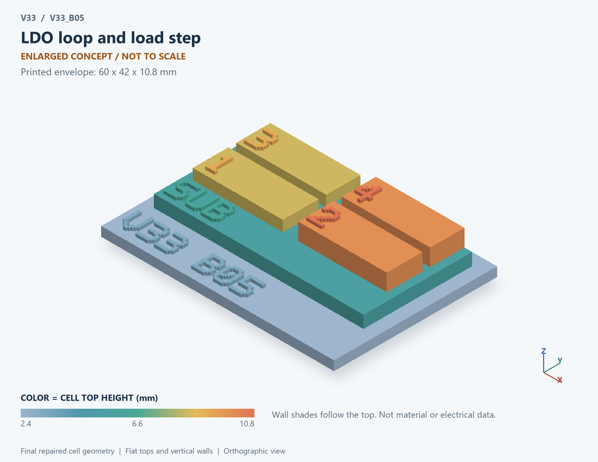

# V33_B05 · LDO loop and load step
# LDO环路与负载阶跃

Classification / 分类: `circuit_bench` · `current`

[STL](../stl/V33_B05.stl) · [Preview](../previews/V33_B05.png) · [Top view](../previews/V33_B05_top.png)

60 × 42 mm footprint; flat face on the bed, Z up. Dimensions are teaching choices; they have no process-scale mapping.
60×42毫米底面；平底朝打印平台，Z朝上。尺寸属于教学选择，不对应工艺比例。

This monolithic tactile relief is intentionally supported down to its base. Plastic continuity does not imply an electrical short or a particular material. Only printed surfaces and exposed ledges are visible; hidden interfaces are interpreted using the key.
本单体触觉浮雕刻意向底座填实支撑，塑料相连不代表电气短路或同一种材料。实物仅呈现表面及外露台阶，隐藏界面须配合图例理解。

## Visible feature key / 可见结构说明

| Mark | English | 中文 |
|---|---|---|
| SUB | Exposed substrate ledge | 外露衬底台阶 |
| 1 | Generic pass-current element | 通用调整电流元件 |
| 2 | Loop-error response | 环路误差响应 |
| 3 | Output capacitance | 输出电容 |
| 4 | Load-step boundary | 负载阶跃边界 |
| KEY | Numbered functional blocks, not silicon layout or solved 3D fields. See numbered key in the atlas. | 编号功能块，不是硅版图或求解的三维场，编号说明见图册 |

Some small/hidden ledges have no raised lettering; the illustrated atlas and feature list identify them. Numbers on functional displays refer to the numbered source-parts list below.
部分小型或遮挡台阶不刻字，由图册和结构表辨认。功能展示件上的数字对应下方源部件列表。

## Source concepts / 来源概念

1. Pass: Generic pass-current element 通用调整电流元件
2. Error: Loop-error response 环路误差响应
3. Cout: Output capacitance 输出电容
4. Load: Load-step boundary 负载阶跃边界
5. Feedback: Output-to-error feedback 输出至误差反馈

## Terminals and boundaries / 端口与边界

- IN (modeled_electrical): Supply input 供电输入
- OUT (modeled_electrical): Output 输出
- GND (modeled_electrical): Ground/reference 地参考

## Interpretation limits / 解释边界

Use pass-element, amplifier and output-capacitor blocks. The small-signal state model does not specify a PMOS/NMOS device, dropout behavior or actual regulator layout. Teaching geometry is enlarged and not to scale. Circuit blocks show functional relationships and are not transistor layouts. The physical equations and numerical results remain unchanged.

使用调整元件、放大器与输出电容功能块。小信号状态模型不指定PMOS/NMOS器件、压差行为或真实稳压器版图。教学几何经放大且不按真实比例；电路图块表示功能关系，不是晶体管版图。物理方程和数值结果保持不变。

Source-model limitations are retained below; STL generation does not add physics or establish process qualification.
下方保留源模型限制；生成STL不增加物理机制或工艺认证。

Small perturbation around a biased operating point; no dropout, current limit, start-up, ESR zero or transistor netlist. Not a reproduction of the cited measured LDO.

围绕偏置点的小扰动模型；无压差极限、限流、启动、ESR零点或晶体管网表；并非复现引用论文的实测LDO。

[Source catalogue / 源目录](../../v33/numerics/analog/models/model_catalog.json) · ID `B05`
