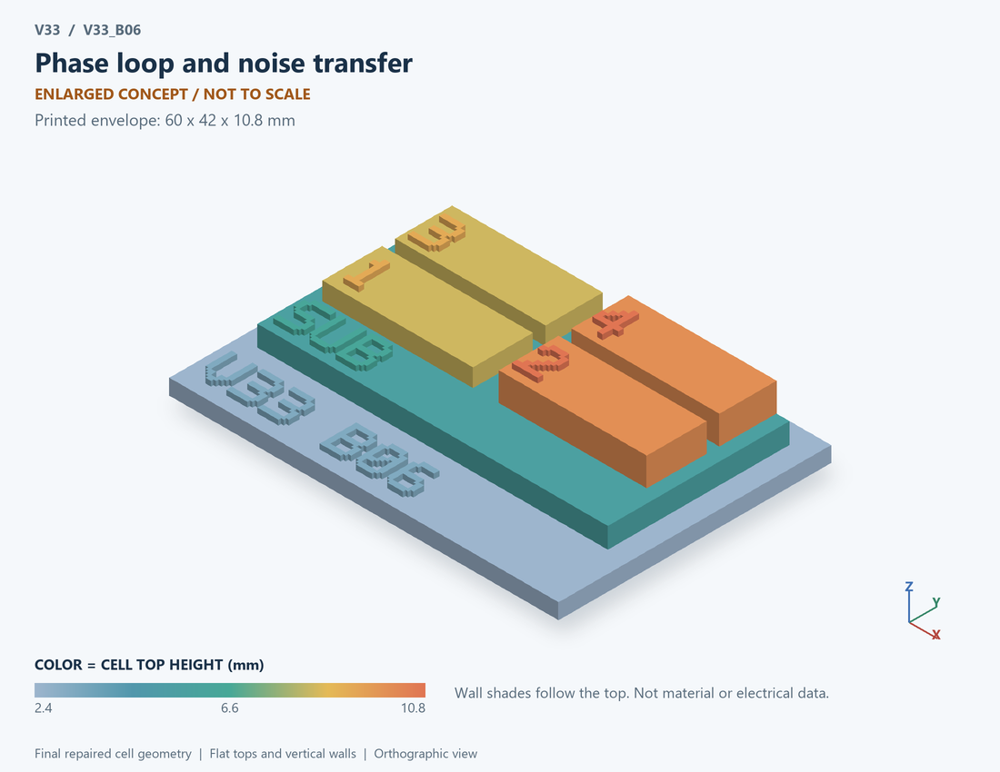

# V33_B06 · Phase loop and noise transfer
# 相位环路与噪声传递

Classification / 分类: `circuit_bench` · `current`

[STL](../stl/V33_B06.stl) · [Preview](../previews/V33_B06.png) · [Top view](../previews/V33_B06_top.png)

60 × 42 mm footprint; flat face on the bed, Z up. Dimensions are teaching choices; they have no process-scale mapping.
60×42毫米底面；平底朝打印平台，Z朝上。尺寸属于教学选择，不对应工艺比例。

This monolithic tactile relief is intentionally supported down to its base. Plastic continuity does not imply an electrical short or a particular material. Only printed surfaces and exposed ledges are visible; hidden interfaces are interpreted using the key.
本单体触觉浮雕刻意向底座填实支撑，塑料相连不代表电气短路或同一种材料。实物仅呈现表面及外露台阶，隐藏界面须配合图例理解。

## Visible feature key / 可见结构说明

| Mark | English | 中文 |
|---|---|---|
| SUB | Exposed substrate ledge | 外露衬底台阶 |
| 1 | Input phase boundary | 输入相位边界 |
| 2 | Canonical second-order response | 标准二阶响应 |
| 3 | Output phase signal | 输出相位信号 |
| 4 | Reference-noise path | 参考噪声路径 |
| KEY | Numbered functional blocks, not silicon layout or solved 3D fields. See numbered key in the atlas. | 编号功能块，不是硅版图或求解的三维场，编号说明见图册 |

Some small/hidden ledges have no raised lettering; the illustrated atlas and feature list identify them. Numbers on functional displays refer to the numbered source-parts list below.
部分小型或遮挡台阶不刻字，由图册和结构表辨认。功能展示件上的数字对应下方源部件列表。

## Source concepts / 来源概念

1. Phase in: Input phase boundary 输入相位边界
2. Response: Canonical second-order response 标准二阶响应
3. Phase out: Output phase signal 输出相位信号
4. REF noise: Reference-noise path 参考噪声路径
5. VCO noise: Abstract oscillator-noise path 抽象振荡器噪声路径

## Terminals and boundaries / 端口与边界

- PHI IN (conceptual_node): Conceptual PHI IN label 概念PHI IN标记
- PHI OUT (conceptual_node): Conceptual PHI OUT label 概念PHI OUT标记

## Interpretation limits / 解释边界

A phase-input/second-order-response/phase-output diagram is appropriate; a PFD, charge pump or transistor VCO would suggest circuitry absent from this canonical phase model. Teaching geometry is enlarged and not to scale. Circuit blocks show functional relationships and are not transistor layouts. The physical equations and numerical results remain unchanged.

适合相位输入/二阶响应/相位输出图；PFD、电荷泵或晶体管VCO会暗示本标准相位模型并不存在的电路。教学几何经放大且不按真实比例；电路图块表示功能关系，不是晶体管版图。物理方程和数值结果保持不变。

Source-model limitations are retained below; STL generation does not add physics or establish process qualification.
下方保留源模型限制；生成STL不增加物理机制或工艺认证。

Canonical phase-domain abstraction without a loop zero. Not a transistor VCO, a full type-II PLL, ISF extraction, cycle-slip or acquisition simulation.

无环路零点的典型相位域抽象；不是晶体管VCO、完整二型PLL、ISF提取、周跳或捕获仿真。

[Source catalogue / 源目录](../../v33/numerics/analog/models/model_catalog.json) · ID `B06`
