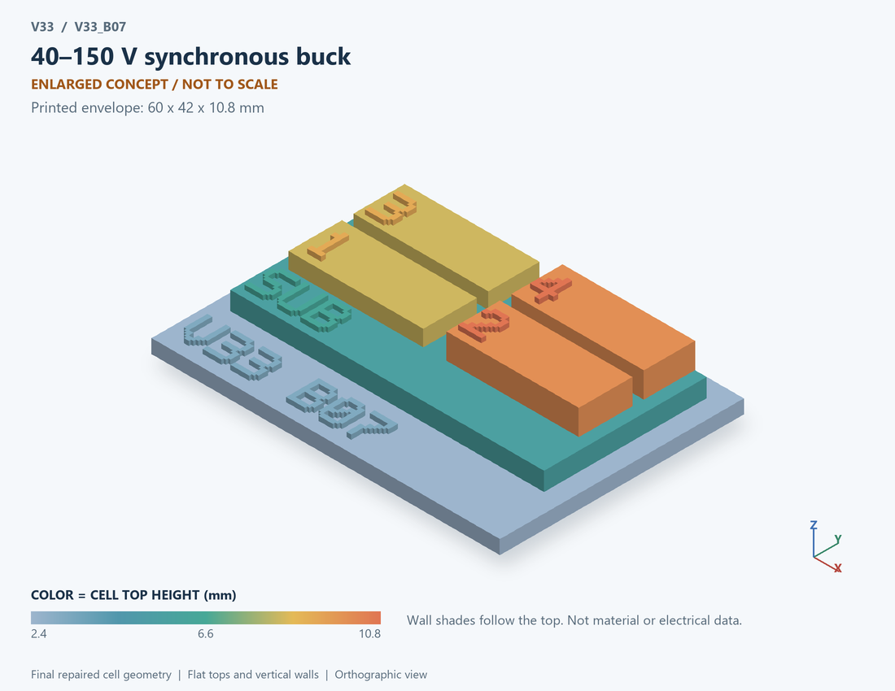

# V33_B07 · 40–150 V synchronous buck
# 40–150V同步降压

Classification / 分类: `circuit_bench` · `current`

[STL](../stl/V33_B07.stl) · [Preview](../previews/V33_B07.png) · [Top view](../previews/V33_B07_top.png)

60 × 42 mm footprint; flat face on the bed, Z up. Dimensions are teaching choices; they have no process-scale mapping.
60×42毫米底面；平底朝打印平台，Z朝上。尺寸属于教学选择，不对应工艺比例。

This monolithic tactile relief is intentionally supported down to its base. Plastic continuity does not imply an electrical short or a particular material. Only printed surfaces and exposed ledges are visible; hidden interfaces are interpreted using the key.
本单体触觉浮雕刻意向底座填实支撑，塑料相连不代表电气短路或同一种材料。实物仅呈现表面及外露台阶，隐藏界面须配合图例理解。

## Visible feature key / 可见结构说明

| Mark | English | 中文 |
|---|---|---|
| SUB | Exposed substrate ledge | 外露衬底台阶 |
| 1 | Ideal high-side switch | 理想高侧开关 |
| 2 | Ideal low-side switch | 理想低侧开关 |
| 3 | Switching-node connection | 开关节点连接 |
| 4 | Output energy-storage inductor | 输出储能电感 |
| KEY | Numbered functional blocks, not silicon layout or solved 3D fields. See numbered key in the atlas. | 编号功能块，不是硅版图或求解的三维场，编号说明见图册 |

Some small/hidden ledges have no raised lettering; the illustrated atlas and feature list identify them. Numbers on functional displays refer to the numbered source-parts list below.
部分小型或遮挡台阶不刻字，由图册和结构表辨认。功能展示件上的数字对应下方源部件列表。

## Source concepts / 来源概念

1. High side: Ideal high-side switch 理想高侧开关
2. Low side: Ideal low-side switch 理想低侧开关
3. SW: Switching-node connection 开关节点连接
4. L: Output energy-storage inductor 输出储能电感
5. Cout: Output capacitor 输出电容
6. Load: Output load 输出负载

## Terminals and boundaries / 端口与边界

- IN (modeled_electrical): Supply input 供电输入
- OUT (modeled_electrical): Output 输出
- GND (modeled_electrical): Ground/reference 地参考
- SW (conceptual_node): Switching node 开关节点

## Interpretation limits / 解释边界

A functional power-stage layout shows high/low switches, switching node and LC output. It is a circuit teaching board, not a microscopic integrated buck cross-section. Teaching geometry is enlarged and not to scale. Circuit blocks show functional relationships and are not transistor layouts. The physical equations and numerical results remain unchanged.

用高低侧开关、开关节点与LC输出表示功能功率级。它是电路教学板，不是微观集成Buck截面。教学几何经放大且不按真实比例；电路图块表示功能关系，不是晶体管版图。物理方程和数值结果保持不变。

Source-model limitations are retained below; STL generation does not add physics or establish process qualification.
下方保留源模型限制；生成STL不增加物理机制或工艺认证。

Forced CCM with ideal instantaneous switches. Efficiency includes conduction loss only; no switching/gate/core loss, dead time, ringing, control-loop start-up, SOA or validated voltage rating.

强制连续导通、理想瞬时开关；效率仅含导通损耗；无开关/栅极/磁芯损耗、死区、振铃、控制启动、SOA或已验证耐压。

[Source catalogue / 源目录](../../v33/numerics/analog/models/model_catalog.json) · ID `B07`
