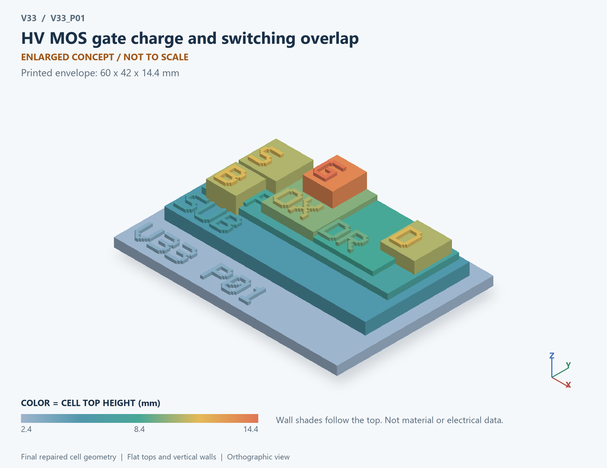

# V33_P01 · HV MOS gate charge and switching overlap
# 高压MOS栅电荷与开关交叠

Classification / 分类: `mechanism_demo` · `current`

[STL](../stl/V33_P01.stl) · [Preview](../previews/V33_P01.png) · [Top view](../previews/V33_P01_top.png)

60 × 42 mm footprint; flat face on the bed, Z up. Dimensions are teaching choices; they have no process-scale mapping.
60×42毫米底面；平底朝打印平台，Z朝上。尺寸属于教学选择，不对应工艺比例。

This monolithic tactile relief is intentionally supported down to its base. Plastic continuity does not imply an electrical short or a particular material. Only printed surfaces and exposed ledges are visible; hidden interfaces are interpreted using the key.
本单体触觉浮雕刻意向底座填实支撑，塑料相连不代表电气短路或同一种材料。实物仅呈现表面及外露台阶，隐藏界面须配合图例理解。

## Visible feature key / 可见结构说明

| Mark | English | 中文 |
|---|---|---|
| SUB | Exposed substrate ledge | 外露衬底台阶 |
| P | Body well | 体区/阱 |
| DR | Extended drift region | 延伸漂移区 |
| S | Source contact / implanted region | 源极接触/注入区 |
| D | Drain contact / implanted region | 漏极接触/注入区 |
| OX | Exposed gate dielectric ledge | 外露栅介质台阶 |
| G | Gate electrode | 栅电极 |
| B | Separate body contact, distinct from doping label | 独立体接触，与掺杂标签区分 |
| POL | N-channel schematic | N沟道示意 |

Some small/hidden ledges have no raised lettering; the illustrated atlas and feature list identify them. Numbers on functional displays refer to the numbered source-parts list below.
部分小型或遮挡台阶不刻字，由图册和结构表辨认。功能展示件上的数字对应下方源部件列表。

## Source concepts / 来源概念

1. MOS: Gate, channel and drift concept 栅沟道漂移区概念
2. Cgs: Equivalent gate-source capacitance 等效栅源电容
3. Cgd: Voltage-dependent Miller coupling 压变米勒耦合
4. Coss: Output capacitance relation 输出电容关系
5. Rg: Gate-path resistance 栅路径电阻

## Terminals and boundaries / 端口与边界

- G (conceptual_node): Gate 栅极
- D (conceptual_node): Drain 漏极
- S (conceptual_node): Source 源极

## Interpretation limits / 解释边界

Use a generic HV MOS teaching section plus Cgd/Cgs/Coss relationship symbols. There is no extracted LDMOS cell or complete charge-conserving transistor port model. Teaching geometry is enlarged and not to scale. Circuit blocks show functional relationships and are not transistor layouts. The physical equations and numerical results remain unchanged.

使用通用高压MOS剖面及Cgd/Cgs/Coss关系符号。没有提取的LDMOS单元或完整电荷守恒晶体管端口模型。教学几何经放大且不按真实比例；电路图块表示功能关系，不是晶体管版图。物理方程和数值结果保持不变。

Source-model limitations are retained below; STL generation does not add physics or establish process qualification.
下方保留源模型限制；生成STL不增加物理机制或工艺认证。

Prescribed staged commutation, not a coupled charge-conserving MOS compact model. Ichannel excludes Coss displacement and diode recovery. Fixed-C Miller appeared in V2 X01; this bench adds nonlinear charge, separate overlap/storage energies and temperature sweeps. No breakdown, avalanche, SOA, gate overshoot or layout extraction. Numerical refinement reduces selected discretization errors, not unknown physical modeling error.

人为规定阶段的换流模型，非完整电荷守恒MOS紧凑模型；沟道电流不含Coss位移和二极管恢复。V2 X01已有固定电容Miller，本版增强非线性电荷、分离交叠/储能及温度扫描；不含击穿、雪崩、SOA、栅过冲或版图提取。 数值改进降低指定离散误差，不代表未知物理建模误差降低。

[Source catalogue / 源目录](../../v33/numerics/dcdc/model_catalog.json) · ID `P01`
