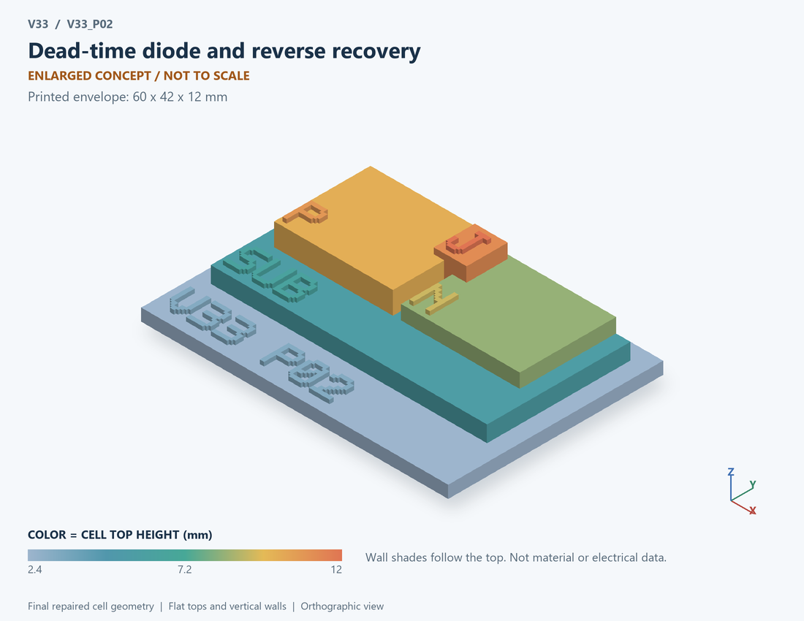

# V33_P02 · Dead-time diode and reverse recovery
# 死区二极管与反向恢复

Classification / 分类: `mechanism_demo` · `current`

[STL](../stl/V33_P02.stl) · [Preview](../previews/V33_P02.png) · [Top view](../previews/V33_P02_top.png)

60 × 42 mm footprint; flat face on the bed, Z up. Dimensions are teaching choices; they have no process-scale mapping.
60×42毫米底面；平底朝打印平台，Z朝上。尺寸属于教学选择，不对应工艺比例。

This monolithic tactile relief is intentionally supported down to its base. Plastic continuity does not imply an electrical short or a particular material. Only printed surfaces and exposed ledges are visible; hidden interfaces are interpreted using the key.
本单体触觉浮雕刻意向底座填实支撑，塑料相连不代表电气短路或同一种材料。实物仅呈现表面及外露台阶，隐藏界面须配合图例理解。

## Visible feature key / 可见结构说明

| Mark | English | 中文 |
|---|---|---|
| SUB | Exposed substrate ledge | 外露衬底台阶 |
| P | P-type region / anode | P型区/阳极 |
| N | N-type region / cathode | N型区/阴极 |
| J | Exposed junction marker | 外露结界面标记 |

Some small/hidden ledges have no raised lettering; the illustrated atlas and feature list identify them. Numbers on functional displays refer to the numbered source-parts list below.
部分小型或遮挡台阶不刻字，由图册和结构表辨认。功能展示件上的数字对应下方源部件列表。

## Source concepts / 来源概念

1. High side: Upper ideal switch 上桥理想开关
2. Low side: Lower ideal switch 下桥理想开关
3. Body diode: Low-side source-to-drain PN diode 低侧源至漏PN二极管
4. L: Inductor-current path 电感电流路径
5. Dead time: Interval with both switches off 两开关均关断区间
6. Qrr: Prescribed recovery-charge marker 规定恢复电荷标记

## Terminals and boundaries / 端口与边界

- VIN (conceptual_node): Input supply or input signal as described 输入供电或输入信号，按条目说明
- SW (conceptual_node): Switching node 开关节点
- GND (conceptual_node): Ground/reference 地参考
- OUT (conceptual_node): Output 输出

## Interpretation limits / 解释边界

The source bench relates a half bridge and its low-side body diode: diode anode at GND/source and cathode at SW/drain. The printable PN junction illustrates only the diode structure; half-bridge wiring and dead-time relations remain in the companion explanation. Recovery-charge marks are symbolic; the separate pulse is not a solved charge distribution. Teaching geometry is enlarged and not to scale. Circuit blocks show functional relationships and are not transistor layouts. The physical equations and numerical results remain unchanged.

原测试台联系半桥及低侧体二极管：阳极接GND/源，阴极接SW/漏。打印PN结仅表示二极管结构；半桥接线与死区关系在旁册解释。恢复电荷为符号；独立脉冲不是求解的电荷分布。教学几何经放大且不按真实比例；电路图块表示功能关系，不是晶体管版图。物理方程和数值结果保持不变。

Source-model limitations are retained below; STL generation does not add physics or establish process qualification.
下方保留源模型限制；生成STL不增加物理机制或工艺认证。

Periodic ideal CCM waveform; recovery pulse is separate from IL and Vsw. Vin Qrr assumes full bus voltage and is not measured diode heat. No stored-charge transport solution, Coss commutation, gate overlap or ringing. V2 X02 already imposed triangular recovery; V3.2 relates it to dead-time sizing and bus-energy accounting. Numerical refinement reduces selected discretization errors, not unknown physical modeling error.

周期理想CCM波形；恢复脉冲与IL、Vsw分别计算。VinQrr假定全母线电压，不等同实测二极管热。无载流子输运、Coss换流、栅交叠或振铃。V2 X02已有三角恢复，本版关联死区选取和母线能量核算。 数值改进降低指定离散误差，不代表未知物理建模误差降低。

[Source catalogue / 源目录](../../v33/numerics/dcdc/model_catalog.json) · ID `P02`
