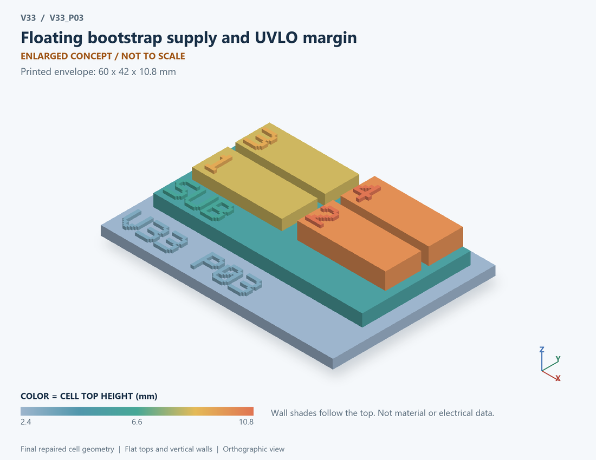

# V33_P03 · Floating bootstrap supply and UVLO margin
# 浮地自举供电与欠压裕量

Classification / 分类: `circuit_bench` · `current`

[STL](../stl/V33_P03.stl) · [Preview](../previews/V33_P03.png) · [Top view](../previews/V33_P03_top.png)

60 × 42 mm footprint; flat face on the bed, Z up. Dimensions are teaching choices; they have no process-scale mapping.
60×42毫米底面；平底朝打印平台，Z朝上。尺寸属于教学选择，不对应工艺比例。

This monolithic tactile relief is intentionally supported down to its base. Plastic continuity does not imply an electrical short or a particular material. Only printed surfaces and exposed ledges are visible; hidden interfaces are interpreted using the key.
本单体触觉浮雕刻意向底座填实支撑，塑料相连不代表电气短路或同一种材料。实物仅呈现表面及外露台阶，隐藏界面须配合图例理解。

## Visible feature key / 可见结构说明

| Mark | English | 中文 |
|---|---|---|
| SUB | Exposed substrate ledge | 外露衬底台阶 |
| 1 | Recharge diode path | 再充电二极管路径 |
| 2 | Floating bootstrap capacitor | 浮动自举电容 |
| 3 | Gate-charge consumption block | 栅电荷消耗功能块 |
| 4 | Supply-margin flag only | 仅供电裕量标记 |
| KEY | Numbered functional blocks, not silicon layout or solved 3D fields. See numbered key in the atlas. | 编号功能块，不是硅版图或求解的三维场，编号说明见图册 |

Some small/hidden ledges have no raised lettering; the illustrated atlas and feature list identify them. Numbers on functional displays refer to the numbered source-parts list below.
部分小型或遮挡台阶不刻字，由图册和结构表辨认。功能展示件上的数字对应下方源部件列表。

## Source concepts / 来源概念

1. Diode: Recharge diode path 再充电二极管路径
2. Cboot: Floating bootstrap capacitor 浮动自举电容
3. Driver: Gate-charge consumption block 栅电荷消耗功能块
4. UVLO: Supply-margin flag only 仅供电裕量标记
5. VS: Switching-source reference 开关源极参考

## Terminals and boundaries / 端口与边界

- VCC (conceptual_node): Bootstrap recharge supply 自举再充电供电
- VB (conceptual_node): Bootstrap positive supply node 自举正供电节点
- VS (conceptual_node): Floating switching-source reference 浮动开关源极参考

## Interpretation limits / 解释边界

Bootstrap diode and capacitor float above VS. VB and VS are nodes; VBS=VB-VS is a difference, not a third pin or the absolute gate voltage. Teaching geometry is enlarged and not to scale. Circuit blocks show functional relationships and are not transistor layouts. The physical equations and numerical results remain unchanged.

自举二极管与电容浮于VS之上。VB与VS是节点；VBS=VB-VS为差值，不是第三引脚或绝对栅压。教学几何经放大且不按真实比例；电路图块表示功能关系，不是晶体管版图。物理方程和数值结果保持不变。

Source-model limitations are retained below; STL generation does not add physics or establish process qualification.
下方保留源模型限制；生成STL不增加物理机制或工艺认证。

VBS is gate-driver supply relative to switching source, not absolute gate voltage. UVLO flags a sizing violation without disabling the prescribed gate-charge pulses. No negative-SW overcharge, diode leakage/recovery, startup recharge sequence, high-side common-mode isolation or high-duty operation qualification. Numerical refinement reduces selected discretization errors, not unknown physical modeling error.

VBS相对开关源极，非绝对栅压；欠压仅标记选值失败，不关闭规定栅电荷脉冲。不含负SW过充、二极管漏电/恢复、启动充电序列、高侧共模隔离或高占空比认证。 数值改进降低指定离散误差，不代表未知物理建模误差降低。

[Source catalogue / 源目录](../../v33/numerics/dcdc/model_catalog.json) · ID `P03`
