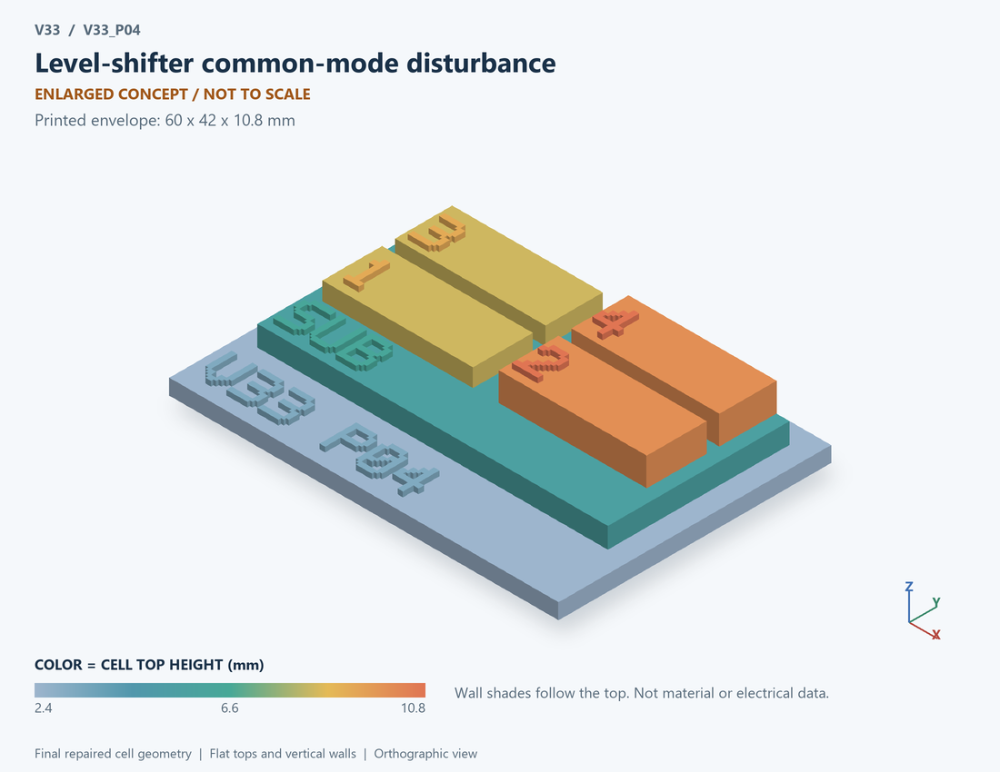

# V33_P04 · Level-shifter common-mode disturbance
# 电平移位接收端共模扰动

Classification / 分类: `circuit_bench` · `current`

[STL](../stl/V33_P04.stl) · [Preview](../previews/V33_P04.png) · [Top view](../previews/V33_P04_top.png)

60 × 42 mm footprint; flat face on the bed, Z up. Dimensions are teaching choices; they have no process-scale mapping.
60×42毫米底面；平底朝打印平台，Z朝上。尺寸属于教学选择，不对应工艺比例。

This monolithic tactile relief is intentionally supported down to its base. Plastic continuity does not imply an electrical short or a particular material. Only printed surfaces and exposed ledges are visible; hidden interfaces are interpreted using the key.
本单体触觉浮雕刻意向底座填实支撑，塑料相连不代表电气短路或同一种材料。实物仅呈现表面及外露台阶，隐藏界面须配合图例理解。

## Visible feature key / 可见结构说明

| Mark | English | 中文 |
|---|---|---|
| SUB | Exposed substrate ledge | 外露衬底台阶 |
| 1 | Common-mode edge input | 共模边沿输入 |
| 2 | Coupling capacitance | 耦合电容 |
| 3 | Receiver capacitance | 接收端电容 |
| 4 | Receiver discharge resistance | 接收端泄放电阻 |
| KEY | Numbered functional blocks, not silicon layout or solved 3D fields. See numbered key in the atlas. | 编号功能块，不是硅版图或求解的三维场，编号说明见图册 |

Some small/hidden ledges have no raised lettering; the illustrated atlas and feature list identify them. Numbers on functional displays refer to the numbered source-parts list below.
部分小型或遮挡台阶不刻字，由图册和结构表辨认。功能展示件上的数字对应下方源部件列表。

## Source concepts / 来源概念

1. CM edge: Common-mode edge input 共模边沿输入
2. Ccm: Coupling capacitance 耦合电容
3. Crx: Receiver capacitance 接收端电容
4. Rrx: Receiver discharge resistance 接收端泄放电阻
5. Threshold: Comparison marker only 仅比较阈值标记

## Terminals and boundaries / 端口与边界

- CM (conceptual_node): Common-mode stimulus 共模激励
- RX (conceptual_node): Receiver disturbance node 接收端扰动节点
- REF (conceptual_node): Reference node 参考节点

## Interpretation limits / 解释边界

A capacitive coupling path into an unclamped RC receiver illustrates susceptibility. Do not draw isolation barriers, logic latches or clamp devices as though they were simulated. Teaching geometry is enlarged and not to scale. Circuit blocks show functional relationships and are not transistor layouts. The physical equations and numerical results remain unchanged.

电容耦合进入未钳位RC接收端表示扰动敏感性。不得将隔离栅、逻辑锁存器或钳位器件画成已经仿真。教学几何经放大且不按真实比例；电路图块表示功能关系，不是晶体管版图。物理方程和数值结果保持不变。

Source-model limitations are retained below; STL generation does not add physics or establish process qualification.
下方保留源模型限制；生成STL不增加物理机制或工艺认证。

Unclamped linear RC susceptibility only. Receiver excursions beyond a real logic rail signal model invalidity/risk; no receiver clamp or latch transistor network is modeled. This is not a level-shifter implementation, isolation test or CMTI certification. Numerical refinement reduces selected discretization errors, not unknown physical modeling error.

仅未钳位线性RC敏感性；超过实际逻辑电源的电压提示模型适用边界/风险，未建模输入钳位或锁存晶体管。不代表完整电平移位电路、隔离测试或CMTI认证。 数值改进降低指定离散误差，不代表未知物理建模误差降低。

[Source catalogue / 源目录](../../v33/numerics/dcdc/model_catalog.json) · ID `P04`
