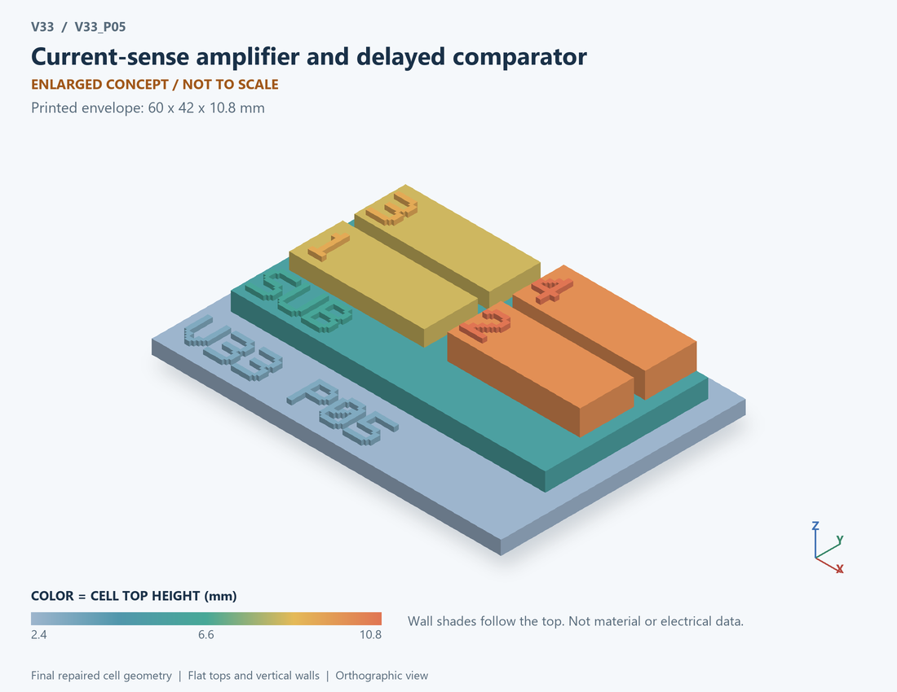

# V33_P05 · Current-sense amplifier and delayed comparator
# 电流检测放大器与延迟比较器

Classification / 分类: `circuit_bench` · `current`

[STL](../stl/V33_P05.stl) · [Preview](../previews/V33_P05.png) · [Top view](../previews/V33_P05_top.png)

60 × 42 mm footprint; flat face on the bed, Z up. Dimensions are teaching choices; they have no process-scale mapping.
60×42毫米底面；平底朝打印平台，Z朝上。尺寸属于教学选择，不对应工艺比例。

This monolithic tactile relief is intentionally supported down to its base. Plastic continuity does not imply an electrical short or a particular material. Only printed surfaces and exposed ledges are visible; hidden interfaces are interpreted using the key.
本单体触觉浮雕刻意向底座填实支撑，塑料相连不代表电气短路或同一种材料。实物仅呈现表面及外露台阶，隐藏界面须配合图例理解。

## Visible feature key / 可见结构说明

| Mark | English | 中文 |
|---|---|---|
| SUB | Exposed substrate ledge | 外露衬底台阶 |
| 1 | Current-sense resistance | 电流检测电阻 |
| 2 | Finite-bandwidth amplifier | 有限带宽放大器 |
| 3 | Assumed deterministic offset | 假设确定性失调 |
| 4 | Threshold and delay block | 阈值与延迟功能块 |
| KEY | Numbered functional blocks, not silicon layout or solved 3D fields. See numbered key in the atlas. | 编号功能块，不是硅版图或求解的三维场，编号说明见图册 |

Some small/hidden ledges have no raised lettering; the illustrated atlas and feature list identify them. Numbers on functional displays refer to the numbered source-parts list below.
部分小型或遮挡台阶不刻字，由图册和结构表辨认。功能展示件上的数字对应下方源部件列表。

## Source concepts / 来源概念

1. Shunt: Current-sense resistance 电流检测电阻
2. Gain: Finite-bandwidth amplifier 有限带宽放大器
3. Offset: Assumed deterministic offset 假设确定性失调
4. Compare: Threshold and delay block 阈值与延迟功能块
5. Output: Logic-output marker 逻辑输出标记

## Terminals and boundaries / 端口与边界

- SENSE (conceptual_node): Ground-referenced shunt signal 地参考取样信号
- REF (conceptual_node): Reference node 参考节点
- AMP (conceptual_node): Amplifier output signal 放大器输出信号
- CMP (conceptual_node): Comparator output signal 比较器输出信号

## Interpretation limits / 解释边界

A ground-referenced shunt, first-order amplifier and delayed comparator form a functional board. It is not a high-side/HV common-mode current-sense IC cross-section. Teaching geometry is enlarged and not to scale. Circuit blocks show functional relationships and are not transistor layouts. The physical equations and numerical results remain unchanged.

地参考取样电阻、一阶放大器与延迟比较器组成功能板。不是高侧/高压共模电流检测IC剖面。教学几何经放大且不按真实比例；电路图块表示功能关系，不是晶体管版图。物理方程和数值结果保持不变。

Source-model limitations are retained below; STL generation does not add physics or establish process qualification.
下方保留源模型限制；生成STL不增加物理机制或工艺认证。

Low-voltage ground-referenced sensing bench. No HV input/common-mode rating, amplifier saturation, input clamp, blanking, random noise, metastability, shunt inductance or actual cycle-by-cycle turn-off. Delay is assumed, not a guaranteed device specification. Numerical refinement reduces selected discretization errors, not unknown physical modeling error.

低压地参考检测台；无高压共模额定、放大器饱和、输入钳位、消隐、随机噪声、亚稳态、取样寄生电感及实际逐周期关断。延迟为假设，非器件保证值。 数值改进降低指定离散误差，不代表未知物理建模误差降低。

[Source catalogue / 源目录](../../v33/numerics/dcdc/model_catalog.json) · ID `P05`
