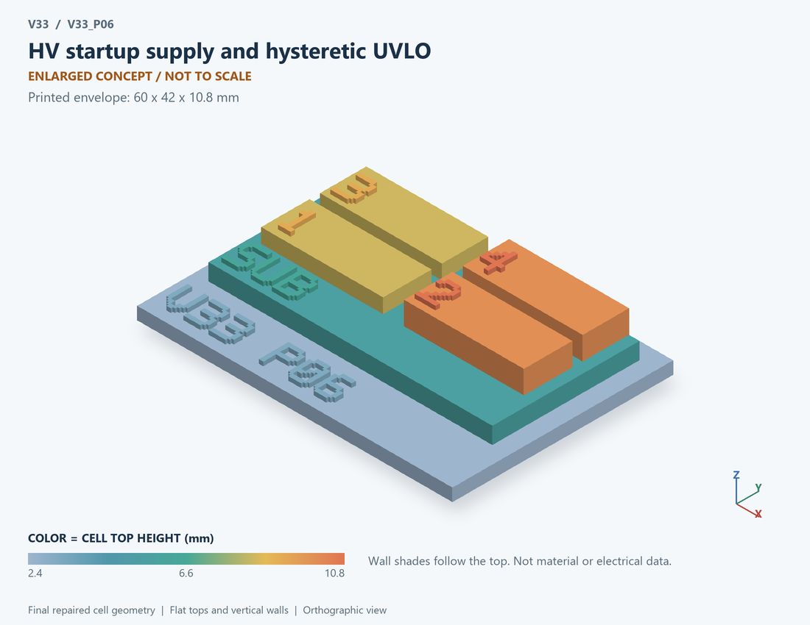

# V33_P06 · HV startup supply and hysteretic UVLO
# 高压启动供电与迟滞欠压锁定

Classification / 分类: `circuit_bench` · `current`

[STL](../stl/V33_P06.stl) · [Preview](../previews/V33_P06.png) · [Top view](../previews/V33_P06_top.png)

60 × 42 mm footprint; flat face on the bed, Z up. Dimensions are teaching choices; they have no process-scale mapping.
60×42毫米底面；平底朝打印平台，Z朝上。尺寸属于教学选择，不对应工艺比例。

This monolithic tactile relief is intentionally supported down to its base. Plastic continuity does not imply an electrical short or a particular material. Only printed surfaces and exposed ledges are visible; hidden interfaces are interpreted using the key.
本单体触觉浮雕刻意向底座填实支撑，塑料相连不代表电气短路或同一种材料。实物仅呈现表面及外露台阶，隐藏界面须配合图例理解。

## Visible feature key / 可见结构说明

| Mark | English | 中文 |
|---|---|---|
| SUB | Exposed substrate ledge | 外露衬底台阶 |
| 1 | Compliance-limited startup source | 有顺从限制的启动源 |
| 2 | Auxiliary storage capacitor | 辅助储能电容 |
| 3 | Ideal supply clamp | 理想供电钳位 |
| 4 | Two-threshold hysteresis | 双阈值回差 |
| KEY | Numbered functional blocks, not silicon layout or solved 3D fields. See numbered key in the atlas. | 编号功能块，不是硅版图或求解的三维场，编号说明见图册 |

Some small/hidden ledges have no raised lettering; the illustrated atlas and feature list identify them. Numbers on functional displays refer to the numbered source-parts list below.
部分小型或遮挡台阶不刻字，由图册和结构表辨认。功能展示件上的数字对应下方源部件列表。

## Source concepts / 来源概念

1. Source: Compliance-limited startup source 有顺从限制的启动源
2. Caux: Auxiliary storage capacitor 辅助储能电容
3. Clamp: Ideal supply clamp 理想供电钳位
4. UVLO: Two-threshold hysteresis 双阈值回差
5. Load: State-dependent auxiliary load 状态相关辅助负载

## Terminals and boundaries / 端口与边界

- VIN (conceptual_node): Input supply or input signal as described 输入供电或输入信号，按条目说明
- VAUX (conceptual_node): Auxiliary supply node 辅助供电节点
- GND (conceptual_node): Ground/reference 地参考
- EN (conceptual_node): Enable signal 使能信号

## Interpretation limits / 解释边界

Print a behavioral current-source block, auxiliary capacitor and hysteretic logic. Do not relabel the current source as a simulated JFET microscopic device. Teaching geometry is enlarged and not to scale. Circuit blocks show functional relationships and are not transistor layouts. The physical equations and numerical results remain unchanged.

打印行为电流源、辅助电容与迟滞逻辑。不得把电流源改称已仿真的JFET微观器件。教学几何经放大且不按真实比例；电路图块表示功能关系，不是晶体管版图。物理方程和数值结果保持不变。

Source-model limitations are retained below; STL generation does not add physics or establish process qualification.
下方保留源模型限制；生成STL不增加物理机制或工艺认证。

Behavioral startup current source, not a JFET transistor model. The source remains on except for an imposed interruption. No real auxiliary winding handover, high-voltage reliability, clamp SOA, leakage, power-on reset timing or guaranteed start-up range. Numerical refinement reduces selected discretization errors, not unknown physical modeling error.

启动限流源为行为模型，非JFET晶体管模型；除规定中断外保持开启。不含真实辅助绕组接管、高压可靠性、钳位SOA、漏电、上电复位时序或保证启动范围。 数值改进降低指定离散误差，不代表未知物理建模误差降低。

[Source catalogue / 源目录](../../v33/numerics/dcdc/model_catalog.json) · ID `P06`
