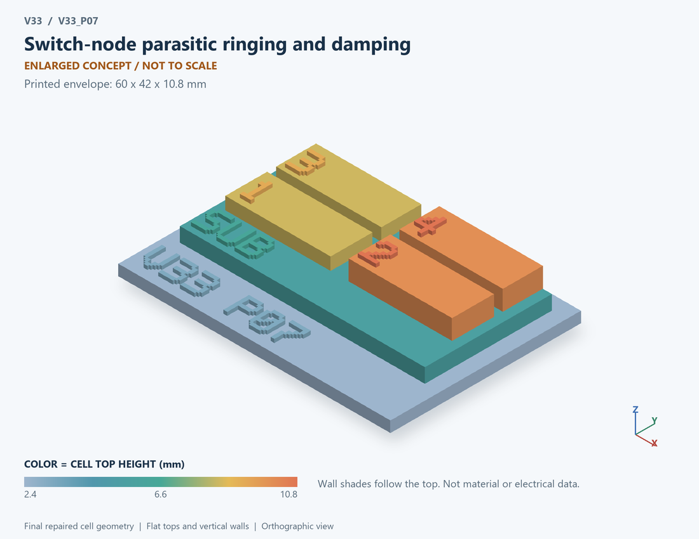

# V33_P07 · Switch-node parasitic ringing and damping
# 开关节点寄生振铃与阻尼

Classification / 分类: `circuit_bench` · `current`

[STL](../stl/V33_P07.stl) · [Preview](../previews/V33_P07.png) · [Top view](../previews/V33_P07_top.png)

60 × 42 mm footprint; flat face on the bed, Z up. Dimensions are teaching choices; they have no process-scale mapping.
60×42毫米底面；平底朝打印平台，Z朝上。尺寸属于教学选择，不对应工艺比例。

This monolithic tactile relief is intentionally supported down to its base. Plastic continuity does not imply an electrical short or a particular material. Only printed surfaces and exposed ledges are visible; hidden interfaces are interpreted using the key.
本单体触觉浮雕刻意向底座填实支撑，塑料相连不代表电气短路或同一种材料。实物仅呈现表面及外露台阶，隐藏界面须配合图例理解。

## Visible feature key / 可见结构说明

| Mark | English | 中文 |
|---|---|---|
| SUB | Exposed substrate ledge | 外露衬底台阶 |
| 1 | Parasitic loop inductance | 寄生环路电感 |
| 2 | Linearized capacitance | 线性化电容 |
| 3 | Series damping resistance | 串联阻尼电阻 |
| 4 | Electric/magnetic storage marker | 电磁储能标记 |
| KEY | Numbered functional blocks, not silicon layout or solved 3D fields. See numbered key in the atlas. | 编号功能块，不是硅版图或求解的三维场，编号说明见图册 |

Some small/hidden ledges have no raised lettering; the illustrated atlas and feature list identify them. Numbers on functional displays refer to the numbered source-parts list below.
部分小型或遮挡台阶不刻字，由图册和结构表辨认。功能展示件上的数字对应下方源部件列表。

## Source concepts / 来源概念

1. Lpar: Parasitic loop inductance 寄生环路电感
2. C: Linearized capacitance 线性化电容
3. Rseries: Series damping resistance 串联阻尼电阻
4. Energy: Electric/magnetic storage marker 电磁储能标记
5. Loop: Closed series-response path 闭合串联响应路径

## Terminals and boundaries / 端口与边界

- RING (conceptual_node): Ringing-state node 振铃状态节点
- REF (conceptual_node): Reference node 参考节点

## Interpretation limits / 解释边界

The underlying bench is series R-L-C; numbered functional blocks do not embody its wiring topology. This is a ringing surrogate, not a literal parallel RC snubber or an extracted switching loop. Teaching geometry is enlarged and not to scale. Circuit blocks show functional relationships and are not transistor layouts. The physical equations and numerical results remain unchanged.

原测试台为串联R-L-C；编号功能块不体现其实际接线拓扑。这是振铃替代模型，不是实际并联RC吸收器或已提取开关回路。教学几何经放大且不按真实比例；电路图块表示功能关系，不是晶体管版图。物理方程和数值结果保持不变。

Source-model limitations are retained below; STL generation does not add physics or establish process qualification.
下方保留源模型限制；生成STL不增加物理机制或工艺认证。

Linearized series-RLC surrogate about a bus voltage, not a literal shunt RC snubber design. Initial disturbance amplitude is prescribed. No switching-edge excitation, EMI prediction, nonlinear Coss or snubber recurring power estimate. Do not copy its Rcritical into a real shunt snubber. Numerical refinement reduces selected discretization errors, not unknown physical modeling error.

母线附近线性化串联RLC替代模型，不是实际并联RC吸收器设计；初始扰动人为规定。无开关边沿激励、EMI预测、非线性Coss或吸收器周期功率；不得将临界电阻直接用于真实并联吸收器。 数值改进降低指定离散误差，不代表未知物理建模误差降低。

[Source catalogue / 源目录](../../v33/numerics/dcdc/model_catalog.json) · ID `P07`
