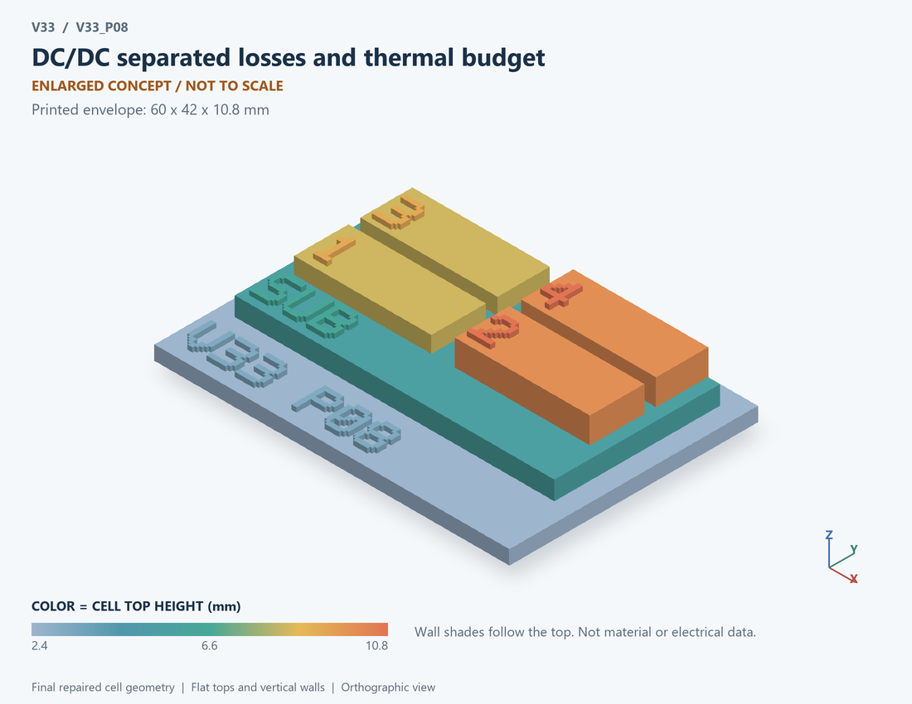

# V33_P08 · DC/DC separated losses and thermal budget
# DC/DC分项损耗与热预算

Classification / 分类: `circuit_bench` · `current`

[STL](../stl/V33_P08.stl) · [Preview](../previews/V33_P08.png) · [Top view](../previews/V33_P08_top.png)

60 × 42 mm footprint; flat face on the bed, Z up. Dimensions are teaching choices; they have no process-scale mapping.
60×42毫米底面；平底朝打印平台，Z朝上。尺寸属于教学选择，不对应工艺比例。

This monolithic tactile relief is intentionally supported down to its base. Plastic continuity does not imply an electrical short or a particular material. Only printed surfaces and exposed ledges are visible; hidden interfaces are interpreted using the key.
本单体触觉浮雕刻意向底座填实支撑，塑料相连不代表电气短路或同一种材料。实物仅呈现表面及外露台阶，隐藏界面须配合图例理解。

## Visible feature key / 可见结构说明

| Mark | English | 中文 |
|---|---|---|
| SUB | Exposed substrate ledge | 外露衬底台阶 |
| 1 | Conduction-loss category | 导通损耗类别 |
| 2 | Overlap and matched-Coss category | 交叠与匹配Coss类别 |
| 3 | Recovery and drive categories | 恢复及驱动类别 |
| 4 | Shared effective thermal node | 共用等效热节点 |
| KEY | Numbered functional blocks, not silicon layout or solved 3D fields. See numbered key in the atlas. | 编号功能块，不是硅版图或求解的三维场，编号说明见图册 |

Some small/hidden ledges have no raised lettering; the illustrated atlas and feature list identify them. Numbers on functional displays refer to the numbered source-parts list below.
部分小型或遮挡台阶不刻字，由图册和结构表辨认。功能展示件上的数字对应下方源部件列表。

## Source concepts / 来源概念

1. Conduction: Conduction-loss category 导通损耗类别
2. Switching: Overlap and matched-Coss category 交叠与匹配Coss类别
3. Recovery: Recovery and drive categories 恢复及驱动类别
4. Hot node: Shared effective thermal node 共用等效热节点
5. Rtheta: Lumped thermal resistance 集总热阻
6. Ctheta: Lumped thermal capacitance 集总热容

## Terminals and boundaries / 端口与边界

- PLOSS (power_flow): Loss-power input to thermal model 热模型的损耗功率输入
- THOT (thermal_state): Shared effective hot-node temperature 共用等效热节点温度
- TAMB (thermal_boundary): Ambient thermal boundary 环境热边界

## Interpretation limits / 解释边界

Print electrical-loss categories feeding one effective thermal node. This is a loss ledger, not a literal chip cross-section; THOT is not an individual MOS junction temperature. Teaching geometry is enlarged and not to scale. Circuit blocks show functional relationships and are not transistor layouts. The physical equations and numerical results remain unchanged.

打印电损耗分类流入一个等效热节点。这是损耗预算，非真实芯片截面；THOT不是单个MOS结温。教学几何经放大且不按真实比例；电路图块表示功能关系，不是晶体管版图。物理方程和数值结果保持不变。

Source-model limitations are retained below; STL generation does not add physics or establish process qualification.
下方保留源模型限制；生成STL不增加物理机制或工艺认证。

A ledger, not one self-consistent switched electrical/thermal simulation. Two matched Coss curves, one hard upper turn-on per cycle, opposite edge ideal energy redistribution; Coss subterm energies are explanatory and only their sum enters the loss ledger. Overlap includes load-channel current only; Qrr is separate, with no reused full Eon. Vin Qrr is conservative full-bus energy, not diode heat. All heat shares one effective node, not a MOS junction; the thermal transient holds converged loss constant. No core/ESR/reliability/layout loss or measured efficiency. Numerical refinement reduces selected discretization errors, not unknown physical modeling error.

此为预算表，非完整自洽开关电热仿真；两管Coss相同，每周期一次高侧硬导通，另一边沿假定理想能量再分配；Coss子项能量用于解释，仅其和计入损耗。交叠仅含负载沟道电流，Qrr单列，不重复使用完整Eon。VinQrr为全母线保守能量，非二极管热；所有热量共用一个等效节点，非MOS结温，热瞬态固定收敛损耗。不含磁芯、ESR、可靠性、版图损耗或实测效率。 数值改进降低指定离散误差，不代表未知物理建模误差降低。

[Source catalogue / 源目录](../../v33/numerics/dcdc/model_catalog.json) · ID `P08`
