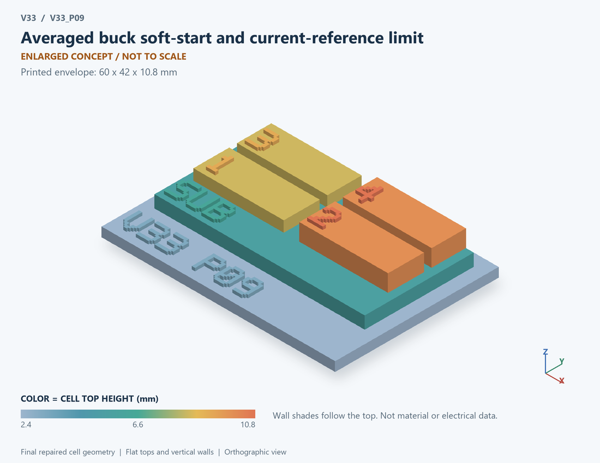

# V33_P09 · Averaged buck soft-start and current-reference limit
# 平均Buck软启动与电流参考限幅

Classification / 分类: `circuit_bench` · `current`

[STL](../stl/V33_P09.stl) · [Preview](../previews/V33_P09.png) · [Top view](../previews/V33_P09_top.png)

60 × 42 mm footprint; flat face on the bed, Z up. Dimensions are teaching choices; they have no process-scale mapping.
60×42毫米底面；平底朝打印平台，Z朝上。尺寸属于教学选择，不对应工艺比例。

This monolithic tactile relief is intentionally supported down to its base. Plastic continuity does not imply an electrical short or a particular material. Only printed surfaces and exposed ledges are visible; hidden interfaces are interpreted using the key.
本单体触觉浮雕刻意向底座填实支撑，塑料相连不代表电气短路或同一种材料。实物仅呈现表面及外露台阶，隐藏界面须配合图例理解。

## Visible feature key / 可见结构说明

| Mark | English | 中文 |
|---|---|---|
| SUB | Exposed substrate ledge | 外露衬底台阶 |
| 1 | Outer voltage-control block | 外电压控制块 |
| 2 | Finite-bandwidth current loop | 有限带宽电流环 |
| 3 | Current-reference clip | 电流参考限幅 |
| 4 | Average-duty power stage | 平均占空比功率级 |
| KEY | Numbered functional blocks, not silicon layout or solved 3D fields. See numbered key in the atlas. | 编号功能块，不是硅版图或求解的三维场，编号说明见图册 |

Some small/hidden ledges have no raised lettering; the illustrated atlas and feature list identify them. Numbers on functional displays refer to the numbered source-parts list below.
部分小型或遮挡台阶不刻字，由图册和结构表辨认。功能展示件上的数字对应下方源部件列表。

## Source concepts / 来源概念

1. PI: Outer voltage-control block 外电压控制块
2. Current: Finite-bandwidth current loop 有限带宽电流环
3. Limit: Current-reference clip 电流参考限幅
4. Average: Average-duty power stage 平均占空比功率级
5. LC: Output inductor and capacitor 输出电感电容
6. Softstart: Reference ramp 参考斜坡

## Terminals and boundaries / 端口与边界

- VIN (conceptual_node): Input supply or input signal as described 输入供电或输入信号，按条目说明
- VOUT (conceptual_node): Output-voltage signal 输出电压信号
- GND (conceptual_node): Ground/reference 地参考
- VREF (conceptual_node): Reference-voltage signal 参考电压信号
- IREF (conceptual_node): Current-reference command 电流参考指令
- DUTY (conceptual_node): Averaged duty command 平均占空比指令

## Interpretation limits / 解释边界

Print a functional average-control path and power stage. Duty and current reference are abstract signals; there are no resolved PWM edges or verified cycle-by-cycle peak protection. Teaching geometry is enlarged and not to scale. Circuit blocks show functional relationships and are not transistor layouts. The physical equations and numerical results remain unchanged.

打印平均控制路径及功率级功能图。占空比与电流参考为抽象信号；没有解析PWM边沿或验证逐周期峰值保护。教学几何经放大且不按真实比例；电路图块表示功能关系，不是晶体管版图。物理方程和数值结果保持不变。

Source-model limitations are retained below; STL generation does not add physics or establish process qualification.
下方保留源模型限制；生成STL不增加物理机制或工艺认证。

Continuous averaged duty, not PWM edges. A current-reference ceiling is not cycle-by-cycle peak protection; high-frequency overshoot, blanking and inductor saturation are absent. P08 switching losses are not inserted into this plant. Saved traces are decimated; energy metrics use every integration step. No sampled-cycle, slope-compensation, subharmonic or hardware-stability prediction. Numerical refinement reduces selected discretization errors, not unknown physical modeling error.

连续平均占空比，非PWM边沿；电流参考上限不是逐周期峰值保护，无高频过冲、消隐与电感饱和。未将P08开关损耗注入功率级；显示曲线抽取，能量指标使用全部积分步。不预测采样周期、斜坡补偿、次谐波或硬件稳定性。 数值改进降低指定离散误差，不代表未知物理建模误差降低。

[Source catalogue / 源目录](../../v33/numerics/dcdc/model_catalog.json) · ID `P09`
